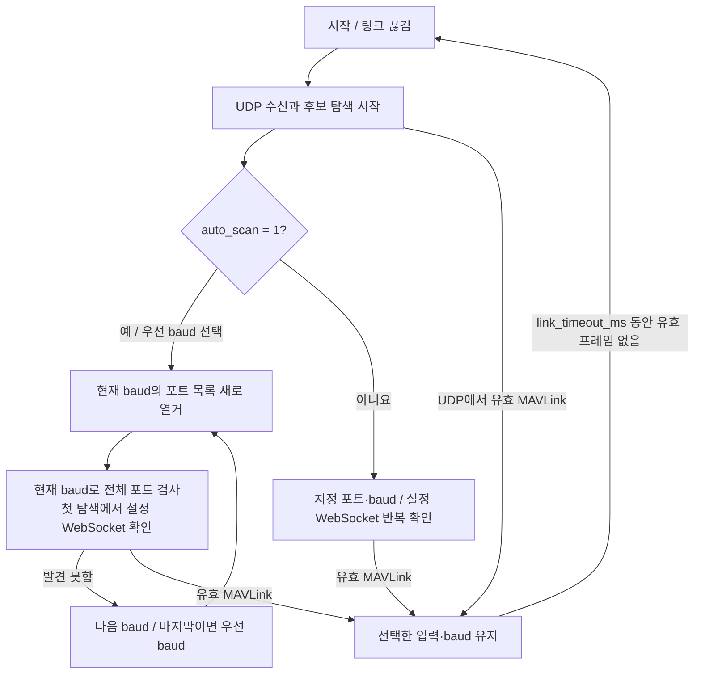
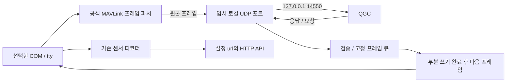

# HyRUS EnvData Router

**MAVLink 스트림을 자동으로 찾아 관측값을 수집하고, 메모리에 모았다가 서버로 보내는 상시 중계 프로그램**입니다. Windows x64와 Linux x64를 지원합니다.

소스 저장소는 [VIPSfef/HyRUS_EnvData_Router](https://github.com/VIPSfef/HyRUS_EnvData_Router)입니다. 이 저장소는 **호스트의 MAVLink 수신·해독, 시각·GPS 연결, 관측 집계와 서버 전송**을 담당합니다. I²C 센서 읽기, PX4 드라이버·uORB 발행, MAVLink 캐리어 송신, 펌웨어 빌드·업로드는 별도 `HyRUS_EnvData_Px4`의 책임입니다. 두 저장소 사이의 메시지·단위·시각 계약은 [PX4 → Router 입력 규약](docs/PX4_MAVLINK_CONTRACT.md)에 정리했습니다. QGC 중계와 선택 시험 서버는 라우터 운용·검증을 위한 보조 기능이며, 시험 서버는 운영 서버나 데이터베이스가 아닙니다.

현재 호스트 버전은 **0.11.0**입니다. 이동 관측은 기본 **10m 수평 경로 구간**으로 집계하고, 여러 구간과 실제 원본을 기본 1초마다 서버로 보냅니다. Windows/Linux의 `_headless`·`_interactive` 네 실행 파일 이름은 유지하며, 이번 호스트 변경에 Pixhawk 펌웨어 변경은 필요하지 않습니다. 새 기능과 변경점은 [0.11.0 릴리스 노트](docs/releases/v0.11.0.md)에 정리했습니다.

Windows의 COM, Linux의 tty, UDP 또는 설정한 WebSocket에서 MAVLink v1/v2를 직접 읽습니다. 매 관측을 사람이 입력하거나 다른 CSV 변환기를 실행할 필요가 없습니다.

선택한 COM/tty의 MAVLink는 기본 `127.0.0.1:14550`의 QGC에도 전달하며, QGC 요청은 같은 시리얼 링크로 돌려보냅니다. 센서 관측의 HTTP 전송과 독립된 경로입니다.

## 어떤 파일을 실행하나요?

| 프로그램 | 용도 |
|---|---|
| `mavlink_telemetry_data_router_interactive` | 기기 목록·수신 상태·서버 전송 상태를 보며 설정을 편집할 때 |
| `mavlink_telemetry_data_router_headless` | 화면 없이 계속 수집·중계할 때 |

Windows에는 `.exe`가 붙습니다. **둘 중 하나만 실행**하세요. interactive 자체가 수신·처리·전송을 수행합니다.

배포본은 **`release/v0.11.0/`**에 모읍니다. Windows는 `windows-x64/Start-Router.cmd`, Linux는 `linux-x64/start-router.sh`로 실행합니다. 시험 서버는 같은 폴더의 `Start-Test-Server.cmd` 또는 `start-test-server.sh`로 별도 실행합니다. 전체 폴더를 유지한 채 사용하세요. 실행 파일은 `bin/`, 시험 서버는 `tools/`, 설정 예제는 `config/`, 서버 API는 `docs/`에 있습니다.

전달·GitHub Release 첨부용 압축 파일과 SHA256 목록은 `release/v0.11.0/assets/`에 있습니다. [배포 폴더 안내](release/README.md)에서 실행·해시 확인 방법을 확인하세요. 소스 빌드 결과는 기존 `build/windows-x64/`·`build/linux-x64/`에 유지하며, CPack의 중간 배포물은 `build/packages/`에 생성합니다.

## 먼저 설정하고 실행하기

아래 명령은 소스 폴더 기준입니다. 설정 예제를 복사합니다.

Windows PowerShell:

```powershell
Copy-Item .\config\telemetry.ini.example .\telemetry.ini
.\build\windows-x64\mavlink_telemetry_data_router_interactive.exe --config .\telemetry.ini
```

Linux:

```sh
cp config/telemetry.ini.example telemetry.ini
./build/linux-x64/mavlink_telemetry_data_router_interactive --config ./telemetry.ini
```

관측 스트림은 프로그램이 자동으로 읽습니다. 위 명령 뒤에 데이터를 파이프로 넣지 않습니다.

설정 파일을 지정하지 않으면 현재 폴더의 `telemetry.ini`, 그다음 실행 파일 옆의 `telemetry.ini`를 찾습니다. 둘 다 없으면 실행 파일 옆에 기본 설정을 만들고 자동 탐색을 시작합니다.

**예제의 `url=-`는 JSON 미리보기 모드이며 서버 전송이 아닙니다.** 실제 운용 전에 `url`을 서버 주소로 바꾸세요. 미리보기 JSON과 화면을 함께 보고 싶지 않다면 Windows에서는 명령 뒤에 `1>$null`, Linux에서는 `>/dev/null`을 붙입니다.

## 어떤 설정을 바꾸면 되나요?

```ini
input_mode=mavlink
serial_port=auto
serial_baud=115200
udp_enabled=1
udp_bind=127.0.0.1
udp_port=14540
websocket_url=
auto_scan=1
url=https://YOUR_SERVER/ingest
stream=weather
session=flight-a
send_interval_ms=1000
http_min_interval_ms=500
spatial_enabled=1
spatial_step_m=10
spatial_gap_ms=2000
spatial_adaptive=1
origin_auto=1
unit_map=temp:C;humidity:%;pm25:ug/m3
```

| 설정 | 의미 |
|---|---|
| `serial_port` | 기본 `auto`: 현재 COM/tty 자동 탐색. COM 이름이나 tty 경로를 지정하면 우선 확인. `none`은 우선 포트 없음 |
| `serial_baud` | 가장 먼저 전체 포트에 시도할 통신 속도. 기본 115200. `auto_scan=0`에서는 이 속도만 사용 |
| `udp_enabled` | `1`이면 UDP 입력 사용, `0`이면 제외 |
| `udp_bind`, `udp_port` | 수신할 **로컬** IPv4 주소와 포트. 기본 `127.0.0.1:14540` |
| `qgc_enabled` | 기본 `1`: 선택한 시리얼과 QGC 사이의 MAVLink 양방향 전달 |
| `qgc_host`, `qgc_port` | QGC가 받을 IPv4 주소·포트. 기본 `127.0.0.1:14550`. TUI 39·40번 |
| `websocket_url` | 선택 사항. `ws://HOST/path` 또는 `wss://HOST/path`의 **바이너리 MAVLink** 스트림 |
| `auto_scan` | 기본 `1`: 현재 COM/tty를 속도별로 모두 검색. `0`: 지정 포트·지정 속도만 사용하며 WebSocket·활성 UDP는 유지 |
| `url` | 센서 관측을 전송할 전체 HTTP/HTTPS API 주소. 예: `http://HOST:21000/ingest`처럼 포트와 경로도 함께 입력 |
| `http_min_interval_ms` | 기본 `500`, 범위500..60000ms: 직전 HTTP 요청 완료 후 다음 요청까지의 최소 간격. 측정·상태·재시도·종료 전송이 함께 사용; TUI48번 |
| `stream`, `session` | 장치 흐름과 관측 실행을 구분하는 이름. 실제 송신 세션에는 실행·소스 변경 식별자가 붙음 |
| `status_interval_ms` | 별도 상태 보고 주기. `10000`이면 새 표본이 없어도 10초마다 보고. 기본 `0`은 끔; TUI 41번 |
| `mavlink_rates_enabled` | `1`이면 선택한 시리얼 기체에 GPS·온습도·대기속도 우선 전송률 요청. 기본 `0`; TUI 42번 |
| `udp_backup_enabled` | `1`이면 HTTP와 독립적으로 센서 JSON·상태를 UDP에도 전송. 기본 `0`; TUI 43번 |
| `udp_backup_host` | 기본 `auto`: HTTP URL의 호스트. 별도 IP/호스트명 지정 가능; TUI 44번 |
| `udp_backup_port` | 기본 `0`: HTTP TCP 포트+1. 별도 UDP 포트 지정 가능; TUI 45번 |
| `tcp_buffer_max_mb` | 기본 `1024`: 미확인 TCP 전송 대기 JSON·관리 정보 최대1GiB. 1MiB 단위로 나중에 변경 가능; TUI 46번 |
| `token` | HTTP Bearer 토큰 직접 입력. 기본 빈 값이면 `token_env`의 환경변수를 사용; TUI 47번 |
| `token_env` | 기본 `TB_TOKEN`: 직접 입력한 `token`이 비어 있을 때 읽을 환경변수 이름 |
| `origin_auto` | 기본 `1`: 첫 유효 전역 항법 위치를 지역 좌표 원점으로 사용. `0`: 지정한 원점 사용 |
| `unit_map` | 선택 사항. 키에 단위를 부여하는 `키:단위;키:단위` 목록 |
| `spatial_enabled` | 기본 `1`: 온습도 공간 구간 집계 사용. `0`으로 꺼도 기존 원본·시간 요약 전송은 유지 |
| `spatial_step_m` | 기본 `10`: 목표 수평 경로 구간 폭(m). 실제 폭은 표본 간격에 따라 달라질 수 있음 |
| `spatial_gap_ms` | 기본 `2000`: 공간 경로를 이어 계산할 수 있는 최대 관측 간격(ms) |
| `spatial_adaptive` | 기본 `1`: 실제 관측 간격이 크면 다음 구간부터 폭을 늘림. `0`은 목표 폭을 유지하며 누락 간격을 표시 |

**토큰은 `token`에 직접 입력할 수 있습니다.** `e` → `47` → Enter → Ctrl+U → 토큰 붙여넣기 → Enter → `r` 순서로 저장하고 적용하세요. Ctrl+U는 기존 입력을 지워 교체할 토큰이 뒤에 붙지 않게 합니다. 입력과 설정 화면에서는 토큰을 가립니다. 직접 입력한 값이 있으면 `token_env`보다 우선하며, 빈 값으로 지우면 기존 환경변수 방식으로 돌아갑니다. 토큰은 HTTP의 `Authorization: Bearer`에만 사용하고 UDP에는 보내지 않습니다.

Windows에서 저장한 토큰은 현재 Windows 사용자에 묶인 DPAPI 암호문(`token=dpapi:...`)으로 설정 파일에 기록합니다. 다른 PC나 사용자로 옮기면 다시 입력해야 합니다. Linux에서는 POSIX 파일 권한을 지원하는 파일 시스템에 소유자만 읽고 쓰는 권한(`0600`)으로 원문을 저장합니다. 권한을 확인할 수 없으면 토큰을 기록하기 전에 저장을 거부하고 기존 파일을 유지합니다. WSL에서는 Linux 홈 디렉터리처럼 이 권한을 지원하는 위치를 사용하세요. 실제 토큰은 로그·문서·Git 예제에 넣지 않습니다.

환경변수 방식을 사용하려면 `token`을 비우고 `token_env=TB_TOKEN`을 유지한 뒤, 라우터를 실행할 환경의 `TB_TOKEN`에 인증값을 넣으세요. **`token_env`는 환경변수 이름을 입력하는 칸**이며 영문자 또는 `_`로 시작하는 영문자·숫자·`_`만 최대64자까지 허용합니다. 현재 로컬 시험 서버는 인증을 요구하지 않습니다.

interactive에서 `e`로 설정을 열고 항목 편집 후 Enter로 확인합니다. **`r`은 저장 후 같은 창에서 재시작하여 적용**, `s`는 저장만 합니다. 모니터 화면에서도 `r`로 저장한 설정을 적용할 수 있습니다. 공간 설정은 **34번 목표 폭, 35번 관측 간격 한도, 36번 사용 여부, 37번 적응 여부**입니다.

재시작은 수신을 잠시 멈추고 기존 설정으로 보류 데이터를 전송한 뒤 포트를 닫고 새 설정으로 다시 연결합니다. **URL이 그대로이면 새 인증 설정으로 보류 데이터부터 재전송**하므로, `401`로 막힌 경우 토큰을 고쳐 `r`을 누르면 대기 데이터를 버리지 않고 적용할 수 있습니다. URL도 바꾸면 보류 데이터는 기존 목적지로 전송합니다. 설정 검증·저장에 실패하면 현재 수신을 유지합니다. 서버가 보류 데이터를 받지 못하면 설정 적용을 취소하고 기존 설정을 유지합니다. 큐가 가득 차 미완성 데이터가 남은 동안에는 수신을 일시 정지하고 전송을 재시도합니다. `run_elapsed`는 같은 프로세스의 누적 실행 시간이며 `config restarts`는 적용 완료 횟수입니다. 이 기능은 MAVLink 수신 모드에서 사용하며 CSV 재생은 지원하지 않습니다.

## 서버 전송 연결만 먼저 시험하기 — TCP 21000

별도 시험 서버를 실행하면 하트비트·좌표가 서버까지 도착하는지 화면에서 볼 수 있습니다. **입력은 기존 COM/tty·UDP 14540이고, 서버 전송은 HTTP/TCP 21000**입니다.

Windows 첫 번째 터미널에서 서버를 실행합니다.

```powershell
.\build\windows-x64\tools\mavlink_telemetry_data_router_test_server.exe
```

두 번째 터미널에서 수집기를 시험 모드로 실행합니다.

```powershell
.\build\windows-x64\mavlink_telemetry_data_router_interactive.exe --test-heartbeat
```

Linux에서도 두 터미널을 사용합니다.

```sh
./build/linux-x64/tools/mavlink_telemetry_data_router_test_server
```

```sh
./build/linux-x64/mavlink_telemetry_data_router_interactive --test-heartbeat
```

기본 서버 주소는 `http://127.0.0.1:21000/ingest`입니다. 다른 컴퓨터의 서버라면 서버에 `--bind 0.0.0.0`을 지정하고 수집기에 `--server-url http://SERVER_IP:21000/ingest`를 추가합니다. 필요하면 기존 설정을 `--config telemetry.ini --test-heartbeat`로 지정합니다. CLI 주소는 해당 실행에 적용하며 설정 파일을 자동으로 덮어쓰지 않습니다.

`--test-heartbeat` 모드는 새 하트비트와 최신 유효 항법 좌표만 기본 1초 간격으로 보냅니다. 온습도·미세먼지·관측 통계는 보내지 않습니다. 위치가 없거나 오래되면 `position: null`로 표시하고 좌표를 만들어 내지 않습니다. 새 하트비트가 없으면 빈 요청을 보내지 않습니다.

시험 서버는 화면과 메모리 로그만 유지하며 파일에 저장하지 않습니다. `--plain`은 색상 없이 JSON 한 줄씩 표시합니다. 여기서 HTTP 204는 시험 서버가 내용을 검사하고 표시했다는 뜻입니다. 회사 서버의 영속 저장을 시험한 결과는 아닙니다. Ctrl+C로 각각 종료합니다.

시험 서버는 선택 도구로 `tools/`에 둡니다. 파일이 없다면 아래처럼 한 번 선택 빌드합니다. 기본 빌드의 운용 프로그램은 OS별 headless·interactive 두 개 그대로입니다.

```powershell
cmake --preset windows-x64 -DBUILD_TEST_SERVER=ON
cmake --build --preset windows-x64
```

Linux에서는 프리셋 이름을 `linux-x64`로 바꿉니다. 현재 WSL SITL을 시험할 때는 Linux 서버와 수집기를 같은 WSL에서 실행해야 내부 UDP 14540을 바로 받을 수 있습니다.

## 온습도 관측을 시험하기

새 온습도 표본이 없어도 연결 상태를 확인하려면 `status_interval_ms=10000`으로 설정하고 `r`로 적용합니다. 같은 URL에 `mavlink_router_status_v1` 상태 보고를 보냅니다. 선택 기체의 연결 여부, 하트비트·일반 데이터 상태와 각각의 수신 경과 시간, 장치별 상태, 추정 패킷 누락, 마지막 온습도 값과 자체 수신 경과 시간을 포함합니다. 센서의 과거 값을 새 관측으로 집계하지 않으며 시험 서버도 `statuses`와 측정 `records`를 따로 셉니다. 상단 `STATUS` 행에서 전송·204 확인·실패 횟수를 볼 수 있습니다. 이 형식을 지원하는 API에서 활성화하세요.

하트비트가 끊기면 무선 모뎀이나 GCS가 계속 송신해도 기체 `connected=false`로 보고합니다. 연결 판정 기준은 `link_timeout_ms`, 센서 값의 FRESH/STALE 기준은 `idle_warn_ms`입니다. `run_elapsed_ms`는 프로그램 누적 실행 시간이고, `hb_age_ms`·`data_age_ms`·`rx_age_ms`는 각각 마지막 수신 이후 경과 시간입니다. HTTP 처리 지연이나 서버 장애 중에는 전달이 늦어질 수 있으며, 다음 주기에는 최신 상태를 다시 보냅니다.

시험 서버 화면은 최신 온도°C·습도%·GPS/ESTGPS 위치, 받은 레코드·상태 보고 수, 키·장치 ID 수, 최근 도착 순서와 마지막 수신 경과 시간을 중심으로 표시합니다. 상세 JSON은 `--plain`으로 확인합니다. 상태 보고의 마지막 값은 새 센서 표본으로 세지 않습니다.

UDP 백업을 켜면 수락한 일반 관측·온습도 표본마다 HTTP 응답이나 전송 주기를 기다리지 않고 송신을 시도합니다. 같은 ID의 JSON은 TCP용 메모리 FIFO에 쌓아 두었다가 설정 주기에 여러 레코드를 묶어 HTTP로 보내고, 204를 받은 항목만 해제합니다. 기본 `tcp_buffer_max_mb=1024`는 보류 JSON·노드 관리 정보 최대1GiB이며 TUI46번에서 바꿀 수 있습니다. 필요할 때 할당하므로 처음부터1GiB를 사용하지 않습니다. 프로세스 전체 메모리 한도는 아니며 디스크에 저장하지 않습니다. 한도가 차면 기존 자료는 남기고 새 TCP 자료의 손실을 표시하며 UDP는 계속 시도합니다.

HTTP 요청은 `http_min_interval_ms=500`으로 분산합니다. 각 요청이 끝난 뒤 최소500ms를 기다리므로 측정·상태 보고를 합쳐 초당 최대2회 수준이며, 응답이 느리면 더 낮아집니다. 밀린 데이터를 한 번에 연속 요청하지 않고 남은 항목은 RAM에 보존합니다. 401·403·429 응답에는 공통 재시도 대기를1초부터 최대30초까지 늘립니다. **403만으로 인증 실패인지 서버의 요청 제한인지 단정하지 않습니다.** 서버 로그로 원인을 확인하며, 응답을204로 받기 전에는 해당 측정 항목을 해제하지 않습니다. HTTP 대기 중에도 MAVLink 수신과 UDP 백업은 계속됩니다.

이 표본별 즉시 송신은 실시간 MAVLink의 일반 관측과 온습도에 적용합니다. 개발용 CSV 재생은 시간 구간별 중복 처리 규칙을 유지하도록 배치 확정 후 보냅니다.

`http://127.0.0.1:21000/ingest`의 기본 UDP 목적지는 `127.0.0.1:21001`입니다. 시험 서버도 기본적으로 TCP 포트+1에서 UDP를 받으며 `--udp-port N`으로 변경하거나 `--udp-port 0`으로 끌 수 있습니다. UDP는 동일 센서 JSON에 조각 헤더를 붙이는 별도 전송 규약이며, 대기 큐·성공 응답·재전송 없이 비차단 송신을 시도합니다. 커널 버퍼 포화나 소켓 오류에는 손실이 생길 수 있고, `sent`는 로컬 송신 횟수로 서버 수신 확인이 아닙니다. [서버 API](docs/SERVER_API.md#2-통신-방식)와 [UDP 백업 규격](docs/UDP_BACKUP.md)을 참고하세요.

라우터의 `position`은 마지막 실제 위치 출처(GPS/ESTGPS)를 유지하고 `state=LIVE/STALE/INVALID`, `rx_age`로 수신 상태를 분리합니다. 500ms가 지났다는 이유만으로 좌표를 UNKNOWN으로 지우지 않습니다. 센서 표본에 위치를 연결하는 엄격한 유효성 검사는 별도로 유지하며, `fix=0`을 GPS 확정 위치로 바꾸지 않습니다.

**측정시각이 있는 공식 `SENS_ATMOS`(8009, ASLUAV dialect)**를 지원합니다. 온도와 상대습도를 한 항목씩 모으고, 실제 대표 표본·그 표본의 측정시각과 위치·구간 통계·원본을 함께 보냅니다. 수집기가 사용하는 전송 단위는 **온도 K, 상대습도 비율 0..1**이며 패킷마다 단위 문자열을 반복하지 않습니다.

위의 TCP 21000 시험 서버를 실행한 뒤, 수집기 옵션을 다음처럼 바꿉니다.

```powershell
.\build\windows-x64\mavlink_telemetry_data_router_interactive.exe --test-weather
```

```sh
./build/linux-x64/mavlink_telemetry_data_router_interactive --test-weather
```

`--test-weather`는 온습도만 보내는 시험 모드이고, 옵션 없이 실행하는 운용 모드도 온습도를 수집합니다. 시험 서버는 측정시각, 위치, 온도·습도, 표본 수·평균·표본분산을 표시합니다. 주소와 설정 파일은 `--test-heartbeat`와 같은 옵션으로 지정합니다. 원본은 메모리에 유지하며 HTTP 204 확인 뒤 해제합니다.

**기본 SITL에는 가상 온습도 센서가 자동으로 생기지 않습니다.** 센서 드라이버와 SITL 온습도 발행·MAVLink 송신 설정은 `HyRUS_EnvData_Px4`에서 관리합니다. 라우터는 이미 송신된 공식 ASLUAV 메시지를 받으며 `common.xml`에 사설 필드를 추가하지 않습니다. WSL 내부 loopback의 UDP14540을 사용할 때는 Linux 라우터를 같은 WSL에서 실행합니다.

SENS_ATMOS의 wire 단위는 **°C와 %**입니다. 예를 들어 `23.45`, `65.20`을 그대로 보내고 수집기가 `296.60 K`, `0.6520`으로 변환합니다. **습도에 100을 곱해서 보내지 않습니다.** 부팅 기준 µs 측정시각은 실제 앞뒤 항법 위치와 연결할 수 있지만, 이 메시지는 센서 ID·시각 오차·측정 불확도를 제공하지 않습니다. 화면의 센서 `0/0`은 이 소스의 논리적인 단일 관측을 구분하는 값이며 실제 센서 ID나 칩 모델을 알아냈다는 뜻이 아닙니다. 알려지지 않은 오차는 `null`로 보존합니다.

공통 규격 **`HYGROMETER_SENSOR`(12920)**도 기본 온습도 값과 센서 instance를 계속 지원합니다. 다만 이 메시지는 측정시각이 없으므로 측정시각과 그 시각의 위치를 `null`로 보냅니다. 과거 시험에서 추가했던 사설 시각 확장은 더 이상 해석하지 않습니다. 원래 온습도 값만 읽고 뒤의 알 수 없는 확장 바이트는 무시합니다. SENS_ATMOS와 HYGROMETER_SENSOR는 `message_id`가 다른 그룹으로 유지하므로 서로 통계를 합치지 않습니다. 동일한 물리 관측을 두 방식으로 보냈는지는 알 수 없으므로 시험에서는 온습도 출력 경로 하나만 활성화합니다.

**10 Hz 송신은 센서가 대기의 변화를10 Hz로 따라간다는 뜻이 아닙니다.** timestamp는 센서 드라이버가 보고한 측정·읽기 시각이며 센서 응답 지연·외함·복사열 영향까지 제거한 대기의 순간 시각은 아닙니다. 선택한 SHTC3도 제조사 조건(25°C·기류1 m/s)에서 공칭 습도 응답 시간이 약8초입니다. 현재 프로그램은 이런 지연의 역보정·기상장 복원을 구현하지 않았으며, 관련 오차를 모르면 미상으로 유지합니다. [SHTC3 데이터시트](https://sensirion.com/media/documents/643F9C8E/63A5A436/Datasheet_SHTC3.pdf)

대표값은 선택한 실제 표본이며, 여러 위치에서 얻은 평균을 그 표본의 위치에서 잰 값으로 표기하지 않습니다. **공간 구간은 이동거리로, 전송 배치는 기본 1초로 나눕니다.** 기존 온습도 시간 통계는 부가 요약이며 공간 구간 통계를 대신하지 않습니다. 측정시각 범위도 별도로 보존합니다. 기존 `unit_map`은 일반 키–값 항목의 단위를 표시하는 설정이며 이 온습도 SI 변환을 바꾸지 않습니다.

운용 서버를 직접 만들 때는 출력 종류를 구분하세요. 일반 관측은 기존 `schema:3`, 온습도는 `mavlink_weather_v1`입니다. 온습도 레코드의 `weather`에는 원본·시간 요약, 추가 `spatial`에는 `mavlink_spatial_v1` 공간 구간을 담습니다. 일반 관측과 온습도가 함께 있으면 `mavlink_router_bundle_v1`의 `records[]`에 각 payload를 묶어 **하나의 요청으로** 보냅니다. 따라서 서버는 기존 전송 묶음과 온습도 레코드의 공간 구간 누적 revision도 처리해야 합니다. TCP 21000 시험 서버는 하트비트 시험·온습도·주기 상태 보고를 지원합니다. 일반 모드에서도 온습도만 전송하면 사용할 수 있지만, 일반 키–값 관측과 혼합 bundle은 지원하지 않습니다.

## 실제 센서 입력과 수신 시험

물리 센서의 측정·CRC 검사·측정시각 발급은 `HyRUS_EnvData_Px4`에서 처리합니다. 이 저장소의 `src/`에는 호스트 수신기·서버 송신기·수신 회귀 검사를 두고, PX4 드라이버·펌웨어 패치와 빌드 절차는 포함하지 않습니다. 기존 SHTC3 드라이버·진단 모듈·SENS_ATMOS 송신 소스와 PX4 적용 도구는 별도 PX4 작업 폴더로 분리했습니다. 라우터는 센서 모델에 관계없이 [입력 규약](docs/PX4_MAVLINK_CONTRACT.md)에 맞는 데이터를 처리합니다.

기존 Pixhawk 6C의 USB SENS_ATMOS → Windows 라우터 → TCP21000 시험 서버 경로에서 실제 온습도 전송을 확인한 기록은 보존합니다. 이는 센서 교정 정확도나 고속 이동 중 위치 정확도의 검증을 뜻하지 않습니다.

Windows에서 실제 TCP 21000 시험 서버와 수집기 TUI를 다시 실행하려면 프로젝트 폴더의 **서로 다른 두 터미널**을 사용합니다. 첫 터미널:

```powershell
& '.\build\windows-x64\tools\mavlink_telemetry_data_router_test_server.exe'
```

시험 서버 화면도 라우터와 같은 행 비교 방식으로 변경된 줄만 갱신합니다. 요청마다 화면 전체를 지우지 않으며, 수신이 없어도 실행 시간과 창 크기를 주기적으로 갱신합니다. `run_elapsed`는 서버 실행 이후 누적 시간입니다.

둘째 터미널은 처음 한 번 설정 예제를 복사한 뒤 실행합니다. 기존 설정 파일이 있으면 복사 단계를 생략합니다. TUI의 수정·저장은 이 복사본에 적용됩니다.

```powershell
Copy-Item '.\config\shtc3-physical.ini.example' '.\build\windows-x64\shtc3-live.ini'
& '.\build\windows-x64\mavlink_telemetry_data_router_interactive.exe' --config '.\build\windows-x64\shtc3-live.ini' --test-weather
```

이 시험은 온습도만 1초마다 묶어 보내며 서버가 검증 후 HTTP 204로 확인한 묶음은 메모리에서 해제합니다. 관측값은 파일에 저장하지 않습니다. 위치 기준·유효 항법과 UTC가 없으면 위치와 UTC는 미상으로 표시합니다. GPS fix가 없더라도 유효한 비행제어기 EKF 전역 좌표가 있으면 위치 출처를 `ESTGPS`로 구분합니다. Linux에서는 대응하는 `build/linux-x64/` 실행 파일과 tty 입력을 사용합니다. 일반 운용 서버로 모든 종류의 데이터를 보낼 때는 `--test-weather`를 빼고 그 서버가 지원하는 주소와 스키마를 설정하세요.

예제는 `serial_port=auto`, `auto_scan=1`로 현재 연결된 포트를 찾습니다. USB를 다시 연결해 COM/tty 이름이 바뀌어도 포트 이름을 고정할 필요가 없습니다. 이전에 복사한 설정 파일은 자동으로 바뀌지 않으므로 고정 설정을 사용 중이라면 두 값을 확인하세요.

## 시리얼·UDP 자동 선택과 QGC

기본 설정은 **UDP `127.0.0.1:14540`을 수신하면서 현재 연결된 COM/tty를 자동으로 확인**합니다. 먼저 모든 포트를 `serial_baud`(기본 **115200**)로 검사하고, 유효한 MAVLink가 없으면 **57600 → 230400 → 460800 → 921600 → 38400 → 19200 → 9600** 순으로 각 속도에서 전체 포트를 검사합니다. 각 속도 탐색을 시작할 때 포트를 다시 열거하므로 중간에 연결된 장치도 다음 탐색에 포함됩니다. 설정한 `serial_baud`가 기본값과 다르면 그 값을 먼저 사용한 뒤, `115200 → 57600 → 230400 → 460800 → 921600 → 38400 → 19200 → 9600`에서 이미 시도한 값을 뺀 순서로 진행합니다.

CRC가 맞는 MAVLink를 발견하면 해당 **포트와 실제 통신 속도**를 유지하고 다른 입력을 닫습니다. 선택한 입력에서 `link_timeout_ms` 동안 유효 프레임이 없으면 기본 탐색 순서부터 다시 시작합니다. 모든 속도에서 찾지 못한 경우에도 포트를 새로 열거하며 같은 순서를 반복합니다. 설정한 WebSocket은 첫 속도 탐색에서 함께 확인하며, 이후 속도마다 반복 연결하지 않습니다. `auto_scan=0`은 지정 포트·지정 속도만 확인하는 선택 기능으로 유지합니다.



탐색 중에는 UDP 수신을 계속하며, 선택 뒤에는 입력 하나의 관측만 수집합니다. TUI `source` 줄의 `baud`는 현재 검사하거나 선택한 실제 속도이고, 설정 화면의 `serial_baud`와 다를 수 있습니다. 설정값은 탐색의 첫 속도이며 자동 선택 결과로 덮어쓰지 않습니다. UDP와 WebSocket에는 직렬 baud를 적용하지 않습니다.

PX4 SITL은 기본적으로 **QGC에 14550, API/Offboard에 14540**으로 각각 보냅니다. 따라서 수집기는 14540을 받고 QGC는 기존 14550을 사용하면 됩니다. SILS에 별도 14551 출력을 추가하거나 수집기가 QGC로 다시 보낼 필요가 없습니다. 두 출력은 메시지 구성이 다를 수 있으므로 커스텀 관측도 14540으로 출력되는지 확인하세요. [PX4 기본 포트](https://docs.px4.io/main/en/simulation/#default-px4-mavlink-udp-ports)

**현재 WSL SITL의 14540은 WSL 내부 loopback으로 향합니다.** WSL 안에서 Linux 수집기를 실행하면 받을 수 있습니다. Windows 실행 파일로 받으려면 별도 연결 경로가 필요하며, WSL 자동 중계는 아직 제공하지 않습니다. `udp_bind=0.0.0.0`으로 바꾸는 것만으로 WSL loopback 패킷이 Windows에 전달되지는 않습니다.

야외에서는 USB 텔레메트리의 COM/tty를 자동으로 찾습니다. **선택한 시리얼의 원본 MAVLink를 QGC로 보내고, QGC의 요청을 같은 시리얼로 전달합니다.** 기본 `qgc_enabled=1`, `qgc_host=127.0.0.1`, `qgc_port=14550`이며 QGC는 UDP 자동 연결을 사용하면 됩니다. 시리얼 포트는 이 프로그램이 소유합니다. TUI **38번 사용 여부, 39번 QGC 주소, 40번 QGC 포트**를 편집한 뒤 `r`로 저장·재시작합니다.



QGC 행의 `tx`는 UDP로 보낸 프레임, `rx`는 QGC에서 받아 시리얼 쓰기까지 완료한 프레임입니다. `READY`는 UDP 소켓 준비 상태이며 QGC 수신 확인을 뜻하지 않습니다. 링크를 잃으면 `WAIT_SERIAL`이 되며 이전 요청 큐를 새 연결로 넘기지 않습니다. QGC가 꺼져 있거나 전달에 실패해도 센서 수집은 계속합니다. 이 전달 기능은 시리얼에만 적용하며 UDP·WebSocket 입력은 다시 전송하지 않습니다.

프레임 처리에는 [공식 MAVLink C 라이브러리](https://github.com/mavlink/c_library_v2)의 고정 Git 커밋 `6b4243f0e54b42ddb1e65df7a3a5e8c99d15ec1f`를 사용합니다. 라이브러리와 공식 all.xml CRC 목록을 소스에 포함해 일반 빌드에 네트워크가 필요하지 않습니다. 시퀀스·페이로드 길이·서명을 보존하며, 서명 인증은 송수신 끝점에서 수행합니다. 알려지지 않은 사설 dialect는 포함된 CRC 목록을 갱신해야 전달할 수 있습니다.

UDP 입력은 수신 전용이며 하트비트·명령·전송 주기 변경 요청을 보내지 않습니다. 이미 점유된 같은 주소/포트에는 연결 실패를 표시하며, 기존 QGC의 14550 수신을 공유하지 않습니다. QGC 전달 소켓은 별도의 임시 로컬 포트를 사용하므로 `udp_port`를 14550으로 바꿀 필요가 없습니다.

기존 설정 파일의 포트는 자동으로 덮어쓰지 않습니다. 이전 기본값 14551이 저장되어 있다면 TUI에서 `e` → **32번 udp_port** → `14540` 입력 후 Enter → `s`로 저장하고 재시작하세요. 31번은 수신 주소, 33번은 UDP 사용 여부입니다. 화면의 ACTIVE UDP가 실제 사용 중인 값입니다.

UDP만 사용하려면 `serial_port=none`, `auto_scan=0`, `websocket_url=`로 둡니다. `udp_bind`는 송신기 주소가 아니라 수집기 자신의 수신 주소입니다. 다른 컴퓨터에서 보낼 때는 수신 가능한 인터페이스 주소 또는 `0.0.0.0`과 방화벽을 맞춰야 합니다. 멀티캐스트 그룹 가입은 제공하지 않습니다.

## 실행 후 자동으로 하는 일

1. UDP를 수신하면서 우선 baud로 전체 직렬 포트를 확인하고, 찾지 못하면 나머지 지원 baud로 범위를 넓힙니다. 지정 WebSocket은 첫 속도 탐색에서 확인합니다.
2. 먼저 CRC가 맞는 MAVLink를 확인한 채널과 실제 baud를 유지합니다. 데이터가 끊기면 우선 baud부터 다시 탐색합니다.
3. HEARTBEAT에서 시스템·컴포넌트 ID, 기기 종류와 PX4/ArduPilot 등의 정보를 확인해 목록으로 보여 줍니다.
4. 선택한 비행제어기의 시계에 속한 키–값 관측에 위치·속도·부팅 경과시각을 연결합니다.
5. 유효한 측정 위치·수평속도가 있는 온습도를 거리 구간에 집계합니다. 변경된 공간 구간·시간 요약·원본을 묶어 기본 1초 간격으로 서버에 보냅니다. 새 관측이나 변경 구간이 없으면 빈 요청은 보내지 않습니다.
6. 서버가 확정 수락한 묶음에 HTTP 204로 응답하면 해당 메모리 공간을 재사용합니다.

관측은 **메모리에만** 유지합니다. 서버에 연결되지 않아도 수신은 계속하지만 메모리가 가득 차면 새 묶음을 버리고 손실을 표시합니다. 종료 시 남은 미확인 자료는 소실됩니다.

하트비트·항법만 있고 수집할 관측값이 없으면 서버에 빈 요청을 보내지 않습니다. 요청이 느리거나 실패하면 재시도하므로 정확한 정시 도착이나 무조건 초당 한 번의 성공을 보장하지는 않습니다.

## 화면에서 연결 상태 확인

TUI는 완성된 화면을 메모리에서 비교해 **바뀐 줄만 한 번에 갱신**합니다. 주기마다 화면 전체를 지우지 않으며, 창 크기 변경과 설정 화면 전환에도 남은 문자를 정리합니다.

제목 바로 아래 **BATTERY** 행은 선택한 비행제어기가 보내는 전압(V)과 잔량(%)을 표시합니다. 잔량은 **40% 초과 초록, 21–40% 노랑, 0–20% 빨강**이며 막대와 `OK`·`LOW`·`CRITICAL` 문구도 함께 표시합니다. 이 구간은 화면 표시 기준이며 비행제어기의 배터리 failsafe 설정과 별개입니다. 잔량이 없으면 전압으로 추정하지 않고 `remaining=unknown`으로 표시합니다.

배터리 메시지가 5초 넘게 갱신되지 않거나 선택 기체의 하트비트/링크를 잃으면 이전 값에 회색 `STALE`을 붙입니다. `rx_age`는 배터리 메시지 수신 이후 경과 시간입니다. [MAVLink BATTERY_STATUS](https://mavlink.io/en/messages/common.html#BATTERY_STATUS)를 우선 사용하고 유효한 최신 정보가 없으면 `SYS_STATUS`로 대체합니다. 여러 배터리 중 ID0을 우선하며, ID0이 없으면 처음 받은 ID를 유지합니다. 배터리 전용 컴포넌트가 아닌 선택한 비행제어기의 보고를 사용합니다.

`vehicle 1.1 heartbeat=LIVE hb_age=266ms data=STALE data_age=5200ms`는 선택한 기체에서 하트비트는 최근 들어왔지만 하트비트 이외 데이터는 오래 들어오지 않았다는 뜻입니다. 각각 마지막 유효 수신 후 경과시간을 표시하며, 한 번도 받지 못한 항목은 `WAIT`와 `unknown`입니다. `link_timeout_ms`가 지나면 하트비트는 `LOST`, 데이터는 `STALE`로 바뀝니다. 무선 모듈이나 GCS의 패킷이 계속 들어와도 기체 하트비트가 끊기면 `source status=HEARTBEAT_LOST`로 표시합니다. 전체 입력이 끊기면 포트를 다시 탐색합니다.

`packets`의 `rx`는 선택 기체의 유효 수신 수, `gap~`는 MAVLink 시퀀스 번호의 누락 추정 수, `dup`은 같은 시퀀스 번호의 중복 수입니다. `loss~`는 `gap / (rx - dup + gap)`의 백분율입니다. 연결 세션이 새로 시작되면 초기화되며, 재부팅·순서 역전·중계 필터·8비트 시퀀스의 한계 때문에 실제 전파 손실의 확정값은 아닙니다. CRC 오류는 별도의 `crc_bad`에 표시합니다.

장치 목록의 `rx_age`와 `input_idle`은 하트비트 전용이 아니라 마지막 유효 패킷 기준입니다. `last_ack_age`는 HTTP 응답 기준이고, 서버 전송이 없는 DRY 모드는 `last_output_age`로 표시합니다.

## 어떤 데이터를 수집하나요?

기본 키–값 운반 형식은 MAVLink `NAMED_VALUE_FLOAT`와 `NAMED_VALUE_INT`입니다. **온도·습도·미세먼지 같은 항목을 코드에 고정하지 않고 새 키를 자동 등록**합니다. 이름이 추가됐다는 이유로 프로그램을 다시 만들 필요가 없습니다. UDP는 처음 도착한 비어 있지 않은 패킷의 송신 IP/포트를 임시 선택합니다. 유효 MAVLink를 확인하지 못하면 `probe_ms` 후 다른 송신자를 받을 수 있게 초기화합니다. 유효 입력을 선택한 뒤에는 해당 송신자만 유지하며 재연결하면 다시 선택합니다. 다른 송신자의 바이트를 섞지 않습니다. 여러 기체·송신자를 동시에 수집하는 기능은 아닙니다.

현재 한 소스 세션의 키 한도는 16개이며 초과는 거부 수로 표시합니다.

이 메시지에는 단위가 없으므로 `unit_map`에서 지정합니다. 미지정 단위는 `unknown`으로 보존합니다. 기본 압력·온도 메시지와 유효 필드가 표시된 HIGHRES_IMU도 수집합니다. 표준 온습도 메시지는 위의 별도 SI 관측 구조로 수집합니다.

MAVLink 패킷 CRC·하트비트는 직접 검사합니다. 알 수 없는 메시지는 미해독 수로 표시하고 다른 메시지 수신을 계속합니다. XML이 다른 임의의 새로운 메시지를 내용 정의 없이 추측해 해독하지는 않습니다.

다른 컴포넌트의 경과시각을 비행제어기 시각과 임의로 섞지 않습니다. 기기 목록에는 표시하되, 시계 관계가 확인되지 않은 관측은 거부 사유를 표시합니다.

## 위치·시각과 통계를 어떻게 보존하나요?

원본에는 키·단위·값과 그 관측의 부팅 시각·위치·속도·품질이 남습니다. 같은 부팅 시계의 유효 항법 자료로 측정시각에 위치를 연결하고, GPS 보조 좌표와 추정 좌표를 구분합니다. 기존 키–값 경로에서 위치를 연결할 수 없는 관측은 보류한 뒤 사유와 함께 누락 수로 표시합니다. 온습도 경로는 위치를 연결할 수 없어도 값·측정시각·통계를 보존하고 위치를 `null`로 보냅니다.

첫 전역 항법 위치를 자동 원점으로 사용할 수 있습니다. 실제 MAVLink 항법의 고도 기준은 MSL이며 타원체고로 바꾸어 표기하지 않습니다. 위치 오차를 모르면 JSON `null`로 보냅니다.

### GPS와 ESTGPS

`GLOBAL_POSITION_INT`는 비행제어기가 계산한 전역 항법 좌표입니다. GPS 원시 측정값으로 단정하지 않고 다음처럼 표시합니다.

| 화면 | 의미 |
|---|---|
| `GPS` | 최근 GPS fix·센서 시각과 비행제어기 절대 위치 상태가 유효한 좌표 |
| `ESTGPS` | GPS 확인이 없는 유효한 비행제어기 EKF 좌표, 또는 아래 조건을 만족한 수집기 속도 적분 좌표 |
| `NO_ANCHOR` | 사용할 전역 위치가 없고 이전의 유효 GPS 기준점도 없음 |
| `UNKNOWN` | 상태·속도·시각이 유효하지 않거나 허용 기간이 지나 현재 위치를 사용할 수 없음 |

먼저 비행제어기의 유효한 전역 좌표를 사용합니다. 그 출력이 끊긴 경우에만 마지막 유효 GPS 기준점과 `LOCAL_POSITION_NED`의 지상 N/E/D 속도로 짧게 이어 계산합니다. heading/yaw와 대기속도를 곱해 지상 이동으로 사용하지 않습니다. 속도 간격이 500 ms를 넘거나 상태가 오래되거나 잘못되면 적분을 중단합니다. **수집기가 직접 계산하는 구간만 마지막 GPS 기준점부터 최대 30초**이며, 계속 유효하게 들어오는 비행제어기 EKF 전역 좌표에는 이 30초 제한을 적용하지 않습니다.

위치 기준이 없는 실내에서는 임의의 초기 좌표를 만들지 않습니다. GPS fix가0이고 유효한 전역 위치·GPS 기준점도 없으면 `NO_ANCHOR`로 표시하며 온습도 수집은 계속됩니다. 온습도 JSON에는 `position_source`와 `estimation_age_us`를 보존하고 추정 위치는 품질 비트로도 표시합니다. 알 수 없는 좌표·경과·오차는 `null`/`unknown`입니다. 자세한 유효 조건은 [기술 참조의 위치 정책](docs/REFERENCE.md)를 따릅니다.


`SYSTEM_TIME`의 원시 boot/UTC 대응점도 보존합니다. 그 오차를 알 수 없는 기본 상태에서는 관측별 UTC 추정은 미상으로 남깁니다. `system_time_uncert_us`에 검증한 오차를 지정하면 UTC 추정과 불확실도를 함께 계산합니다.

1초마다 보내는 배치와 측정시각의 1초 요약은 다릅니다. 같은 시간 요약이 여러 전송 배치로 나뉠 수 있어도 원본 시각은 바꾸지 않습니다. `schema:3`의 **`(stream, session, batch_id)` 중복 제거**와 아래 공간 구간의 **누적 revision 교체**는 다른 규약입니다. 통계만으로 이동 경로의 원본을 완전히 복원할 수 없으므로 기본값은 원본 포함이며, 고정 용량을 초과하면 기존 손실 계수로 표시합니다.

### 기본 10m 공간 구간과 속도 적응

공간 구간은 현재 지원하는 온습도 경로에 적용합니다. 일반 `NAMED_VALUE_*`·CSV 통계는 기존 방식 그대로입니다. 온습도 구간은 수평 경로를 따라 나누며 같은 지도를 왕복하더라도 다른 경로 구간입니다. 유효한 측정시각·위치·수평속도를 사용하고, N/E 속력의 사다리꼴 적분으로 경로 길이를 계산합니다. GPS 좌표의 작은 흔들림을 매번 거리로 더하지 않습니다. 항법이 미상이거나 관측 간격이 `spatial_gap_ms`를 넘으면 경로를 끊고 원본은 계속 보존합니다. 이 설정은 ESTGPS의 더 엄격한 항법 유효 조건을 완화하지 않습니다.

기본 목표 폭은 10m입니다. 적응 모드에서는 새 구간에 들어갈 때 목표 폭과 실제 표본 간 이동거리 중 큰 값으로 폭을 정합니다. 예를 들어 표본 사이가 15m이면 다음 구간의 명목 폭은 15m가 될 수 있습니다. 이미 열린 구간의 폭은 도중에 바꾸지 않습니다. 실제 폭·경로 범위·누락 진단을 함께 보존하므로 목표 간격을 지키지 못한 구간도 구별할 수 있습니다. 표본이 없는 구간에 값을 만들지 않습니다.

**항상 가용한 원본을 수신하며 센서 설정을 속도에 맞춰 자동 변경하지는 않습니다.** 적응하는 것은 수집기의 공간 구간 폭입니다. 현재 10Hz 센서가 20m/s로 움직이면 원본 간격은 약 2m이고 10m 구간에 대략 5개 표본이 들어갑니다. 더 느리면 같은 구간의 `n`과 표본변동 통계가 쌓이지만, 표본들이 독립이거나 센서 정확도가 자동으로 향상됐다는 뜻은 아닙니다. 1초 배치에 여러 완료 구간이 들어갈 수 있고, 느리거나 정지해 아직 끝나지 않은 구간은 같은 ID의 누적 revision으로 갱신합니다. 서버는 그 ID의 **최신 revision 하나만 유지**하며 매초 받은 `n`을 더하지 않습니다. 완료·중단 상태도 마지막 누적 revision으로 반영합니다.

구간 폭 10m는 데이터 분류 기준입니다. SHTC3의 제조사 습도 응답 시간은 지정 조건에서 약 8초이며, 20m/s에서는 1차 지연 모형의 공간 기억길이가 약 160m가 됩니다. **10m 구간이 대기의 변화를 10m 해상도로 측정·복원했다는 뜻은 아닙니다.** 위치 오차가 구간 폭보다 크거나 속도 잡음이 남는 상황도 구별해야 합니다. 측정 능력과 통계·서버 갱신 규약은 [기술 참조](docs/REFERENCE.md)를 따릅니다.

## 화면과 종료

상단에는 온도 K/°C와 상대습도 비율/%, 수신률, 센서별 최근 수신 경과, 측정 boot 시각을 고정 표시합니다. `d`/`k`로 목록을 바꾸어도 이 값은 보입니다. 위치 줄에는 `GPS`·`ESTGPS`·`NO_ANCHOR`·`UNKNOWN`, 마지막 GPS 경과와 오차를 표시하며, 오래된 온습도 값에는 `STALE`을 붙입니다. 서버 요청·204 ACK·보류 큐·프레임/CRC·기기/연결 상태도 함께 확인할 수 있습니다.

- `d`: 하트비트로 발견한 장치 목록
- `k`: 관측값 목록
- 위/아래: 목록 이동
- `e`: 설정 편집, Enter: 검증, `s`: 저장
- Ctrl+C: 수신 종료 후 대기 자료 전송을 시도하고 종료

터미널의 `source status=LOCKED`는 **초록색**으로 표시합니다. 단순히 포트를 열었거나 하트비트 식별을 기다리는 상태는 노란색입니다. 출력이 파일·파이프로 연결되면 색상 제어 문자를 넣지 않습니다.

서버 오류·CRC 오류·미해독 메시지·위치 없음·시계 불일치·지연 관측·큐 손실을 구분해 확인할 수 있습니다. 서버는 모든 묶음을 확정 수락한 뒤 204를 보내야 합니다. TCP ACK나 HTTP 200/202는 이 확인을 대신하지 않습니다.

## 빌드·설치

CMake 3.21 이상, Ninja, 대상 OS의 x64 C 컴파일러가 필요합니다. Windows는 LLVM-MinGW x64 Clang을 PATH에 두고 실행합니다.

```powershell
cmake --preset windows-x64
cmake --build --preset windows-x64
cmake --build --preset package-windows-x64
```

Linux에서는 회사 GitLab 등의 실제 clone URL을 사용합니다.

```sh
sudo apt-get update
sudo apt-get install git cmake ninja-build build-essential libcurl4-openssl-dev python3
git clone YOUR_REPOSITORY_CLONE_URL mavlink_telemetry_data_router
cd mavlink_telemetry_data_router
cmake --preset linux-x64
cmake --build --preset linux-x64
sh install.sh
```

기본 설치 위치는 `$HOME/.local/bin`이며 `PREFIX=/원하는/경로 sh install.sh`로 변경합니다. Windows에서 Linux x64도 [교차 컴파일](docs/REFERENCE.md#빌드와-개발-검사)할 수 있습니다.

## test_ 프로그램은 무엇인가요?

개발자가 수정 후 오류를 찾는 도구이며 운용 중 실행하거나 배포할 필요가 없습니다. 검사 코드는 운용 프로그램에 들어가지 않습니다.

| 검사 | 확인 대상 |
|---|---|
| `test_telemetry` | 통계·관측 순서·용량·보간·JSON |
| `test_weather` | 온습도 센서 분리·SI 통계·대표 표본·미상 시각 보존·메모리 상한 |
| `test_time_sync` | UTC 추정·드리프트·극단 시각 |
| `test_config` | 설정 검증·저장·한글 경로·비밀정보 표시 방지 |
| `test_mavlink_input` | 실제 바이너리 패킷 CRC·장치 식별·위치 연결·재부팅 |
| `test_input_transport` | UDP·WebSocket·분할 프레임·ping/pong·가상 tty |

원인을 구분하기 위해 나눈 검사들입니다. **기본 빌드는 검사 OFF**이며, 선택하면 `tests/` 하위 폴더에 만듭니다. CTest는 위 검사와 실제 MAVLink→HTTP 통합 시험, 입력 자동 선택·전환 시험을 실행합니다. Linux에서는 가상 터미널로 연결 상태 색상도 검사합니다.

```powershell
cmake --preset windows-x64-tests
cmake --build --preset windows-x64-tests
ctest --preset windows-x64-tests
```

Linux에서는 `windows`를 `linux`로 바꿉니다. 일반 프리셋으로 다시 구성하면 검사는 OFF가 되지만 이미 생성된 `tests/` 파일은 자동 삭제하지 않습니다.

## 상세 자료와 검증 범위

**다른 Windows x64 PC에 소스와 문서를 가져가려면 ZIP 하나만 복사하세요.** 공유용 ZIP에는 가져오기·업데이트에 필요한 Git도 들어 있어 별도로 설치하거나 내려받을 것이 없습니다. 압축을 모두 풀고 **`Start-Sync.cmd`를 두 번 클릭**하면 처음에는 가져오고, 이후에는 같은 작업 폴더를 업데이트합니다. 새 버전은 새 전달 폴더에 풀어 같은 방법으로 실행하세요. 압축 안의 `runtime` 폴더를 스크립트와 함께 두어야 합니다. `source\docs\SERVER_API.md`에서 API 문서를 바로 읽을 수도 있습니다. 자세한 사용법은 [다른 PC에서 가져오기](docs/COLLABORATION.md#zip-하나로-처음-가져오기와-업데이트하기)에 적었습니다.

- [서버 개발자용 API](docs/SERVER_API.md): HTTP204·데이터 규격·중복 제거·거리 구간 revision·저장 절차
- [OpenAPI·JSON Schema·합성 예제](docs/api/README.md): 서버 구현·구조 검사에 사용할 기계 판독 규격
- [개발자 공유·다른 PC 업데이트](docs/COLLABORATION.md): private GitLab/GitHub, OneDrive Git bundle 사용법
- [기술 참조](docs/REFERENCE.md): 전체 설정·좌표/시각·출력 규약·교차 빌드·CSV 재생
- [검토·검증 기록](docs/REVIEW.md): 실제 시험과 계산량·메모리·한계

Windows와 Linux x64 실행 파일로 UDP·WebSocket→HTTP 확인 검사를 통과했습니다. PX4 SITL의 별도 UDP 14540을 같은 WSL의 Linux 수집기로 받아 관측 전송과 TCP 21000 시험 모드를 확인했고, 해당 시험에서 QGC의 14550은 유지했습니다. 이후 실물 Pixhawk 6C의 COM5와 SHTC3→Windows 수집기→실제 C 시험 서버의 JSON/TUI 경로도 확인했습니다. Linux 실행 환경은 Ubuntu 24.04 WSL이며, Linux 실물 tty·Ubuntu26.04·회사 서버 연결과 실외 ESTGPS 위치 정확도는 검증하지 않았습니다.
