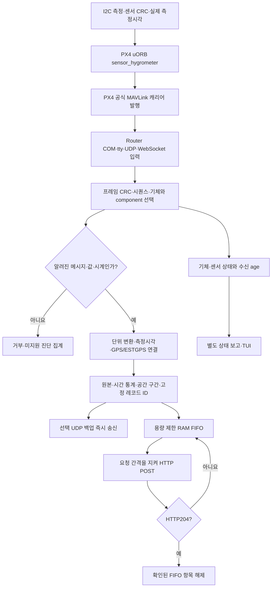

# PX4 → Router 입력 규약

`HyRUS_EnvData_Router`는 **수신한 MAVLink를 해독·검증하고 센서 관측을 서버에 전달하는 호스트 프로그램**이다. `HyRUS_EnvData_Px4`는 I²C 센서를 읽고 그 값을 MAVLink로 발행하는 펌웨어 구현을 담당한다. 서버의 HTTP JSON·UDP 조각 규약은 [SERVER_API.md](SERVER_API.md)와 [UDP_BACKUP.md](UDP_BACKUP.md)에 별도로 정의한다. MAVLink 입력과 서버 JSON 출력을 혼동하지 않는다.

## 소유권과 전체 처리 흐름

| 구현 | 소유 저장소 |
|---|---|
| 센서 버스·전원/핀 설정, 드라이버·CRC, uORB 값·측정시각, MAVLink 송신, PX4 보드 패치·빌드·업로드 | `HyRUS_EnvData_Px4` |
| 자동 포트 탐색, MAVLink CRC/디코드, 소스·시계·항법 연결, SI 변환·집계, RAM 큐·HTTP·UDP 백업, 상태 화면 | `HyRUS_EnvData_Router` |
| 시리얼↔QGC 전달, 선택적인 메시지 주기 요청, 호스트 수신 회귀 검사·진단 시험 서버 | `HyRUS_EnvData_Router`의 운용·검증 보조 기능 |
| 운영 API·인증 정책·장기 저장·중복 제거·HTTP204 응답 | 별도 수신 서버 구현 |

기존 `src/px4/`와 `support/px4/`의 드라이버·stream·overlay는 Router 밖의 `HyRUS_EnvData_Px4` 작업 폴더로 분리했다. 이는 PX4 저장소의 원격 게시나 펌웨어 업로드 완료를 뜻하지 않는다. Router의 공식 MAVLink 헤더와 수신 테스트 패킷은 호스트 기능의 일부로 유지한다.

## 온습도 기본 캐리어: SENS_ATMOS

메시지 ID **8009**, 공식 **ASLUAV** dialect, **MAVLink2**, CRC_EXTRA **144**, 기본 payload **16바이트**를 사용한다. 새 사설 필드나 `common.xml` 수정은 사용하지 않는다. wire 정수·float는 MAVLink의 little-endian 표현을 따른다. MAVLink2 끝의0바이트 생략은 파서가 복원한다.

| offset | 필드 | wire 값 | Router 서버 값 |
|---|---|---|---|
| 0 | `timestamp` | uint64, **같은 PX4 부팅 기준 µs**의 실제 표본 시각 | boot `t_us`; 항법과 연결할 수 없으면 위치는 null |
| 8 | `TempAmbient` | float32, °C | `temperature`, K = °C +273.15 |
| 12 | `Humidity` | float32, 상대습도 **%** | `humidity`, 비율 = % ×0.01 |

예를 들어23.45°C·65.20%는 wire `23.45`, `65.20`이며 서버에는 약296.60K·0.6520으로 간다. float32 반올림 오차는 허용한다. **SENS_ATMOS 습도에100을 곱하지 않는다.** 유한하지 않은 값, 절대영도 미만 온도, 0..100% 밖 습도는 쌍 전체를 거부한다. Unix epoch 시각을 이 필드에 보내면 부팅 시계와 임의로 연결하지 않고 거부한다. timestamp0은 호환 수신 시 시각 미상으로 남으므로 PX4 발행자는 실제 유효한 측정시각을 제공한다.

SENS_ATMOS에는 물리 센서 ID·instance·측정분산·시각오차가 없다. Router의 `(sensor_id=0,sensor_instance=0)`은 **선택한 소스의 논리적인 단일 온습도 입력**이며 물리 칩 식별자가 아니다. 기존 PX4 발행자는 uORB instance0 하나를 사용한다. 동일 component에서 여러 센서 값을 구분 없이 번갈아 넣으면 Router가 분리할 수 없다. 여러 센서를 지원하려면 양 저장소에서 별도의 식별 가능한 캐리어 계약과 검사를 먼저 추가한다.

PX4 발행자는 새 uORB 표본이 있을 때만 전송한다. 분리 시점의 SENS_ATMOS 구현은 `timestamp_sample=0`, 미래 시각,1초보다 오래된 표본, 잘못된 온습도를 송신하지 않는다. 센서가 끊겼을 때 직전 값을 새로운 timestamp로 다시 발행하지 않는다. 측정시각은 수신 PC의 시각이나 HTTP 송신시각으로 대체하지 않는다.

## 기존 호환 캐리어: HYGROMETER_SENSOR

공식 common ID **12920**, MAVLink2, CRC_EXTRA **20**, 기본 payload **5바이트**다.

| offset | 필드 | wire 값 | Router 서버 값 |
|---|---|---|---|
| 0 | `temperature` | int16,0.01°C | `wire ×0.01 +273.15` K |
| 2 | `humidity` | uint16,0.01% | `wire ×0.0001` 비율 |
| 4 | `id` | uint8 센서 instance | `sensor_instance`; `sensor_id=0` |

예를 들어23.45°C·65.20%는2345·6520이다. 이 메시지에는 **측정시각이 없다**. Router는 측정시각·측정 위치·속도를 null로 유지하고, 알 수 없는 확장 바이트를 시각으로 해석하지 않는다. 수신 age는 호스트의 별도 수신 시계로 표시한다.

같은 물리 관측을 SENS_ATMOS와 HYGROMETER_SENSOR 양쪽으로 중복 발행하지 않는다. Router는 `(metric,message_id,sensor_id,sensor_instance)`를 별도 그룹으로 보존하지만 두 메시지가 같은 원본인지 판별할 식별자는 없다.

## 기체 식별·시계·항법

온습도 캐리어는 기체 HEARTBEAT와 **동일한 sysid/compid**로 송신한다. 현재 Router는 HEARTBEAT로 선택한 단일 기체 component의 관측을 수집하며, 다른 component의 boot 시계를 합치지 않는다. 자동 선택에서 GCS·온보드 컨트롤러·autopilot 미지정 HEARTBEAT는 기체로 선택하지 않는다. `target_system`/`target_component`로 선택 대상을 지정할 수 있다.

| 메시지 | Router에서 사용하는 근거 |
|---|---|
| HEARTBEAT(0) | 기체 선택·기체 생존; 주기1Hz를 유지. 센서 수신 여부와 별개 |
| GLOBAL_POSITION_INT(33) | `time_boot_ms`, 위경도·MSL 고도, NED 속도를 읽어 위치·ENU 변환에 사용 |
| GPS_RAW_INT(24) | GPS fix와 정확도 정보. 이 메시지만으로 온습도 표본의 위치를 만들지 않음 |
| ESTIMATOR_STATUS(230) | boot 시각과 estimator flags로 위치·속도의 유효성을 판단 |
| LOCAL_POSITION_NED(32) | boot 시각·속도 및 제한된 ESTGPS 보조 근거 |
| SYSTEM_TIME(2) | boot/UTC anchor. 오차를 모르면 UTC를 임의로 확정하지 않음 |

측정 위치는 같은 부팅·항법 연속 구간의 유효한 앞뒤 항법 사이에서 연결하며, 최대 보간 간격은200ms다. 센서에 위치가 없다고 직전 좌표를 붙이지 않는다. 온습도는 위치·UTC가 없어도 보존하고 위치 출처를 `GPS`/`ESTGPS`/`UNKNOWN`으로 구분한다. `ESTGPS`는 GPS fix의 대체 표기가 아니며 자세한 조건은 [기술 참조](REFERENCE.md)의 위치 정책을 따른다. 큰 boot 시각 후퇴·재연결은 새 세션/epoch로 구분하여 이전 미확인 자료를 새 시계로 바꾸지 않는다.

## 전송률과 추가 센서

센서의 실제 새 표본 발행률, MAVLink stream 전송률, Router HTTP 요청률은 서로 다르다. PX4 측 온습도는 현재10Hz 구성을 기준으로 하지만, 이는 센서 물리 응답속도나 모든 링크에서의 도착률 보장이 아니다. Router의 `mavlink_rates_enabled=1`은 **선택한 시리얼 링크**에서 다음 상한을 목표로 가용 대역폭·ACK·실측 손실에 따라 요청한다. 기본값은 꺼짐이다.

| 메시지 | 요청 상한 |
|---|---|
| GPS_RAW_INT / GLOBAL_POSITION_INT | 10Hz /20Hz |
| 관측된 SENS_ATMOS 또는 HYGROMETER_SENSOR 한 경로 | 10Hz |
| VFR_HUD 또는 AIRSPEED 한 경로 | 10Hz |
| ESTIMATOR_STATUS | 5Hz |
| 관측된 자세 stream | 2Hz |
| 허용 목록의 기타 주기 telemetry | 1Hz |

HEARTBEAT는 별도로 유지하며, 미지원 명령·mission·parameter·알 수 없는 메시지를 임의로 주기 stream으로 바꾸지 않는다. 요청은 PX4의 실제 센서 생산률을 높이거나 없는 센서를 생성하지 않는다. HTTP는 수신률과 독립적으로 `send_interval_ms`와 `http_min_interval_ms`에 따라 묶어 보낸다.

추가 스칼라 센서는 `NAMED_VALUE_FLOAT`(251)·`NAMED_VALUE_INT`(252)의 `time_boot_ms`, 최대10바이트 이름, float32/int32 값으로 받을 수 있다. 단위는 `unit_map`에서 지정하며 값의 자동 SI 변환은 하지 않는다. 이 일반 관측 경로는 유효 항법 연결이 필요하므로 온습도의 위치 미상 보존 경로와 같다고 가정하지 않는다. SCALED_PRESSURE/2/3(29/137/143)의 절대압·온도, HIGHRES_IMU(105)의 유효 필드 비트가 표시된 절대압·온도도 해독한다.

현재 VFR_HUD(74)·AIRSPEED(295)는 주기 요청과 원본 QGC 중계 대상이지만 **서버 센서 JSON의 전용 대기속도 필드로 해독하지 않는다**. 대기속도 원본을 서버에 추가하려면 이름·단위가 정해진 캐리어를 사용하거나 전용 디코더와 서버 계약을 함께 확장한다. CRC가 맞는 새 메시지를 받았다는 사실만으로 모든 필드가 서버에 저장되는 것은 아니다.

## 결측과 양쪽 회귀 검사

- 센서 단절·CRC 실패에는 PX4가 새 관측을 만들지 않는다. Router는 마지막 값의 `rx_age_ms`를 늘리고 FRESH/STALE/UNKNOWN 상태로 보고한다.
- 기체 HEARTBEAT가 끊기면 GCS·다른 모듈의 데이터가 와도 선택 기체를 연결 상태로 보지 않는다. `hb_age_ms`, `data_age_ms`, 센서 `rx_age_ms`, 프로세스 `run_elapsed_ms`는 각각 별개다.
- 부트 시각·GPS·센서 정확도 미상은0이나 현재 시각으로 채우지 않는다. 값의 실제0과 미상 null을 구분한다.
- PX4 검사는 실제 wire의 ID·CRC·단위·timestamp, 새 표본만 발행, 실패 시 미발행을 검증한다. Router 검사는 같은 wire fixture로 SI 변환, 알려지지 않은 시각·위치, component 분리·재부팅·잘못된 값과 중복을 검증한다.

Router 쪽 기준 검사는 `src/tests/test_mavlink_input.c`, `test_weather.c`, `test_spatial.c`, `test_status_report.c`, `test_mavlink_rates.c`다. firmware 드라이버·stream 검사는 `HyRUS_EnvData_Px4`의 `src/px4/*/tests/`에서 별도로 실행한다.
