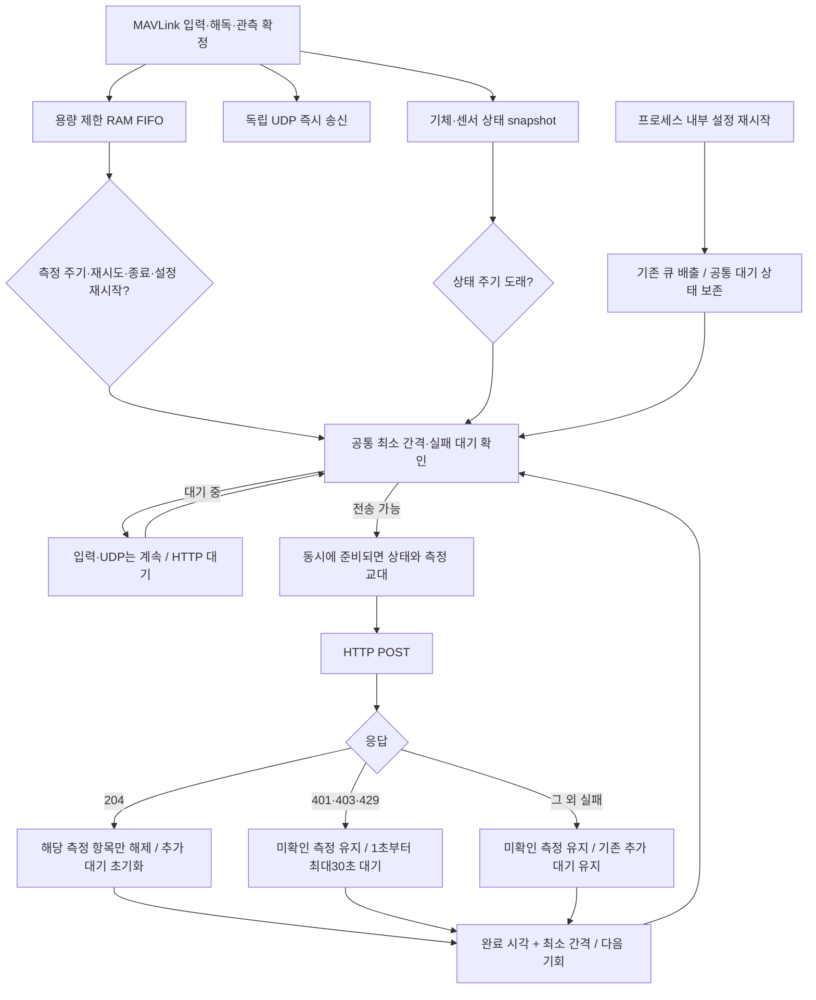
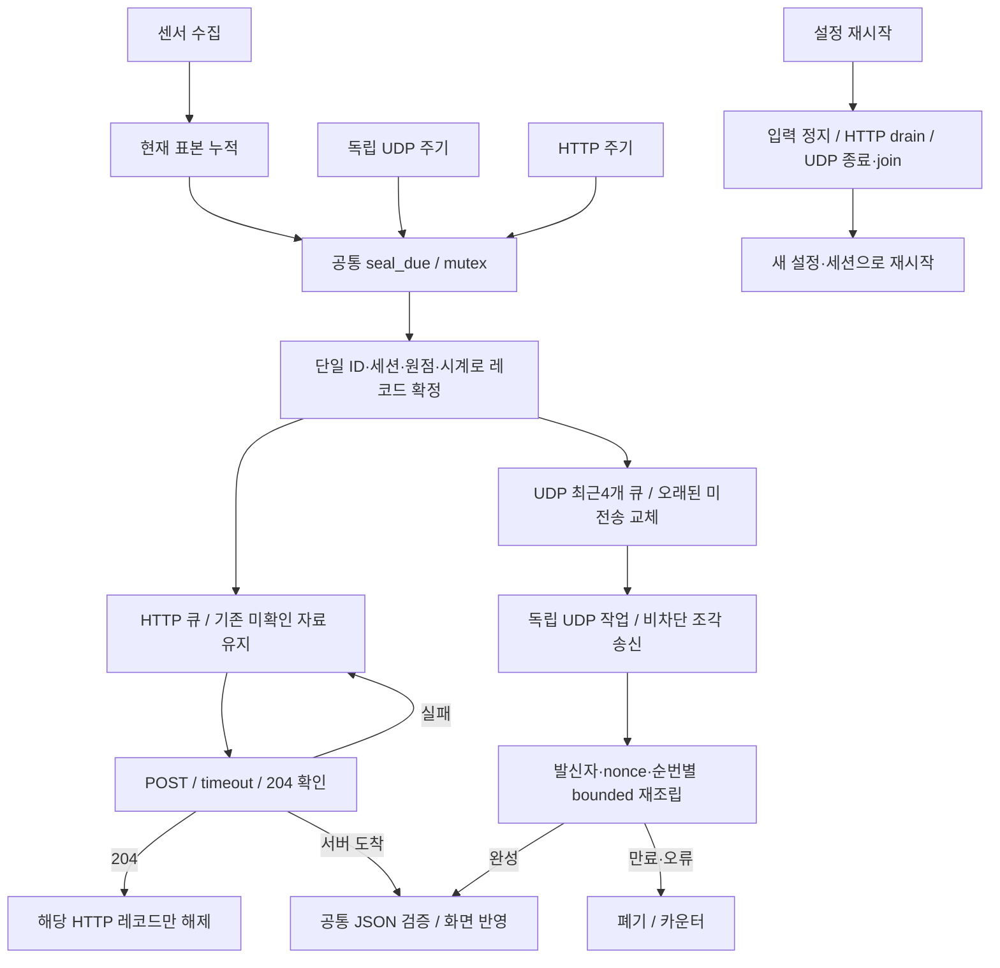
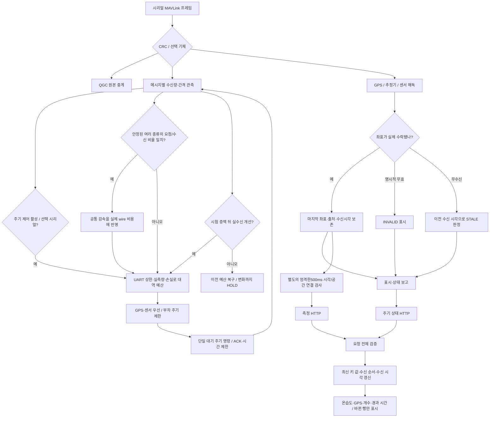
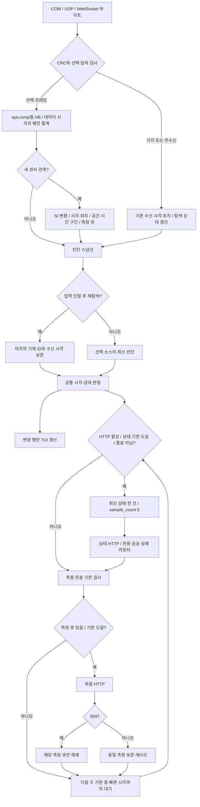
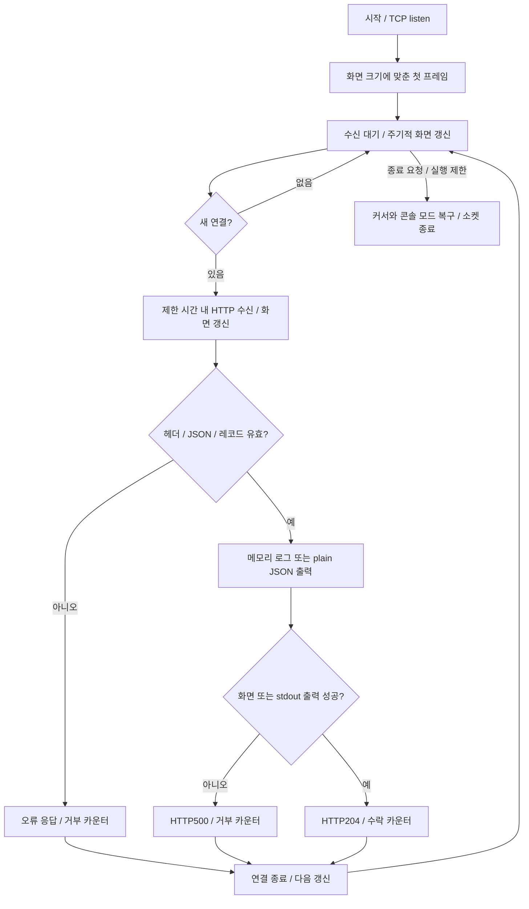
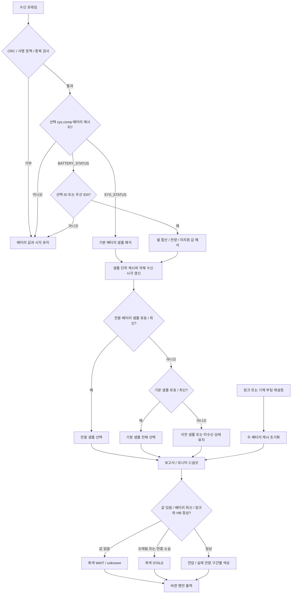

# 검토 기록 — mavlink_telemetry_data_router v0.11.0

검토일: 2026-10-27. 현재 호스트 버전은 0.11.0이다. 이전 내용의 수치·PASS는 당시 구현과 실행 범위를 보존한 이력이며 다른 검증으로 옮겨 해석하지 않는다. [현재 사용법](../README.md), [서버 API](SERVER_API.md), [기술 참조](REFERENCE.md)를 따른다.

저장소 역할 분리 후 이 저장소는 호스트 MAVLink 수신·분석·서버 전송만 관리한다. 아래 과거 기록의 `src/px4/`·`support/px4/`와 펌웨어 검사 수치는 당시 경로·구현의 이력이며, 해당 소스는 별도 `HyRUS_EnvData_Px4` 작업 폴더로 이동했다. 현재 두 저장소의 접점은 [PX4 → Router 입력 규약](PX4_MAVLINK_CONTRACT.md)이다. 과거의 원격 미연결·미게시 기록도 해당 검사 시점에 대한 설명이며 현재 저장소 주소는 [VIPSfef/HyRUS_EnvData_Router](https://github.com/VIPSfef/HyRUS_EnvData_Router)다.

## 2026-10-27 · Router/PX4 역할 분리와 HTTP 요청 분산

입력·큐·정기 상태·재시도·종료·설정 재시작 경로를 함께 추적했다. 밀린 묶음을 비우는 루프와 별도 상태 보고가 각각 POST하면 측정 주기가 1초여도 실제 요청은 몰릴 수 있다. 모든 POST가 공유하는 완료 시각 기반 대기 상태를 두고, 지연된 전송 기회를 한꺼번에 소비하지 않게 했다.

`http_min_interval_ms`의 기본·최솟값은500ms이며 최댓값은60000ms다. 기본 설정은 응답 완료 뒤500ms를 기다리므로 초당 약2회 이하로 분산한다. 403 응답만으로 인증과 요청 제한 중 어느 원인인지 단정하지 않는다. 실제 서버의 거부 원인·정책 검증은 별도이며, 이 검사는 합성 loopback 서버를 사용한다.

Windows 등록35개 검사가 모두 통과했다. Linux 등록38개 중 상태 ACK 격리 fixture가 기존 요청 순서에 의존한 실패를 확인했고, 측정202 → 상태204 → 측정204 순서를 fixture가 보장하도록 고친 뒤 양쪽 해당 검사가 통과했다. 나머지 Linux37개도 통과했다. HTTP 전송 간격,403 재시도 불변성,느린 응답,종료 배출,상태·측정 공정성,UDP 지연,설정 재시작 대기 상태,1MiB 포화·회복을 확인했다. 패키징6개와 API schema·예제·경계86개 검사도 통과했다.

기존 펌웨어 추적 파일40개를 별도 `HyRUS_EnvData_Px4` 폴더에 보존했다. 36개는 기존 HEAD와 바이트 단위로 같고4개는 줄바꿈만 다르며, 세 overlay manifest의34개 항목은 모두 SHA256이 일치한다. Router 빌드·테스트·배포에서 펌웨어 의존성을 제거하고 입력 계약을 별도 문서로 정리했다. 이전 Git 이력은 재작성하지 않는다. 이 분리 검사는 PX4 전체 펌웨어 빌드·플래시나 실물 센서 검증을 뜻하지 않는다.

## 2026-10-26 · 0.11.0 배포 준비와 URL 편집

입력 → 초안 표시 → Enter 검증 → 저장 → 재시작 흐름을 분리해 확인했다. 이전에는 편집 화면도 활성 URL용 표시 함수를 사용해 `http://`가 불완전하면 주소 전체를 `[invalid URL]`로 바꿨다. 공통 마스킹 함수에 편집용 표시 경로를 추가하여 불완전한 접두사도 표시하고, Enter에서만 검증한다. 다시 입력하면 이전 검증 메시지를 지운다. 붙여넣기는 대기 중인 키를 제한된 수만큼 먼저 처리한 뒤 한 번 표시하며, 사용자정보·쿼리·fragment 마스킹을 유지한다.

별도 MinSizeRel 빌드에서 Windows 등록 검사34개와 Linux 등록 검사37개를 실행했다. 새 URL 검사의 중간 화면 노출을 수정한 뒤 설정·URL·직접 토큰·재시작·배터리·위치·화면 관련 검사를 재실행하여 통과했다. 재시작 검사는 과거 출력 대신 실제로 편집기가 닫힌 새 화면을 기다리도록 보완했다. Linux 기존 HTTP sender·monitor 검사도 통과했다. API 구조·경계86개와 실제 C 시험 서버의204/400/복구204 흐름을 확인했다. 패키징 경계·개인 설정 제외·압축 경로·결정적 압축에 대한 오프라인 검사6개도 통과했다.

Windows는 GCC16.1/UCRT x64, Linux는 Ubuntu24.04 WSL·GCC13.3·glibc2.39·시스템 libcurl8.5.0 환경이다. 세 실행 파일의 `--version`은 CMake의 한 버전에서 생성한다. 소스 압축본은 현재 작업 파일과 새 파일을 함께 포함하며, manifest의 기반 커밋은 미커밋 변경 전체의 커밋을 뜻하지 않는다. GitHub 업로드·태그·원격 연결은 수행하지 않았다.

## 2026-10-26 · HTTP 무응답과 독립적인 UDP 백업

수정 전에는 HTTP sender가 정기 측정 묶음 생성과 POST를 함께 담당하고, HTTP 큐가 가득 차면 새 묶음의 ID 발급·공간 snapshot도 생략했다. 따라서 POST 뒤에 UDP send를 추가하거나 같은 큐를 읽는 방식으로는 HTTP 정체 중 최신 데이터가 나가지 않는다. 설정 적용의 drain과 HTTP 초기화 실패도 입력 시작·종료에 연결되어 있어 전체 수집·전송·재시작 흐름을 함께 추적했다.

동일 메타데이터를 여러 병렬 배열에 보관하던 레코드를 enum·struct·union으로 묶고, 공통 생성·발행 함수로 HTTP/UDP에 분배한다. JSON 인코더는 출력 버퍼를 인자로 받아 각 작업자의 버퍼를 분리한다. UDP 성공은 HTTP ACK가 아니며 두 큐를 함께 지우지 않는다. 상태 보고도 공통 인코더·순번으로 처리하며 UDP의 별도 주기를 사용한다. 설정은 끝에 추가하여 기존 번호를 유지하고 URL authority 파싱을 자동 UDP 목적지 계산과 공유했다.

Windows30개·Linux33개 등록 검사가 통과했다. 신규 장애 시험의 초기25초 제한은20초 수집 이후 기존8칸 HTTP 큐를 정상 배출하는 시간을 포함하지 못하여 양쪽에서 timeout이었다. 제품 코드를 바꾸지 않고 제한35초로 수정한 뒤 해당 시험을 다시 실행해 통과했으며 Linux 실제 소요는28.50초였다. 무응답·500·HTTP 큐 포화 동안 최신 UDP 표본·독립 상태 지속, HTTP/UDP 동일 관측 ID·내용, UDP 성공과 실제204의 큐 해제 격리, 비활성 기본값, UDP 목적지 부재에도 HTTP 동작을 확인했다.

UDP 조각 단위1849항목과 설정1487항목을 검증했고, 서버 통합은 역순·중복·UTF-8 분할·발신자 격리·2초 만료·HTTP 지연 중 UDP 처리·두 경로의 같은 레코드 중복 표시 억제를 확인했다. 기존 API86항목과 C 서버의 정상204/오류400/복구204도 통과했다. 읽기 검토에서 HTTP 초기화 실패 중 재시작 작업자 조기 종료 경로를 찾아 재시도 유지로 고쳤으며, 종료 직전 미완성 묶음도 공통 확정 후 UDP에 전달한다.

Windows/Linux 실행 파일6개를 표준 build 경로에 배치하고 SHA256 일치를 확인했다. 운용 설정은 UDP 백업1·호스트auto·포트0으로 켜서 HTTP21000/UDP21001을 사용한다. 실제22초 확인에서는 COM4 열기가 실패하여 센서 표본0건이었고, HTTP 상태2건204·UDP 상태2건 수락·UDP 오류/누락0을 확인했다. 최초 실물 helper가 센서 중복 수신까지 무조건 요구하여 실패한 부분은 입력 부재와 전송 실패를 구분하도록 정정했다. 따라서 실제 센서의 양쪽 전송 비교는 이 실물 구간에서 검증하지 못했고, 합성 장애 통합으로 검증했다. COM4 장치는 PnP에서정상으로 존재했고 QGC도 실행 중이었으나 포트 점유자를 확정하지는 않았다. 최신 중계기·시험 서버 TUI를 다시 켜두었고 같은 서버 프로세스의 TCP21000·UDP21001 listen을 확인했다. 실제 관측은 파일로 저장하지 않았다.

## 2026-10-26 · 간결한 수신 화면과 위치 표시·전송 우선순위

수정 전 전체 흐름을 세 가지로 추적했다. 서버는 HTTP 전체 검증 → 레코드별 여러 줄 로그 → 최근 로그만 화면에 표시하여 값·수신 시각보다 통계·품질·공간 정보가 화면을 차지했다. 위치는 GPI 수신 → 항법 검증 →500ms 만료 → have_navigation=false → 화면 UNKNOWN으로 이어져, 정상적인1Hz 위치에도 출처가 깜빡였다. 링크는 수신·QGC 중계만 하고 메시지 우선순위를 요청하지 않았다.

변경 전 실제 COM4/57600 중계의20초 수동 수신 측정은 전체724B/s였다. GPI33은1.40Hz, 간격 중앙688ms·최대797ms로500ms 표시 만료를 반복했다. 자세30/31은4.24/2.84Hz로 약295B/s, GPS24는1Hz, 온습도12920은20초 동안1건이었다. GPS fix0·위성수255였으므로 좌표 스트림 수신과 GPS 확정 fix를 구분한다. 이 측정은 QGC가 점유하지 않은 로컬 미러를 수신만 했으며 장치에 명령을 보내지 않았고 원본을 파일에 저장하지 않았다.

Windows26개·Linux29개 전체 회귀 검사를 통과했다. GPS 표시 검사는 500ms 측정 연결 제한과 표시 보존, 명시적 무효·오래됨·새 세대 초기화를 구분한다. 실제 ConPTY/PTY 시험은 간결한 서버의 단위·개수·최신 키 값·수신 순서·경과 시간과 전체 지우기 없는 갱신을 확인했다. API86개 오프라인 검사와 Linux C 서버의 정상·거부 응답도 통과했다. 주기 제어는 독립 CRC 검사, 부분 쓰기, 수락·거부·무응답, QGC 양보 및 가상 시리얼 통합을 검사했다.

첫 실제 적용50초는 주기 명령47건 수락·거부0·무응답0, 10초 상태 보고5건 모두HTTP204였다. 후반25초 동안 온습도와VFR_HUD는 각각1.15Hz, 추정기 상태는1.07Hz였다. 그 구간에는 GPS24/GPI33이 없고 추정기 flags175가 수평 절대 위치를 유효하다고 표시하지 않았다. 이후 다시 실행한20초 수신에서는 GPS24=1.19Hz·GPI33=1.14Hz·온습도/VFR_HUD=1.19Hz, 자세30/31=0.60Hz, GPS fix3·위성12~18로 바뀌었다. 이 관측은 기체 상태도 변했으므로 동일 조건의 GPS 성능 향상 수치로 해석하지 않는다. 원본 패킷·관측·화면은 RAM에서만 처리했다.

실물 검사에서 실측772B/s와 보수적인 계획1304B/s의 비율59% 때문에 이용률65% 조건만으로는 증속을 멈출 수 있음을 확인했다. 이를 ACK·손실 상태가 안정적일 때의 제한된 시험 증액과 실제 수신량/핵심 메시지 빈도 비교로 대체했다. 효과가 없으면 이전 예산으로 복구하고 HOLD하여 하드웨어 자체 발행률이 느린 경우 끝없이 요청을 높이지 않는다. 추가 검토에서 새 세션 식별자와 이전 위치가 잠깐 함께 보고될 수 있는 경쟁 구간을 찾아 동일 mutex 안에서 위치 메타데이터를 먼저 초기화했다. 실제 sender의 세션 전환 직후를 결정적으로 검사하며 단순 연결 단절의 마지막 위치·장치 이력은 유지한다.

이 보완을 포함한 Windows27개·Linux30개 전체 회귀 검사가 통과했다. 당시 주기 제어 단위 검사는648개이며 저이용률의 짧은 패킷에서도 시험 증액함, 효과 있는 증액 유지, 무효 증액 복구·HOLD, 새 입력 변화에 따른 재개, 혼잡 우선 감속을 확인했다. ATTITUDE_TARGET/ALTITUDE의 관측된 주기만 제한하고 SET_ATTITUDE_TARGET 명령을 주기 요청 대상으로 취급하지 않는 경계도 검사했다. 실제 sender를 호출하는 세션 경계 회귀를 추가하고 앱·검사의 플랫폼별 링크 설정은 공통 CMake 함수로 묶었다. 두 플랫폼의 실행 파일4개와 시험 서버2개를 표준 build 경로로 복사하여 SHA256 일치를 확인했다.

이후70초 실제 검사에서는 명령76건 수락·누락 추정0·상태7건204였으나, 후반 GPS/온습도가 약0.32Hz로 떨어져 성능 검증에 실패했다. 원인은 이미 관측된 부차 트래픽을 최대 패킷 크기로 과대 예약하고, 예산 부족 때 핵심·부차를 같은 비율로 감속하며, 5초 관측 창의 작은 변동에 반복 요청하여 자기 ACK를 다시 예약하는 구조였다. 이 결과는 정상 완료로 간주하지 않고 실제 wire 예약·핵심1Hz 우선 배분·자기 제어 응답 중복 제거·요청 주기 변경 억제를 추가 검증 대상으로 삼았다.

수정된 분배기는 관측한 wire 비용과 요청 증가분의 최대 비용을 공통 함수로 계산하고, 동일한 이분 탐색으로 우선순위별 주기를 배분한다. 자체 주기 ACK는 비관리 예약과 시험 증액의 처리량 판정 양쪽에서 제외한다. 관측 평활화·10% 변경 억제는 동일 예산의 작은 변동에 적용하며 명시적 시험 증액·복구에는 적용하지 않는다. 최신 주기 단위 검증1548항목, Windows 관련7개·Linux 관련9개 회귀가 모두 통과했다. 440B/s 합성 예산에서 핵심 기본 요청 우선권을 확인했고, ACK100건/창 및 표본 수±1의100초 합성 입력에서도 후반60초 추가 명령0을 확인했다. 이는 합성 검증이며 실제 수신률 보장을 뜻하지 않는다.

다음90초 실물에서는 상태9건204·추정 누락0·GPS fix3과 안정적인 위치 표시를 확인했지만 GPS/온습도 실수신은 약0.46Hz였다. GET_MESSAGE_INTERVAL 읽기 요청으로 확인한 설정은 GPS/온습도/VFR1.149Hz, GPI1.316Hz, EST1.064Hz, 자세·SYS_STATUS·ALTITUDE1Hz였다. 여러 스트림의 실수신이 요청의 약0.4~0.5배라는 증거에 따라 요청Hz와 실제 wire 비용을 동일하게 보는 가정을 다시 분리했다. 개별 센서의 발행 상한을 공통 감속으로 오인하지 않도록 서로 다른 종류의 안정된 비율이 함께 일치하는 경우만 비용 모델을 보정하는 흐름을 추가했다. 조회는 임시 로컬 QGC 미러를 통해 읽기 명령만 보냈으며 영구 파라미터는 변경하지 않았다.

공통 감속 보정까지 포함한 엄격한 C99 주기 단위 검증1586항목과 Windows 관련7개·Linux 관련9개 회귀가 통과했다. 공통0.5배에서 핵심 실효1Hz 우선 배분, 부차 스트림의 적용 명령이 없어도 항법·센서로 학습, 느린 단일 센서 제외, 명령 직후 관측 제외, 적용 변경 이후 안정 배율 보존, 손실 감속, 요청 상한과 최대4배 보상 제한을 확인했다. 이 코드로 두 플랫폼의 실행 파일6개를 다시 빌드·배치하고 SHA256 일치를 확인했다.

최종120초 실물 검사에서는 공통 비율50%를 학습하고 MONITORING 상태에 도달했다. 마지막30.19초의 실제 수신은 GPI2.05Hz, GPS1.36Hz, 온습도·VFR_HUD 각1.33Hz, 추정기0.96Hz, 기체 하트비트0.99Hz였다. 자세30/31은0.40/0.36Hz, 전체597B/s로 핵심 데이터에 우선 배분됨을 확인했다. 주기 명령30건 수락·거부0·무응답0, 선택 기체1707프레임의 추정 누락0, 상태12건 모두HTTP204였다. GPS fix3·추정기 flags959였고 마지막 위치 표시도 LIVE를 유지했다. 이 값은 해당 시점의 장치·링크에서 측정한 수신률이며 요청 상한을 달성했다는 뜻은 아니다. 시험용 UDP 수신기를 종료하고 최신 Windows 중계기와 시험 서버를 각각 보이는 TUI 창으로 다시 실행했다. 원본 관측·패킷·화면은 저장하지 않았다.

## 2026-10-26 · 새 표본 없는 주기 보고와 기기 연결 상태

기존 전체 흐름을 입력·관측·송신·표시 가지로 나누어 검토했다. 새 온습도 표본은 이동거리와 관계없이 시간 전송 구간에 들어가지만, 새 표본이 없으면 큐가 비어 HTTP 요청도 발생하지 않았다. 따라서 공간 폭을 줄이거나 과거 관측을 재삽입하는 것으로 해결할 문제가 아니었다. 화면과 HTTP의 스냅샷·수신 상태 판정을 공통 함수로 묶고, 같은 송신 작업자 안에 측정 주기와 독립적인 상태 보고 기한을 추가했다.

상태 보고는 선택 기체의 연결/HB/데이터, 마지막 센서 값과 자체 수신 경과 시간, 장치별 상태, 추정 패킷 누락을 보낸다. `run_elapsed_ms`는 실행 누적 시간으로 구분한다. GCS 또는 라디오가 살아 있어도 선택 기체 하트비트가 만료되면 connected=false다. 재탐색 중 마지막 기기 정보가 초기화되어 단절을 WAIT로 오인할 수 있는 경로를 수정하고, 새 입력 선택 때 이전 기기 진단을 교체한다. 상태는 최신 한 건만 만들고 실패 이력을 전송 큐로 쌓지 않는다. 기존 측정 ACK·관측 수·원본 큐와 상태 ACK·전송 통계를 분리했다. 기본 비활성 설정을 보존하고 운용 설정에서10000ms를 명시한다.

Windows24개·Linux26개 등록 검사를 모두 통과했다(기존 전체 회귀와 새 주기 통합 검사를 분리 실행). 직렬화70개 검사는 escaping·민감 URL 가림·버퍼 경계·최대32장치·수신시각0·미상 값·기체별 나이를 확인한다. 주기 통합 검사는 실제10초 간격으로 무입력 보고가 측정60초 주기에 막히지 않음, HB만 만료·GCS만 생존·완전 무수신·재연결, 끊긴 기기 ID와 수신 경과 시간 보존, 추정3패킷 누락, 상태500/204와 측정202/204의 큐 격리, 과거 값을 새 표본으로 세지 않음을 확인했다. 별도 ConPTY/PTY에서 시험 서버의 STATUS·독립 카운터와 전체 화면 지우기 없음을 검증했다. API 스키마79개 검사와 Linux 실제 C 서버의 정상204·오류15건400·복구 검사를 통과했다. 합성 통합 시험은 임시 loopback 포트와 RAM만 사용했다.

검증한 Windows/Linux 운용 파일4개와 시험 서버2개를 표준 build 경로로 복사하고 SHA256 일치를 확인했다. 기존 URL·포트 탐색 설정을 유지하고 `status_interval_ms=10000`만 활성화했다. 실제 COM4/57600 입력으로22초 실행한 검사에서 상태 요청2건 모두 localhost21000의 새 C 시험 서버가204로 수락했고 실패0·정상 종료를 확인했다. 이 검사에서 선택 기체1.1의 HB와 데이터가 LIVE였으며 실물 전원을 끄는 시험은 수행하지 않았다. 실제 관측·화면 프레임은 파일에 저장하지 않았다. 이후 Windows 라우터와 시험 서버를 각각 보이는 TUI 창으로 실행했다.

## 2026-10-26 · 시험 서버 화면 갱신

라우터에 적용한 부분 갱신은 시험 서버에는 적용되지 않았다. 기존 시험 서버는 시작·요청 검증 뒤·연결 처리 뒤에 dashboard를 호출하며 매번 전체 화면 삭제를 출력했다. 같은 요청에서 두 차례 전체 화면을 지울 수 있었고, 요청이 없으면 실행 시간·창 크기도 갱신되지 않았다. 수정 전 분기 흐름을 확인한 뒤 라우터의 `monitor_frame` 구현을 함께 사용하도록 바꿨다.

화면은 고정 메모리의 현재·이전 프레임을 비교하며, 변경 행을 덮어쓴 뒤 남은 문자만 지운다. 제목과 로그 모두 너비를 제한하고 마지막 열 자동 줄바꿈과 화면 맨 아래 개행을 피한다. 유휴 갱신과 창 크기 변경을 처리하면서도 정상 레코드는 HTTP204 전에 화면에 반영한다. 실행 누적 시간은 `run_elapsed`로 표기한다.

Windows/Linux 엄격 빌드 및 관련 CTest 각 5개가 통과했다. 새 실제 ConPTY/PTY 검사는 합성 HTTP 요청 25건의204·카운터·로그 표시, 유휴 실행 시간 갱신, 64×8 축소 및160×48 복원, 고정 제목 유지·전체 지우기 없음, 정상 종료와 커서 복원을 확인했다. 공유 프레임 검사와 기존 하트비트·온습도·공간 HTTP 회귀도 통과했다. 두 표준 tools 실행 파일을 검증한 빌드로 교체하고 해시 일치를 확인했다. Windows 시험 서버를 기본 localhost21000의 보이는 TUI 창에서 실행했다.

## 2026-10-26 · 상단 배터리 전압·잔량 표시

기존 흐름은 수신 바이트 → CRC·서명 정책 확인 → 장치/시퀀스 처리 → 선택 기체 검사 → 메시지 해석 → 입력 상태 → 동기화된 모니터 스냅샷 → 행 단위 갱신이었다. 배터리 프레임은 QGC 전달 경로를 통과하지만 모니터용 해석이 없어 전압과 잔량을 표시하지 않았다. 메시지 해석 분기에 SYS_STATUS/BATTERY_STATUS를 추가하고, 같은 battery 구조를 보고서·스냅샷에 사용해 전압·잔량·수신 시각을 함께 전달한다.

배터리 선택은 선택 sys.comp인지 확인 → 메시지별 단위·sentinel 해석 → 첫 배터리 ID 유지(ID0 우선) → 최신 유효 BATTERY_STATUS 우선 → 없으면 최신 SYS_STATUS 전체 샘플 대체 → 둘 다 오래되면 이전 값에 STALE 표시 순서다. 다른 메시지의 전압과 잔량을 섞지 않는다. 셀 전압 합산과 확장 필드의 서로 다른 미지원 값, 잔량 0%·미지원·범위 오류, MAVLink2의 끝자리 0 생략을 구분한다. 링크/기체 부팅 재설정 때 배터리 캐시를 비우며, 하트비트 수신이 배터리 수신 시각을 갱신하지 않는다.

제목 바로 아래 한 행에 전압·잔량 막대·상태·rx_age를 표시한다. 40% 초과 초록, 21–40% 노랑, 20% 이하 빨강이며 이들은 화면 표시 기준이다. 전압만 알면 중립색으로 표시하고 잔량을 추정하지 않는다. 5초 초과 배터리 무수신, 링크/하트비트 소실, 종료/오류 상태에서는 회색 STALE을 표시한다. 기존 화면 비교 경로를 사용하므로 전체 지우기 없이 색상과 값이 함께 갱신된다.

Windows 21개·Linux 23개 전체 CTest가 통과했다. MAVLink wire 검사 886개에 배터리 단위·sentinel·확장 셀·0%·잘린 패킷·외부 기체/컴포넌트·CRC/서명·재부팅·연결 초기화 검사를 포함한다. 새 배터리 통합 검사는 테스트 전용 UDP와 Windows ConPTY/Linux PTY에서 실제 실행 파일의 두 번째 행, 색상 경계 41/40/21/20/0%, 미지원 필드, 배터리 메시지 우선순위, 하트비트 상실·복귀, 별도 5초 배터리 만료와 전체 화면 지우기 없음을 확인했다. 합성 데이터로 검증했으며 실물 배터리 값 수신을 확인한 결과는 아니다. 네 운용 실행 파일을 검증된 빌드와 해시가 일치하도록 교체하고 기존 설정을 유지한 새 TUI를 실행했다.

## 2026-10-26 · 공식 MAVLink 라이브러리와 QGC 양방향 전달

수정 전 실행 중 QGC는 UDP14550을 열고 있었지만 수집기에는 UDP 송신 소켓과 시리얼 중계 경로가 없었다. 입력 UDP 설정을 바꾸어 해결할 수 없는 구조였다. 흐름을 시리얼 탐색·선택 → 원본 프레임 전달 → QGC 응답 큐 → 시리얼 부분 쓰기 순서로 분석하고, 기존 센서 디코더·HTTP 경로를 유지하는 별도 QGC 전달 모듈을 추가했다.

공식 `mavlink/c_library_v2`를 Git으로 가져와 커밋 `6b4243f0e54b42ddb1e65df7a3a5e8c99d15ec1f`에 고정했다. 원본 protocol 헤더 7개와 all.xml CRC 목록을 포함하며 재생성 스크립트가 해당 checkout을 확인한다. 라이브러리의 parser를 사용하되 전달 시 payload를 잘라내는 helper는 사용하지 않아 서명·padding·시퀀스·checksum을 보존한다. 서명을 인증된 센서 관측으로 취급하지 않으면서 서명 스트림도 QGC 경로를 선택·유지할 수 있다.

QGC 목적지 설정은 기존 UDP 입력과 분리하고 TUI38–40번에 추가했다. 기본 `127.0.0.1:14550`로 OS가 고른 임시 로컬 포트에서 전달한다. 응답은 고정된 상대만 받고, 제한된 데이터그램 처리량과 32프레임 큐를 사용한다. 시리얼 쓰기는 하트비트와 QGC 프레임이 같은 상태를 공유하여 부분 쓰기 중간에 다른 프레임이 끼어들지 않는다. 소스 단절·재시작에서는 이전 요청과 부분 parser 상태를 비운다. QGC 소켓 오류는 센서 입력을 종료하지 않는다.

최종 Windows CTest20개와 Linux22개가 모두 통과했다. bridge107개 검사는 원본 프레임·최대 길이 서명·padding·CRC·잘못된 peer·큐 포화·재개방을 확인한다. routing63개 검사는 모의 시리얼의 1–3바이트 부분 쓰기, 최초 프레임, 서명 전용 입력, 재연결과 UDP 입력 격리를 검증한다. Linux 실제 가상 tty와 임시 UDP를 사용한 생산 실행 파일의 양방향 검사도 통과했다. 기존 센서·HTTP·하트비트·재시작 회귀는 유지했고 일반 합성 시리얼 검사에서는 QGC 전달을 명시적으로 꺼 실제 QGC에 시험 데이터를 보내지 않도록 했다.

실물 Windows20초 검사에서는 COM4 열기가 실패해 tx/rx0이었다. 이어 읽기 전용 프로세스 핸들 검사로 QGroundControl PID35788이 COM4에 해당하는 `\Device\VCP0`을 점유한 것을 확인했다. 라우터가 시리얼을 소유하려면 QGC의 COM4 직접 연결을 해제하고 UDP로 받아야 한다. 이 결과는 실제 QGC 수신 성공으로 기록하지 않는다. 검증한 네 실행 파일을 표준 build 경로에 반영하고 QGC 전달이 켜진 새 TUI를 실행했다. 센서 서버 URL과 기존 탐색 설정은 유지했다.

## 2026-10-26 · 같은 창에서 설정 저장·재시작

기존 설정 흐름은 초안 편집 → 검증 → 원자 저장까지였고 실행 중 설정은 바뀌지 않았다. `r`을 저장·재시작 동작으로 추가하고 `s`는 저장만 하는 동작으로 유지했다. 모니터에서도 `r`로 저장한 초안을 적용한다. 입력 중인 문자 r과 재시작 명령은 편집 상태로 구분한다. 설정 검증이나 파일 저장이 실패하면 수신을 중단하지 않는다.

수신·송신·모니터의 수명을 함께 추적하여 검증·저장 → 입력 일시 정지 → 기존 설정으로 보류 전송 → 디코더 종료 처리·포트 반환 → 남은 전송과 작업자 종료 → 새 설정 초기화 → 입력 재탐색 순서로 구현했다. 기존 큐의 ACK 전에 설정을 덮어쓰지 않고, 실패 시 새 적용을 취소한다. 포화 큐의 미완성 구간을 일반 봉인 또는 재연결 초기화 경로에서 버릴 수 있음을 검토 중 발견하여, 해당 구간이 안전하게 큐에 들어갈 때까지 수신을 정지한 채 기존 송신을 재시도하도록 수정했다. 반복 재시작의 실패 예산은 시도별로 초기화한다. 누적 실행 시간·손실 진단은 유지하며 성공한 적용만 횟수를 늘린다.

설정 목록과 표시 형식은 기존 config 필드 레지스트리로 통합했다. TUI의 별도 37개 필드명과 숫자 switch, URL 숫자 인덱스, 송신 용량 기본값 4를 제거했다. Windows/Linux 엄격 컴파일과 설정 검사 1,015개가 통과했다.

두 OS에서 자체 PTY/ConPTY의 실제 키 입력으로 저장만 하기, 같은 PID의 연속 재시작, refresh·UDP 포트 적용과 이전 포트 반환, 잘못된 값·저장 실패 시 수신 유지, HTTP503 실패 후 기존 배치·목적지 보존과 HTTP204 복구 후 재적용을 확인했다. 추가 포화 검사는 큐 8개와 미완성 구간 1개를 만든 뒤 실패한 재시작에서도 기존 목적지로 9개 값을 모두 ACK하고 큐·원본 손실 0임을 확인했다. 임시 설정·생성 UDP·loopback HTTP만 사용했으며 실제 COM이나 사용자 터미널을 조작한 검사가 아니다.

최종 빌드에서 Windows 18개·Linux 19개 등록 검사에 해당하는 전체 회귀를 통과했다. 재시작 검사는 별도 직접 실행하고 나머지를 CTest로 실행했다. 별도 모니터 통합 검사도 두 OS에서 통과했고 Linux Ctrl+C의 termios·커서 복원을 확인했다. 네 운용 실행 파일을 표준 build 경로에 반영하고 SHA256 일치를 확인했다. 기존 telemetry.ini를 보존한 채 새 Windows TUI를 실행했다.

## 2026-10-26 · 부분 화면 갱신과 기체 하트비트 감시

수정 전 전체 흐름을 수신·표시 두 경로로 추적했다. 수신 경로는 CRC 확인 → 장치별 수신 시각 → 시퀀스 처리 → 상태 발행 → 스냅샷이었다. 채널의 유효 패킷 시각과 과거 하트비트 존재 여부만으로 LOCKED를 유지하여, 기체 전원이 꺼져도 라디오/GCS가 송신하면 정상처럼 보였다. 선택 sysid/compid의 하트비트와 비하트비트 데이터 시각을 별도로 전달하고, 하트비트가 link_timeout_ms 동안 없으면 HEARTBEAT_LOST로 표시한다. 같은 시퀀스의 하트비트도 실제 수신 시각과 식별 정보를 갱신한다. 다른 관측의 중복 억제는 보존했다. 선택 장치 탐색을 공통 함수로 합쳤다.

화면은 스냅샷/키 입력 → draw → 전체 화면 삭제 → 글자별 stderr 출력 흐름이었다. 이제 고정 메모리 프레임 2개를 비교하여 변경 행을 한 번에 출력한다. 새 텍스트를 먼저 쓰고 남은 문자만 지우며, 설정 화면·삭제 행·창 크기 변경도 같은 경로를 사용한다. 화면 갱신 중 전체 삭제나 마지막 행 개행은 없다. 화면 저장소 200,816B는 --sizes의 monitor_storage와 static_total에 포함한다. 파일·파이프 출력은 기존 ANSI 없는 전체 스냅샷을 유지한다.

TUI는 선택 기체의 heartbeat LIVE/LOST/WAIT와 data LIVE/STALE/WAIT를 각각 마지막 수신 이후 ms로 표시한다. 실행 run_elapsed은 독립된 누적 시간이다. packets에는 유효 수신·추정 시퀀스 누락·중복과 추정 누락률을 연결 세션 기준으로 표시한다. DRY 로컬 출력 시각은 last_output_age로 이름을 구분했다. 재부팅과 8비트 시퀀스의 모호성 등으로 누락 추정치를 실제 무선 손실 확정값으로 해석하지 않는다.

Windows CTest 17개와 Linux 18개가 통과했다. 파서 834개 검사는 시각 0, 하트비트/데이터 독립, 다른 장치 격리, 같은 시퀀스 복귀, 누락 추정·CRC 거부를 포함한다. 실제 라우터를 loopback UDP로 실행하여 라디오/GCS 트래픽만 계속되는 동안 하트비트 만료·복귀, 데이터 단독·하트비트 단독, 전체 무수신을 확인했고, 의도적으로 뺀 3개 시퀀스와 표시 누락률을 대조했다. 실제 장치의 전원을 조작한 시험은 아니다.

프레임 검사의 541개 조건은 변경 행·짧아진 문자열·삭제 행·색상·창 크기·버퍼 한계·출력 실패를 화면 셀로 재구성하여 검증한다. 별도 모니터 통합 검사가 Windows/Linux 모두 통과했고, Linux 제어 PTY에서 설정 저장·복귀·Ctrl+C 후 termios와 커서 복원을 확인했다. Windows ConPTY에서 실제 새 실행 파일을 2.5초 실행해 정상 종료, 기체 상태와 패킷 통계, 초기화 이후 전체 지우기 없음, 고정 헤더 1회 출력을 확인했다. 화면 캡처 4,028B는 RAM에만 유지했다.

## 2026-10-26 · 포트 전체 탐색 후 보레이트 확대

기존 입력 흐름은 후보 열거 → 포트 열기 → MAVLink CRC 확인 → 입력 선택 → 단절 시 재탐색이었다. 후보에 보레이트 차원이 없어 설정된 속도만 반복했고, 현장 실행 설정에는 COM5 고정과 자동 탐색 OFF가 남아 있었다. 현재 연결된 COM4에서는 115200으로 바이트가 들어와도 유효 프레임이 없었고, 57600에서는 유효 MAVLink를 확인했다.

자동 탐색은 설정 보레이트로 존재하는 모든 직렬 포트를 먼저 확인하고, 발견하지 못하면 다른 지원 속도마다 전체 포트를 다시 확인한다. 매 순회 포트를 재열거하고, 연결이 끊기면 설정 속도부터 시작한다. UDP 병행 수신과 단일 입력 선택은 유지하며 자동 직렬 후보에는 CRC 확인 전 하트비트를 보내지 않는다. TUI에는 검사 중이거나 선택된 실제 보레이트를 표시한다. 지원 속도 목록은 설정 검증·탐색·Linux termios 변환이 공유한다. 수동 실물 검사 도구의 COM5 기본값도 없애고 공통 인수·설정 생성 코드를 공유하도록 정리했다.

Windows GCC 16.1 및 WSL Linux GCC 13.3으로 별도 빌드 폴더에서 두 실행 파일과 검사 대상을 빌드했다. Windows CTest 15개가 통과했고 Linux 16개도 통과했다. Linux 자동 입력 검사는 추가된 `baud` 표시를 포트 이름과 분리하도록 검사 파서를 수정한 뒤 재실행하여 통과했다. 새 메모리 모형 검사는 실제 `ri_run`과 MAVLink 해독기로 속도별 포트 순서, 중복 속도 제외, 없는/점유된 포트, 수동 모드, 단절 후 새 포트, 잘못된 CRC 및 미확인 입력에 대한 송신 억제를 확인한다. 기존 UDP/WebSocket 경합·전환 검사도 통과했다.

실물에서는 `serial_port=auto`, 우선 속도 115200, `auto_scan=1`로 시작해 COM4의 57600을 자동 선택했다. 12초 실행 종료 시 유효 프레임 182개, 선택 입력 CRC 오류 0개, 시스템/컴포넌트 1.1을 확인했다. 일반 관측 중 항법이 없는 6개는 기존 정책대로 제외되었으며, 서버 업로드나 온습도 수신을 확인한 시험은 아니다. 실제 관측값은 파일로 저장하지 않았다.

## 2026-10-25 · 별도 Git 설치가 필요 없는 단일 ZIP

받는 PC에서 Git을 따로 설치해야 했던 제약을 없앴다. 공식 Windows x64 MinGit 2.56.0.3의 전체 배포 파일과 라이선스를 공유용 ZIP의 `runtime/git` 아래에 포함한다. 원본은 Git for Windows의 공식 릴리스이며, 배포 API가 제공한 SHA256 `2e5619966e588fde5f8122c5557cad50c0fbafcaed736689f40ec1dfb1d78ea7`과 다운로드 파일을 대조했다. 버전과 출처는 `support/sharing/git-runtime.json`에 고정하고, 발행 도구는 해당 해시와 다른 파일을 거부한다.

자동 가져오기 스크립트는 함께 들어 있는 Git을 우선 사용한다. 최신 MinGit의 `ucrt64` 배치와 이전 `mingw64` 배치를 모두 확인하며, 내장 Git을 쓸 때는 Git 실행 도구와 템플릿 경로를 해당 프로세스에서만 지정하고 종료 시 되돌린다. 전역 PATH나 시스템 실행 정책을 바꾸지 않는다. 내장 런타임 폴더가 있으나 실행 파일이 빠졌으면 다른 Git으로 조용히 대체하지 않고 압축 전체를 풀었는지 확인하도록 안내한다.

내장 런타임이 불완전할 때의 중단 검사까지 포함해 최종 PowerShell 스크립트의 회귀 검사 14개를 Windows PowerShell 5.1과 PowerShell 7에서 각각 통과했다.

최종 배포본의 검증에서는 설치된 Git을 찾을 수 없도록 PATH를 제한하고, 별도 임시 사용자 홈과 캐시에서 압축을 푼 시작 파일을 실행한다. 최초 복제·재실행·이전 버전 업데이트와 파일별 SHA256을 확인한 결과는 `build/sharing/`의 최종 검증 기록에 남긴다. 받는 사람에게는 내부 발행 파일 대신 완성한 ZIP 하나만 전달한다.

## 2026-10-25 · 자동 가져오기 스크립트와 한 파일 배포

`support/sharing/Sync-MavlinkRouter.ps1`을 추가했다. 처음에는 전체 이력을 가진 bundle을 복제하고, 이후에는 기존 `main`에서 이어지는 변경만 적용한다. 기본 작업 폴더는 사용자 홈의 `dev/mavlink_telemetry_data_router`이며, 전달 폴더나 캐시와 겹치지 않게 검사한다. `Start-Sync.cmd`는 이 스크립트를 Windows PowerShell에서 실행하고 결과를 확인할 때까지 창을 유지한다. 실행 정책 우회 옵션은 해당 프로세스에만 적용하며 PC 전체 설정을 바꾸지 않는다.

갱신 전에는 배포 목록, SHA256, 선택적 파일 크기와 bundle의 `main` 커밋을 대조한다. 작업 파일이 남았거나 현재 브랜치가 `main`이 아니면 중단한다. 기존 폴더가 다른 저장소의 하위 경로이거나, 받은 버전보다 앞선 로컬 커밋 또는 갈라진 이력이 있어도 강제로 적용하지 않는다. 새 이력은 임시 참조에 가져와 선후 관계를 확인한 뒤 `--ff-only`로 적용한다. 성공 후 `onedrive/main`도 같은 커밋으로 맞춘다. 자동 삭제, 강제 초기화나 자동 stash는 하지 않는다. SHA256으로 구분한 외부 캐시와 파일 잠금으로 같은 작업에 대한 중복 실행을 막는다.

`src/tests/test_bundle_sync.py`의 기본 인자를 포함한 실제 Git 통합 검사 13개를 Windows PowerShell 5.1과 PowerShell 7에서 각각 통과했다. 최종 실행 시간은 각각 약 39.1초, 50.6초였다. 한글과 공백이 있는 임시 경로에서 초기 복제, 재실행, 실제 업데이트, 추적 브랜치 일치를 확인했다. 수정 파일과 새 파일, 다른 브랜치, 로컬 추가 커밋과 분기, 잘못된 대상 폴더, 변조된 해시와 커밋, 경로 이탈을 거부할 때 HEAD·전체 refs·Git 설정과 사용자 파일을 보존하는지도 검사했다. 검사는 합성 텍스트만 사용했으며 네트워크나 실물 장치에 접근하지 않았다. 실행 예시는 `python src/tests/test_bundle_sync.py --powershell powershell.exe`이며, `--powershell`에 PowerShell 7 실행 파일 경로를 줄 수도 있다.

마지막 압축 해제본의 실행 검사에서는 PowerShell 5.1이 매개변수 기본값을 평가할 때 `$PSScriptRoot`가 비어 있는 경우를 확인했다. 공유 경로의 기본값은 스크립트 본문에서 해석하도록 바꾸고, 공유 경로를 생략한 최초 복제·반복·업데이트와 모든 인자를 생략한 실행을 회귀 검사에 추가했다. 기본 작업 경로를 확인하는 검사도 별도 임시 사용자 홈과 캐시에서 수행하므로 실제 사용자 홈에는 파일을 만들지 않는다.

PowerShell 5.1에서 상속된 모듈 검색 경로에 따라 `Get-FileHash`를 찾지 못하는 환경 차이를 확인해, 스크립트의 해시 검사는 .NET의 SHA256 스트리밍으로 구현했다. 한국어를 읽을 수 있도록 PS1은 UTF-8 BOM을 포함한다. 스크립트와 문서의 PowerShell 예제 12개를 구문 검사했고, CMake를 통한 별도 설치 경로에서 공유 도구와 안내 문서가 포함되는 것도 확인했다. 기존 수집 프로그램과 시험 서버는 재시작하거나 중단하지 않았다.

가져오기 작업의 주된 비용은 bundle 크기 B에 대한 순차 파일 읽기 O(B), 작업 파일 수 N에 따른 Git 상태 검사, 이력 길이 H에 따른 선후 관계 확인이다. 해시 계산은 파일 크기와 무관하게 고정 크기 버퍼를 사용한다. 실제 시간은 디스크와 Git의 처리에 좌우되며, 실시간 수집 루프에서 실행하는 기능이 아니므로 수집기의 처리 주기에는 연산을 추가하지 않는다.

`support/sharing/package_handoff.py`는 커밋된 `main`을 기준으로 bundle, 소스 ZIP과 공유용 ZIP을 만든다. 공유용 ZIP에는 실행할 스크립트와 시작 파일, 배포 목록, bundle, 안내문, 파일별 SHA256 및 `source/` 아래의 전체 소스·문서를 넣는다. 소스 ZIP을 Git blob과 바이트 단위로 대조하고 파일을 완성한 뒤 `LATEST.json`을 바꾼다. 최종 압축 해제본에서 실행한 검증과 크기·해시는 `build/sharing/`의 해당 배포 목록을 따른다. 이 최초 배포본은 받는 PC에 설치된 Git을 사용했다. 현재 배포본은 앞 절의 내장 MinGit을 사용하며 Python은 발행할 때만 필요하다.

## 2026-10-25 · 서버 API 문서와 Git 공유

[서버 API 문서](SERVER_API.md)에 0.10.0에서 사용하는 다섯 가지 최상위 요청 구조를 설명했다. 서버가 HTTP 204를 반환할 조건, 봉인된 개별 ID를 기준으로 중복을 제거하는 방법, 공간 구간을 최신 revision으로 교체하는 방법도 정리했다. 시각·단위·null과 64비트 정수의 표현 방식, 저장 트랜잭션, 시험 서버의 제한은 실제 소스와 대조했다.

재시도할 때 요청 전체의 바이트가 같다는 보장은 없다. 봉인된 개별 ID와 관측값, 해당 항목의 메타데이터가 유지되는 것을 독립 검토로 확인했다. 일반 통계의 실제 필드인 `stats`, `key_n`, `raw_included`와 표본이 없는 경우의 의미도 확인했다. 기본 설정에서 `time_uncert_us`의 상한은 20,000 µs, `nav_age_us`의 상한은 200,000 µs다. 기존 기술 참조에서 시험 서버의 본문 상한을 128 KiB로 적었던 부분은 실제 값인 512 KiB로 바로잡았다.

`docs/api/`에는 JSON Schema 2020-12와 OpenAPI 3.1.1, 실제 C 인코더로 만든 합성 예제 세 개를 추가했다. 설치된 WSL의 jsonschema를 사용해 메타스키마, 예제, 잘못된 입력과 64비트 경계값을 포함한 60개 검사를 통과했다. 임시 loopback 포트에서 실제 C 시험 서버를 실행해 정상 요청의 204 응답, 공간 데이터 변조 여덟 종류의 400 응답, 이후 정상 요청의 204 응답을 확인했다. OpenAPI는 로컬 참조와 필수 구조, 인증과 응답 정의를 검사했으며, 전용 OpenAPI 메타검증기는 실행하지 않았다. 예제에는 실제 관측 기록을 사용하지 않았고 검사 출력은 RAM에만 유지했다.

README에서 새 문서를 연결하고 CMake 설치 대상에 포함했다. 별도 설치 경로에서 문서가 포함되는지 확인했으며 Markdown의 로컬 링크와 코드 블록도 검사했다. [공유 안내](COLLABORATION.md)에는 비공개 GitHub/GitLab을 사용하는 방법과, OneDrive로 받은 bundle을 PC별 작업 폴더에 복제하고 갱신하는 절차를 설명했다. 실제 원격 저장소 생성과 push는 수행하지 않았다. 원본과 다른 폴더에 만든 복제본에서 전체 이력의 복제와 새 bundle을 통한 업데이트를 확인했다. 배포 커밋, 파일별 SHA256과 최종 검증 결과는 `build/sharing/`의 배포 목록에 기록한다.

### 다른 PC에서 따라 하는 명령과 문장 정리

API·공유·예제 안내를 사람이 순서대로 읽을 수 있는 문장으로 다듬었다. Windows의 공유 절차는 `LATEST.json`을 읽어 최신 bundle을 로컬에 복사하는 단계, 처음 복제하는 단계, 기존 작업 폴더를 갱신하는 단계로 나누었다. PowerShell 명령 블록 여덟 개의 구문을 검사하고, 문서에서 추출한 실제 명령으로 별도 폴더의 초기 복제와 재실행을 확인했다. 수정한 파일이 있는 경우에는 적용 전에 멈추고 파일 내용을 보존하는 것도 확인했다. API의 코드 블록 열 개와 기계 판독 규격은 바꾸지 않았다. 새 문서 커밋의 bundle을 실제로 가져와 적용한 최종 결과는 해당 배포 목록에 기록한다.

## 0.10.0 · 기본 10m 공간 구간과 적응 폭

### 설계와 운용 계약

사용자 요구의 기준은 초당 한 대표값이 아니라 이동거리당 비슷한 관측 구간이다. 기본 `spatial_enabled=1`, 목표 폭 `spatial_step_m=10`, 관측 간격 한도 `spatial_gap_ms=2000`, 적응 모드 `spatial_adaptive=1`을 사용한다. TUI34~37에서 각각 폭·간격·사용·적응 여부를 수정/저장하고 재시작 후 적용한다. 네 운용 실행 파일과 공식 센서 wire 규격은 유지하며 이 호스트 변경을 위한 Pixhawk 플래시는 없다.

새 집계는 지원 온습도 관측에 적용하고 일반 NAMED_VALUE/CSV 경로의 통계는 유지한다. 센서 출력률을 속도로 자동 설정하지 않으며 가용 원본을 수신해 공간 구간 선택과 폭만 적응한다. 유효한 측정 위치와 N/E 수평속력으로 사다리꼴 경로 길이를 구한다. 새 구간 진입 때 목표 폭과 실제 표본 이동 간격 중 큰 값으로 연속적인 폭을 정하고 구간 도중에는 바꾸지 않는다. 작은 초과 간격을 목표 폭 배수로 올림하지 않는다. 표본이 없는 구간·경계 값을 만들지 않고 실제 대표 표본, 누적 n·평균·M2·시각 범위와 실제/명목 경로 범위를 유지한다. 시각·속도·위치가 미상이거나 소스/부팅/항법 연속 구간이 바뀌면 경로를 끊되 기존 관측 경로는 유지한다. 온습도 원본 한도128/호스트 배치 초과 시 시간·공간 통계는 반영하되 `raw_dropped`를 남기며 무한·무손실 원본 보존을 주장하지 않는다.

기본 1초 전송은 여러 공간 구간·기존 원본·부가 시간 요약을 담는 배치다. 기존 `mavlink_weather_v1` 레코드에 `spatial` 객체를 추가하고 그 내부 schema는 `mavlink_spatial_v1`을 사용한다. 아직 열린 구간은 같은 ID의 누적 revision으로 갱신하고 서버는 최신 revision으로 교체한다. 마지막 완료/중단 revision을 기존 partial에 더하지 않는다. 이 규칙과 HTTP 요청의 재시도 중복 제거는 별개다. ACK한 원본은 해제하되 열린 구간의 누적 통계만 고정 상태로 남는다.

### 이론과 비용 검토

원본 간격 `Δs≈v/fs`, 구간 표본 수 `n≈fs*L/v`를 구분한다. 빠른 이동에서 원본 밀도가 부족하면 실제 구간 폭/간격과 undersampled 진단을 남긴다. 낮은 속도로 n이 늘어도 독립 표본 수나 표준오차 개선을 자동 계산하지 않는다. 자기상관에 대한 [NIST 연구](https://www.nist.gov/publications/calculation-uncertainty-mean-autocorrelated-measurements?pub_id=151800)를 참고했다. 표본분산은 해당 구간의 관측변동이며 센서 교정 정확도의 분산이 아니다.

GPS 좌표 차분의 길이를 단순 누적하지 않는다. 정지 위치 잡음의 거리 과대평가 근거는 [Ranacher 등](https://pmc.ncbi.nlm.nih.gov/articles/PMC4786863/)이다. 속도 적분에도 속도 잡음과 유효성 판단의 한계가 남으며 10m 분류 폭은 10m 위치 정확도를 보증하지 않는다. 정지 판정/잡음 처리를 실제 실행으로 확인하기 전 정지 경로 오차가 제거됐다고 주장하지 않는다.

[SHTC3 데이터시트 v4](https://sensirion.com/resource/datasheet/shtc3)의 normal 변환은 typ10.8/max12.1ms이고 RH τ63%는 지정 조건에서8s다. 온도 τ63%는<5~30s이며 기판/실장에 좌우된다. 문서가 보증하지 않는 최대 반복 Hz를 변환시간의 역수로 선언하지 않는다. `vτ`는 1차 모형의 공간 기억길이 추정이고 10m bin이 10m 대기장 해상도를 구현한다는 근거가 아니다. 자동 지연 역보정은 이번 설계에 포함하지 않는다.

표본당 경로 계산 O(1), 그룹 검색 최대16개, Welford 갱신 O(1)이며 건너뛴 구간 수에 비례하는 반복은 금지한다. 헤더는 진행16/완료128/snapshot144 레코드 상한을 둔다. 예상 추가 CPU는 `f_time*C_path + f_weather*(C_group+C_statistics) + f_send*(C_snapshot+C_JSON)`이며 송신은 기존 작업자에서 처리한다. 새 작업 풀이나 표본별 할당 없이 고정 상태를 갱신한다. 이 연산량은 전체 수신/전송의 WCET 측정이나 실물 지연 검증을 대신하지 않는다.

### 0.10.0 검증 상태

Windows14개·Linux15개 등록 CTest 항목이 통과했다. 첫 전체 실행에서 시험 서버 본문 상한을512KiB로 늘린 변경에 맞지 않는 기존128KiB 경계 검사만 실패했고, 선언 길이를524,289로 고친 후 해당 항목을 양 OS에서 재실행해 통과했다. 나머지 항목은 전체 실행에서 통과했다. 별도 모니터/설정 통합 검사도 양 OS에서 통과했으며 Linux PTY의 설정 저장·재시작 적용·Ctrl+C 복원을 확인했다. 기본 공간 검사3,267개, 선택100k 벤치 포함3,268개, MAVLink wire815개, 온습도1,213개, 설정814개가 통과했다. Linux ASan/UBSan 공간 검사도 통과했다.

실제 수집기에 합성10Hz 온습도 각60개를 넣는 격리 loopback 시험을 Windows/Linux에서 수행했다. 2/20/250m/s 모두 원본120개를 보존했고 완료 온도 구간은1/11/59개, 한 요청의 최대 완료 온도 구간은1/2/10개였다. 느린 구간은 약50표본,20m/s 구간은약5표본이었으며250m/s는실효폭약25m로확대됐다. 원본에서 평균·M2·n−1분산·범위·대표값을 독립 재계산하고, 누적 revision의 최신값만 취했을 때 전체 표본 수가 일치함을 확인했다. 202 재시도 본문 불변과204 후pending0, 실제 C 서버의 정상204·변조8종400·정상회복204도 통과했다. 초기에 시험 fixture의 URL override가 누락된 실행은 제외했고, 명시적인 임시 포트와 실제 endpoint 확인을 추가했다. 시험 서버 RAM 로그는 새로 시작했으며 최종 합성 시험은 COM·21000·QGC 포트를 사용하지 않았다.

공간 상태38,488B·전송 사본38,192B·구간264B이며 원본 표본의 속도 유효성/항법 구간 메타데이터를 포함한 weather_sample은104B다. 전체 고정 저장공간 합계는 Windows3,881,588B·Linux3,881,596B로 이전 Windows 대비356,528B 증가했다. 관찰한100k 단일 그룹 합성 경로의 평균CPU시간은Windows0.030µs·Linux0.068µs/표본이다. 이는 I/O·여러 그룹·JSON·mutex 지연을 포함한 WCET가 아니다. 최대144레코드를 채운 검사 객체는119,041B·서버 파서 토큰13,153개였고 서버의512KiB/32,768토큰 예산 내였다. 실제 wire 송신은 기존 별도 작업자에서 수행한다. 온습도 대기열은 시각/seq 순으로 배출하도록 정렬해 동일 시각의 온습도가 경로를 두 번 적분하지 않는다. 최대128개 대기 표본의 추가 처리는 O(P*N+P²)로 고정된다.

최종 실물 SHTC3→COM5→Windows headless→실제 C TCP21000 서버 재검사는11요청·11 HTTP204·거부0·원본238개·동일시각119쌍·ACK후pending0이었다. 독립 평균/분산과 위치 미상·품질 비트 일관성을 확인했고 최소 요청 간격은1,000ms였다. 실제120×30 두 창에서 온습도·LOCKED·NO_ANCHOR와목표10m·adaptive·실효간격unknown을확인했으며계속실행한다. 관측·좌표·화면 프레임은RAM만사용했다. 실내 GPS 기준점·유효 지상속도가 없으므로 이 실물 시험은 공간 이동 정확도 검증이 아니며, 거리 집계의 속도별 결과는 위 합성 시험에 한한다. 아래0.9.0 이전 실물 PASS와도 구분한다.

---

## 0.9.0 · 위치 출처와 실시간 모니터

호스트 수집기만 변경하며 Windows/Linux headless·interactive 네 실행 파일 이름을 유지한다. 이미 설치한 실물 SHTC3/SENS_ATMOS 펌웨어는 이 변경을 위해 다시 빌드하거나 업로드하지 않는다. 관측·좌표·화면 프레임은 메모리에만 유지하고 서버의 HTTP 204 이후 해당 큐를 해제하는 계약은 그대로다.

### 구현·정책 범위

- GPI는 FC EKF 전역 좌표다. 최근 GPS source 시각과 fix 및 유효한 절대 위치 상태 `16|32`가 함께 있어야 GPS로 분류하고, GPS 확인 없는 FC GPI는 ESTGPS로 보존한다. 최근 status가 절대 위치를 부정하거나 오류를 알리면 거부하며, status 없음/노후 입력의 ESTGPS는 상태 확인·오차 미상임을 구분한다.
- 최근 FC GPI를 우선하며 그 출력이 끊긴 경우만 마지막 유효 GPS 기준점에서 LOCAL_POSITION_NED 지상 N/E/D 속도를 사다리꼴 적분한다. heading/yaw × airspeed 경로는 없다.
- GPS/status 최근성 2초, 수신기 적분 속도 간격 500ms, 수신기 DR 최대 30초를 적용한다. 비트 `2|4`가 모두 필요하고 CONST128·GPS glitch1024·accel error2048은 수신기 DR을 막는다. 정상 정지 GPS/GPI의 CONST128은 허용한다. 계속 유효한 FC GPI에는 DR의 30초 제한을 적용하지 않는다.
- 지연 GPS/status가 기존 boot 시계나 세션을 파괴하지 않도록 검사한다. 전역 기준이 없으면 좌표를 만들지 않고, 오차 계산 근거가 없으면 null을 유지한다.
- 온습도 표본과 대표값에 position_source·estimation_age_us를 추가하고 ESTGPS 품질 비트0x10000000을 보존한다. 측정시각 미상0x08000000·위치 미상0x04000000과 구분한다. 위치가 있는 대표 표본끼리는 GPS를 ESTGPS보다 우선한다.

### 모니터 검증·메모리·추가 연산량

온도 K/°C·상대습도 비율/%와 수신률·센서별 age·boot 시각을 기기/값 목록 위에 고정했다. 위치 줄은 GPS/ESTGPS/NO_ANCHOR/UNKNOWN과 마지막 GPS source 경과·오차를 명시한다. 좌표 known flag가 없거나 NaN/범위 오류면 좌표를 출력하지 않는다. UINT32_MAX 시각 오차와 NaN 위치 오차도 큰 정수/nan 대신 unknown으로 표시한다.

Windows Clang과 Linux GCC에서 실제 monitor.c를 포함한 독립 C99 엄격 경고 빌드(-Wall/-Wextra/-Wpedantic/-Werror)를 수행했다. 각 OS에서 UNKNOWN·GPS·ESTGPS·NO_ANCHOR·잘못된 좌표·오래된 센서·값 없음의 7조건 × plain/70열/110열, 총 21개 합성 표시 조건을 확인했다. 24행 기준 본문22행·열폭 미만을 지켰다. NO_ANCHOR에 0 좌표와 known flag를 고의로 넣어도 geodetic 좌표 행은 나오지 않았다. 별도로 미상 오차의 unknown 표시를 합성 검사했다. 이는 전체 앱·실물 ESTGPS 정확도의 검증을 대신하지 않는다.

진단 snapshot은 Windows 3,168→3,352B(+184B), Linux 최종3,360B다. 최신 수신시각을 넣은 tm_key는 88→96B이며 snapshot의 최대16개 key에128B가 추가되고 위치 표시 메타데이터56B가 더해진다. monitor의 current/previous 두 사본은 Windows6,704B·Linux6,720B다. snapshot이64KiB를 넘으면 컴파일을 거부한다. 이는 앱의 전체 고정 메모리나 OS/HTTP/스택/RSS 상한이 아니다.

새 온습도 요약 검색은 refresh당 최대 `2×16×(32+16)=1,536`바이트 비교와 상수 개수의 산술·snprintf다. snapshot 4Hz 복사는 Windows기준13,408B/s로 기존12,672B/s보다736B/s 증가한다. 수신 루프에서 정렬·출력·파일/네트워크 작업을 하지 않으며 모니터는 기존 별도 스레드를 사용한다. 새 작업 풀·표본당 할당은 없다.

위치 추가 작업의 예산은 `f_nav*C_classify + f_velocity*C_trapezoid(3 axes) + f_ui*C_location_render`로 구분한다. 유효성/상태 판정과 한 속도 적분 단계는 O(1), 기존 항법 이력·보류 스캔은 고정 nav32/pending512 상한에 따른다. 직렬/OS·mutex·terminal·HTTP 지연을 포함한 WCET와 실물 위치 오차는 이 연산량만으로 보장하지 않는다. 전체 호스트 고정 저장공간은 최종 실행 파일의 --sizes로 확인한다.

### 실물과 합성 시험의 구분

현재 실물 GPS fix0·전역 위치/GPS 기준점 없음 조건에서는 NO_ANCHOR가 정답이다. 이 상태에서도 SHTC3 온습도 관측과 서버 전송은 유지되며 위치·UTC·미상 불확도는 null이다. 문서 끝의 실물 SHTC3→TCP21000 통과 결과와 위 합성 ESTGPS 표시 검사를 구분한다. 이번 실내 상태가 이동 적분 정확도·실외 GPS 전환·장시간 항법 안정성을 실증한 것은 아니다.

최종 0.9.0 코어는 Windows/Linux 각각 MAVLink wire 검사416개·온습도 검사1,209개를 통과했다. 지연/미래/epoch GPS와 status, 정지 CONST128, 만료 GPI, LOCAL先/GLOBAL後 도착, 무효 구간을 가로지르는 보간 차단, 잘못된 첫 GPI의 원점 오염 방지를 포함한다. 무효 ABS 구간의 경계를 고정 구간 번호로 관리해 해당 경계를 넘는 보간을 막으며, 같은 구간 안의 유효 LOCAL DR 이력은 유지한다.

최종 전체 CTest는 Windows12/12·Linux13/13 통과했다. 양 OS의 별도 monitor/config 통합 검사도 통과했고 Linux PTY에서 설정 저장·재시작 적용·Ctrl+C 터미널 복원을 확인했다. native GCC의 강화된 반환값 검사에 맞게 터미널 복구 write의 결과를 명시적으로 받도록 보완했다. Windows PE32+ x64 두 개와 Linux ELF64 x86-64 두 개를 다시 빌드했으며 OS별 배포 묶음의 두 앱과 Linux 실행 권한도 확인했다.

MinSizeRel 실행 파일의 고정 저장공간 합계는 Windows3,525,060B·Linux3,525,068B이고 입력 decoder 하나는96,920B다. weather_sample은88→96B, group은168→176B, batch는13,984→15,136B다. 최종 MinSizeRel에서 MAVLink 파싱을 포함한 속도 패킷10만 개의 평균은 Windows1.173µs·Linux2.188µs였다. 같은 평균을50Hz에 적용하면 각0.059/0.109ms CPU/s 수준이나, OS·장치·스케줄링 차이와 최악 실행시간을 보장하지 않는다. 별도 O2 측정과 직접 성능 비교하지 않는다.

최종 Windows headless→실제 C TCP21000 서버의12초 실물 재검사에서12요청·12 HTTP204·거부0, 원본248개·동일시각124쌍, ACK 후pending0을 확인했다. 독립 평균·n-1 분산과 새 위치 출처/품질 비트의 일관성을 대조했다. 기준 위치가 없으므로248개 모두 position_source=UNKNOWN·추정경과null이며 좌표를 만들지 않았다. 최소 요청 간격1,000ms, 확인된 중복0이었다. 실제 interactive와 C 서버를 별도 보이는120×30 창으로 실행해 온습도·LOCKED·NO_ANCHOR와 서버 수신/204를 확인했으며 두 창은 계속 실행한다. 관측값·화면은 RAM에서만 검사했고 파일에는 설정·PID와 이 검증 요약만 남긴다.

---

## 이전 버전 검토 이력

## 0.6.1 변경 범위

- UDP 기본값을 PX4 SITL API/Offboard의 14540으로 맞췄다. 기존 설정 파일의 14551 등 명시 값은 덮어쓰지 않는다. QGC의 14550 수신·송신원 설정은 변경하지 않는다.
- 고정된 두 경로에 독립 파서·시계·항법 저장공간을 둔다. UDP를 확인하면서 직렬/WebSocket 후보를 순서대로 확인하고, 먼저 CRC가 맞는 프레임을 처리한 입력 하나를 선택한다. 나머지는 닫는다.
- UDP는 탐색 중 계속 bind를 유지한다. `probe_ms` 동안 유효 MAVLink가 없는 임시 peer·부분 데이터그램·파서는 소켓을 닫지 않고 초기화한다. 직렬/WebSocket 후보만 순서대로 교체한다.
- 링크가 끊기면 이전 소스의 유효 보류 관측을 먼저 마감하고 새 탐색을 시작한다. 두 입력의 바이트·관측·원점·부팅 시각을 섞지 않는다.
- TUI의 LOCKED 상태는 초록색, 탐색/식별 대기는 노란색이다. 파일·파이프 출력에 ANSI 색상을 넣지 않는다.
- 입력 read 대기는 경로당 최대 20ms다. 탐색 중 최대 두 경로를 확인하고 연결 후 한 경로만 읽는다. 지정 WebSocket 연결은 여전히 동기식이며 `connect_timeout_ms`만큼 입력 처리를 지연시킬 수 있다. OS/I/O/디코딩을 포함한 WCET 보장은 아니다.
- WSL loopback의 14540을 Windows에서 자동으로 이어 주는 기능과 UART→QGC 원시 MAVLink 전달은 구현 범위에 포함하지 않았다. 같은 WSL에서 Linux 실행 파일을 사용하면 WSL 14540을 직접 받을 수 있다.

## 0.6.1 검증 상태

Windows x64의 최종 CTest 10항목이 모두 통과했다. Linux x64에서는 C 검사 4항목과 Python 통합 검사 7항목을 직접 실행해 모두 통과했다. Linux 검사에는 UDP transport/router, WebSocket transport/router·가상 tty, 양방향 자동 입력 전환, 연결 색상 가상 터미널, 하트비트·좌표 전용 시험 모드와 선택 TCP 서버가 포함된다. 아래 0.6.0 기록은 당시 검증 범위를 보존한 것이다.

실행 중인 PX4 SITL의 WSL loopback 14540을 **Linux 실행 파일로 직접 8초 수신**했다. 직렬 자동 검색도 켜 두었으며 PX4의 system 1/component 1 하트비트와 plane 종류를 식별했다. 실제 관측 332개(imu_pressure 159, imu_temperature 159, pressure 7, temp 7)를 8회 HTTP 204로 확인받고 pending 0·거부 0·원본초과 0·큐손실 0으로 종료했다. 시각오차 검증값을 주지 않아 332개 UTC는 모두 null로 유지했다. 관측 파일은 만들지 않았다.

동시에 eth0를 수신 전용으로 관찰해 QGC행 UDP 4,236개와 QGC발 UDP 13개, 양방향 하트비트 각 11/12개를 확인했다. 수집기 종료 뒤 QGC발 하트비트 2개도 확인했으며 QGC PID 40868의 14550 점유는 유지됐다. QGC 설정·SITL 출력·원래 링크는 변경하지 않았다. 이 검증은 QGC 화면을 육안 점검했다는 뜻은 아니다.

## 하트비트·좌표 시험 모드와 TCP 서버 검증

`--test-heartbeat`는 기존 입력 경로를 사용하며 하트비트·최신 실제 좌표만 진단 JSON으로 전송한다. 기본 서버는 HTTP/TCP `127.0.0.1:21000/ingest`이고, 임시 CLI 주소는 설정 파일을 자동으로 덮어쓰지 않는다. 선택 서버는 `tools/` 아래의 별도 실행 파일이며 기본 운용 네 파일을 바꾸지 않는다.

Windows와 Linux의 실제 실행 파일에서 다음을 확인했다.

- 실행 파일 옆 기본 설정 탐색과 `--server-url`의 설정 주소 덮어쓰기. 하트비트만 있는 입력은 위치·좌표 나이를 null로 보내며, 항법·기상 키만 있고 하트비트가 없으면 요청을 만들지 않는다.
- HTTP 202→204 사이의 레코드 JSON 바이트·순번·좌표·나이 보존. 확정 수락한 레코드를 다시 보내지 않으며 기상 키·원본 관측·통계가 시험 JSON에 들어가지 않는다.
- GLOBAL_POSITION_INT 뒤에 다른 좌표의 GPS_RAW_INT를 보내도 GLOBAL 위치와 boot/수신시각의 대응을 유지한다. 항법이 끊겨 `link_timeout_ms`가 지나면 위치와 나이를 null로 바꾼다.
- 기체 boot 시각을 10초대에서 1초대로 되돌리고 하트비트를 잠시 끊었다. 새 시계 구간에 이전 하트비트를 붙이지 않고, 새 하트비트 뒤 새 session/generation으로 전송하며 전역 순번을 유지했다.
- C 시험 서버에 TCP 헤더/본문을 나눠 보낸 정상 요청을 204로 수락했다. 깨진 JSON·필수 하트비트 누락·잘못된 schema·NUL 본문/헤더·Content-Length 오류/중복/초과·Transfer-Encoding·다른 URL 경로를 수락하지 않았다. 이후 정상 요청은 다시 204로 처리하고, `--plain`에는 정확한 레코드 JSON 두 줄과 색상 없는 진단만 출력했다.

실행 중인 SITL의 UDP 14540→Linux 시험 수집기→C 시험 서버 TCP 21000 경로도 실제 WSL 가상 터미널에서 8.5초 확인했다. 서버는 요청 8개·수락 8개·레코드 8개·거부 0, 수집기는 pending 0·손실 0으로 종료했고 양쪽 종료코드는 0이었다. 서버 TUI에 하트비트 식별·위치·MSL 고도·실제 좌표 나이가 표시됐다. 관측 파일은 만들지 않았다. 이 시험 서버의 204는 표시 완료 확인이며 영속 저장 검증이 아니다.

선택 시험 서버의 고정 상태는 Windows·Linux 모두 282,800B다. 요청 저장 139,265B, JSON 토큰·상태 131,104B, 최근 로그 12,288B를 포함한다. 스택·런타임·소켓 큐는 별도다. 헤더 8KiB·본문 128KiB·토큰 8,192개·중첩 32단계·요청당 레코드 64개로 제한하며, 파싱은 고정 필드 수를 상수로 두면 O(헤더+본문)이다. 연결 처리는 전체 5초 기한과 최대 100ms 폴링을 사용한다. Linux에서는 실행 중인 서버의 포트 점유를 보호하고 즉시 같은 포트로 재시작되는 것도 검증했다.

## 0.6.1 계산 예산

최종 `--sizes` 실측은 Windows state 662,744B + wire 1,110,016B + input 471,488B + auxiliary 4,100B = **2,248,348B**다. Linux는 state 정렬 차이로 **2,248,356B**다. 자동 선택만 추가한 단계의 Windows 2,244,580B에서 시험 모드·항법 진단 저장공간이 3,768B 증가했으며, 최종 크기는 양쪽 모두 0.6.0보다 158,592B 증가했다. 이 수치는 관리하는 고정 저장공간이며 스택·OS 소켓 큐·TLS/HTTP 내부 메모리를 포함한 프로세스 전체 사용량은 아니다.

새 경로는 decoder 2개·transport 2개를 고정 확보한다. 탐색 중 read 확인은 최대 2개이고 선택 후 1개로 돌아간다. 입력별 파싱은 O(bytes×log(235)), 관측별 통계/보간/HTTP 처리는 기존 경로와 같다. UDP 미검증 peer 초기화는 `probe_ms` 간격의 고정 decoder 초기화이며 관측마다 수행하지 않는다.

추가 예상 CPU/s는 `f_probe_udp*C_poll + f_probe_other*C_poll + f_probe_reset*C_decoder_reset + f_ui*C_colour`로 구분한다. 색상 출력은 화면 갱신당 상수 문자열이며 새 스레드·작업 풀·관측당 메모리 할당을 추가하지 않았다. 각 read 20ms 대기는 OS/I/O/파싱을 포함한 최악 실행시간 보장이 아니다.

시험 모드의 추가 작업은 250ms 상태 보고마다 최대 32개 장치 검색 O(32), 새 하트비트당 최대 1Hz의 고정 레코드 복사 약 464B, 송신 작업자의 O(레코드 수×문자열 길이) JSON 생성이다. C 시험 서버는 헤더/JSON 바이트·토큰 수에 선형으로 처리하며 깊이 32·토큰 8,192개·본문 128KiB·로그 64개·연결 5초로 제한한다. 이 진단 서버는 동시 연결 작업 풀 없이 한 연결씩 처리하므로 시험 용도이며 회사의 다중 사용자 저장 서버를 대체하지 않는다.

---

# 0.6.0 과거 검토 기록

검토일2026-10-19. UDP 수신·QGC와의 포트 분리·TUI 편집/저장을 추가했다. [현재 사용법](../README.md), [출력/통신 규약](REFERENCE.md)을 따른다.

## 변경과 실제 검증

- UDP 기본127.0.0.1:14551, 독점 bind, 완전 수신 전용. QGC와 같은 포트에 bind 실패를 표시하며 재사용/패킷 가로채기를 하지 않는다.
- 기존 설정번호를 보존하고31=udp_bind,32=udp_port,33=udp_enabled를 추가했다. 설정 중복 검출을64bit로 확장해33번째 항목까지 검증한다. 작은 TUI 화면의 선택행 스크롤도 보완했다.
- 첫 nonempty UDP peer를 연결별로 고정하며 최대65,507B 데이터그램을 보존한다. 0길이·다른 peer는 제외하고 read당100ms 대기/256회 시도로 제한한다. 재연결 때 파서·위치·시계 세션을 새로 연다.
- UDP 주소가 화면에서 invalid URL로 보이던 연결 오류를 실제 통합 시험에서 찾아 수정했다. 잘못된 일반 endpoint의 it_open 반환값도0으로 통일했다.
- Windows와 Ubuntu24.04 WSL에서 실제 실행 파일로 통계2,406개·시계110개·설정700개·MAVLink274개 검사를 통과했다. Linux용 ELF는 기존 교차 빌드 결과를 그대로 실행했다.
- 두 OS에서 UDP65507B를64B 읽기로 정확히 보존,빈 패킷·다른 송신자 flood 제외,무송신,기존SO_REUSEADDR 소켓의 포트 점유 보존,닫고 새 소스 열기 검사를 통과했다.
- 두 OS의 실제UDP→HTTP시험에서 약30KB 단일 데이터그램의600관측을 위치·UTC·평균·분산과 독립 대조했다. HTTP202→204 동안 ID/원본/통계/시계 진단 불변, 확인 후 중복 전송0·pending0·UDP 회신0을 확인했다.
- 실제Windows PTY에서32번 포트를14552→14553 저장하고 ACTIVE bind가재시작전에는유지됨을확인했다. Linux80×24 controlling PTY에서도장치·관측값목록과단축키가보이고,32번저장·기존bind유지·재시작후새포트수신·termios/커서복원을확인했다.
- Windows CTest8항목모두통과했으며기존monitor회귀는양쪽OS에서통과했다.
- Linux에서 기존WebSocket와 가상tty 검사도 실제 통과했다. 실제 Pixhawk/물리COM·Ubuntu26.04·원격CI/회사서버는 검증하지 않았다.

## 현재 QGC와 실제 SITL 트래픽 검증

2026-10-19 15:52 KST, QGC PID40868의0.0.0.0:14550 수신과 실행 중인 Ubuntu24.04 WSL PX4를 유지했다. 실제 목적지는172.30.183.133:18570→172.30.176.1:14550으로,172.30.176.0/20 서브넷의 특정호스트를 향한 **유니캐스트**였다. QGC bind 주소만으로 추정한 결과가 아니다.

10초 동안 eth0의 기존 outgoing UDP3,761개/153,480B를 AF_PACKET로 메모리에서 복사했다. Windows 별도14551 수집기→로컬 HTTP 시험 서버로압력9개·온도9개,합18개를9회 전송하여204 확인 후pending0·손실계수0·종료코드0을 확인했다. 원본 관측 파일은0개다. 시각오차 검증값을 주지 않았으므로18관측의UTC는 미상null로 유지했다.

QGC의 기존 UDP 포트를 열거나 설정을 변경하지 않았다. QGC의GCS heartbeat는 캡처처음/마지막구간각1개,복사중단후2개로 양방향 링크가 유지됨을 확인했다. 이는 QGC 화면을 육안 점검한 결과는 아니다. 임시 수신 전용 캡처→UDP 복사 경로는 검증 후 종료했으며, 제품에 자동 캡처를 추가한 것은 아니다. 이 기록의14551 복사 경로는 당시 검증 전용이다. 현재SITL 수집에는 별도API/Offboard14540을 사용할 수 있다.

## 계산량과 메모리

Windows --sizes는 state659,064B+wire1,110,016B+input316,576B+auxiliary4,100B=**2,089,756B**, Linux는 ABI 정렬 차이로2,089,764B다. 이전2,022,068B보다 Windows67,688B 증가했다. 대부분UDP 고정 데이터그램 버퍼와 후보1개·설정3개이며 관측마다 heap 할당하지 않는다. 스택·OS 수신 큐·TLS/HTTP 내부 메모리는 제외한다.

UDP 복사는O(D),주소비교O(1),모듈 내 임시 데이터그램 저장은최대65,507B다. caller4096B 기준최대16회로 읽는다. 다른 peer flood는호출당최대256 datagram을확인하고반환한다. 예상추가CPU/s는 `f_datagram*C_recv + bytes_per_second*C_copy + f_foreign*C_peer_check`이며,MAVLink파싱/보간/통계/HTTP/UI비용은 이전 절의 별도항이다. 채널을 열 때 handle의 memset이 추가65,560B를 초기화하지만 관측 seal의71,840B 복사량은 증가하지 않는다. 이 예산과100ms poll은 OS 스케줄링을 포함한WCET 보장이 아니다. 실측 트래픽은약376UDP/s·15.3KB/s였다.

---

아래는0.5.0이전의 기록이다. 현재 동작과 검증 범위는 상단의 최신 버전 설명이 우선한다.

# 0.5.0 과거 검토 기록

검토일: 2026-10-19. 이번 변경은 실제 바이너리 MAVLink 입력부터 서버 확인까지 연결한 자동 수집 중계기다. **이전 0.4.x는 정규화된 CSV를 받는 코어·중계기였으며, 자동 COM/tty/WebSocket 수집 기능이 없었다.** 아래 과거 기록은 그때의 범위를 기록한 것이고 현재 규약은 [기술 참조](REFERENCE.md)를 따른다.

## 이번 구현과 리뷰 결과

- Windows COM, Linux tty와 지정 ws/wss를 설정 순서대로 확인한다. 유효 MAVLink 채널을 유지하고 끊기면 탐색을 재개한다. 기본 입력은 stdin과 독립적이다.
- CRC 검증과 HEARTBEAT 기기 목록, 비행제어기 선택, 임의 키 등록, boot-ms 확장·재부팅 구분을 연결했다. 알 수 없는 메시지·다른 컴포넌트 시계·미검증 서명은 사유별 수로 표시한다.
- 위치는 실제 전후 항법으로만 보간한다. 고속 항법 이력에서 밀리기 전에 보간값을 보존하며, 위치 오차 미상은 null로 유지한다. 기본 UTC 오차 미상을 0으로 가정하지 않는다.
- 새 실시간 schema3는 불변 batch_id를 사용한다. 호스트 1초 전송과 원천 측정 1초 구간을 분리하여 같은 구간의 후속 관측을 받는다. 서버 중복 키는 **(stream,session,batch_id)** 다. CSV schema2만 기존 window_us 중복 키를 쓴다.
- 재연결 전에 유효한 보류 관측을 처리하고 이전 구간을 이전 session/origin/clock으로 마감한다. 이전 미확인 자료는 새 소스에도 유지한다. 각 묶음에 시계 모델·원시 boot/UTC 앵커를 고정하여 여러 모델을 한 요청으로 보낼 때 해석을 구분했다.
- 전송 중 큐 슬롯을 계속 점유하고, 요청의 모든 묶음에 대한 서버 204 확인 뒤 재사용한다. 202/실패는 같은 batch_id와 자료를 유지한다. 관측 없는 HEARTBEAT만으로 HTTP 요청을 만들지 않는다.
- 실행 파일 옆 설정 자동 로드와 TUI 편집·저장을 연결했다. 원본 관측을 디스크에 저장하지 않는다.

## 이번 실제 검증

Windows x64, LLVM-MinGW Clang22.1.8, C99, -Wall/-Wextra/-Wpedantic/-Werror로 확인했다.

| 대상 | 결과 |
|---|---|
| 통계/보간 코어 | 2,406개 C 검사, Python 독립 JSON9fixture 통과 |
| 시계/설정 | 시계110개, 설정592개 검사 통과 |
| MAVLink wire | CRC·재정렬·고속 항법·오차 미상·자동 원점·wrap/reboot·watermark 경계 등274개 통과 |
| 실제 WebSocket transport | 분할 바이너리·ping/pong·부분 TCP·잘못된 accept·텍스트 거부·idle 수신 종료·긴 URL7시나리오 통과 |
| 무인자 실행 | 한글 경로의 실행 파일 옆 설정 로드, stdin 닫힘에도 지정 시간 수집 유지, 설정 덮어쓰기 없음 |
| 실제 MAVLink→HTTP | 600개 관측의 원본 float32/ENU/속도/UTC/단위/평균/표본분산 독립 대조 통과 |
| 서버 확인 | 202→204 동안 batch_id·raw·통계·시계 모델/앵커 불변, 확인 후 재전송 없음 |
| 채널/키 확장 | 없는 COM에서 WS로 전환, PX4/카메라 나열, 새 humidity 키 자동 수집, 75개 원본 보존 |
| 원천 시계가 느린 경우 | 원천400ms의80관측을 호스트2.25초에 걸쳐 입력, 같은 window_us에서 서로 다른 batch_id로1Hz 전송, 누락/중복 없음 |
| 빈 입력 | HEARTBEAT만 수신하는 동안 장치 식별 유지, HTTP 요청0 |
| TUI | 실제 Windows PTY에서 e/번호/Enter/Ctrl+U/s로1000→2000 저장, ACTIVE1000 유지·재시작 적용 안내·종료 복원 확인 |
| 이전 CSV 경로 | 수신·확정 확인·모니터·최대4개 꽉 찬 구간/16키/64bit 시각 JSON628,162B 검사 통과 |
| Windows/Linux 결과 | 두 OS의 headless/interactive 실제 빌드, Linux 검사기5개 교차 컴파일 |

MAVLink 통합 시험은 독립 Python bit CRC/RFC6455/로컬 HTTP 서버와 실제 production 실행 파일을 사용했다. stdin은 닫았다. 이 검증을 실제 Pixhawk·물리 COM·회사 서버에 연결한 결과로 해석하지 않는다. Linux ELF 실행·Linux PTY·원격 CI는 여기서 수행하지 않았다.

## 계산량·고정 메모리·시간 예산

--sizes 실측: sample136B, batch71,840B, 앱 상태658,992B, 송신 버퍼1,110,016B, 입력 저장248,960B, 경로/종료 플래그4,100B로 **고정 합2,022,068B(약1.93MiB)** 다. decoder 자체81,808B는 입력 저장에 포함된다. 스택·OS 직렬 버퍼·WinHTTP/libcurl/TLS·CRT의 내부 메모리는 제외하므로 프로세스 RSS나 메모리 상한 전체가 아니다.

M=CRC표235, D=기기32, P=보류512, N=항법32, K=키16, R=원본512로 제한한다. 프레임 CRC/해석은 바이트 수 B에 선형이며 메시지 표 검색은 O(log M), 기기 검색은 O(D)다. 재정렬 전체 flush는 select-min 방식 **O(P²+P*N)** 이며 실제 배출 수가 적으면 O(P) 탐색이 주가 된다. 보간 캐시와 pending 탐색을 포함하므로 패킷당 상수 시간이라고 주장하지 않는다. 전체512개 배출 시 min 선택 방문은 최대512×513/2=131,328회, 보간 이력 방문은 최대512×32=16,384회다. 비교의 세부 분기·좌표 계산·callback 비용은 따로 발생한다.

관측 코어 추가는 O(K), UTC 추정은 O(16anchor), 구간 마감은71,840B 복사와 고정 초기화다. 송신 작업자에서 O(R log R) 정렬과 O(R) JSON 생성 및 HTTP를 처리한다. TUI는 별도 작업자로 작은 진단 snapshot만 복사하며 원본 큐를 매번 복사하지 않는다. Windows WebSocket은 고정 수신 작업자1개를 추가한다. 작업자는 입력·송신·화면의 고정 역할이며 관측마다 스레드나 작업 풀 항목을 만들지 않는다.

예상 CPU 예산은 `f_byte*C_parse + f_packet*C_dispatch + f_tick*C_reorder(P,N) + f_obs*(C_key+ C_clock) + f_seal*C_copy + f_request*C_encode(R) + f_ui*C_render`로 나눈다. 직렬115200bps/8N1에서 wire 상한은 약11,520B/s이고100,000B/s 스트림을 이 baud로 받을 수는 없다. 입력 폴링·OS 버퍼·전송 지연·mutex 구간이 있어 하드 실시간 WCET는 보장하지 않는다. 특히 Windows의 작은 송신 HEARTBEAT도 OS I/O 지연을 포함한다.

1000Hz named+100Hz 항법을 생성하는100,000관측 시험의 이번 실행은0.20552초, 약2.06µs/관측이었다. 입력 생성·독립 참조 CRC·실제 feed·callback을 포함하고 HTTP/TUI를 제외한 로컬 PC 측정이다. 이전 실행의1.38–1.57µs와 차이가 있어 고정 지연 보장으로 쓰지 않는다. 비교용2.06µs를1000관측/초에 단순 곱하면 약2.06ms CPU/초지만, 실제 키 수·pending 포화·I/O·UI 비용은 위 식에 추가해야 한다. MCU/실제 터미널/최악 부하 예측치가 아니다.

## 현재 운용 한계

- 실제 MAVLink message 구조는 common CRC표에 고정된다. 새 NAMED_VALUE 키는 자동 수집하지만 미정의 custom dialect의 새 wire 구조를 추측하지 않는다. NAMED_VALUE 이름은 wire 최대10바이트다.
- 첫 비행제어기 한 소스 시계를 선택한다. 타컴포넌트 시계 관계, 센서별 지연, 실제 위치 정확도, signed 메시지 키/anti-replay는 아직 장치 통합 대상이다.
- SYSTEM_TIME만으로 실제 GNSS 절대시각 오차를 알 수 없다. 기본 오차 미상에서는 raw anchor만 보존하며 관측 UTC는 null이다. TIMESYNC 왕복 측정/장치 시각 품질 검증을 구현했다고 주장하지 않는다.
- 고도는 MSL이고 위치 투영은 지역 근사다. 별도 geoid 변환이나 물리장 복원 모델은 없다. 표본 통계와 원본을 전달하며, 여러 묶음을 합칠 때 n/평균/M2로 재집계한다.
- 큐8묶음·요청4묶음·원본512행/묶음·키16·보류512·항법32·장치32의 상한을 넘으면 사유별 손실을 표시한다. 장시간 서버 장애/프로세스 종료/정전에서 RAM 자료를 영속 보존하지 않는다.
- url=-는 명시적 미리보기이고 stdout 성공 뒤 메모리를 재사용한다. 실제 서버 확인이 아니며 운용 URL을 지정해야 한다.
- Linux는 glibc2.34+ 및 OpenSSL 계열 libcurl.so.4용 ELF64 교차 빌드를 확인했다. Ubuntu26.04/실제 장치/원격 서버에서 실행 검증한 결과는 아니다. 원격 Git 게시도 하지 않았다.

---

아래는 이전 버전의 검토 이력이다. 당시 크기·입력 모드·중복 키·미구현 항목은 현재 설명과 구분한다.

# 0.4.x 과거 검토 기록

이전 검증 기록의 `telemetry_send` / `telemetry_monitor`는 각각 현재 `_headless` / `_interactive` 프로그램의 예전 이름이다. 현재 사용 이름과 개발 검사 선택 방식은 README를 따른다.

검토일: 2026-10-19. 대상: 범용 수치형 관측 KV 수집 코어, GPS/elapsed 시계 추정, HTTP 중계기. 회사 서버/실제 비행 장치 연결은 수행하지 않았다.

## 구현 결과

- 관측마다 키·단위·측정시각·위치·속도·순번·품질을 보존한다. 키를 추가해도 기존 필드 위치를 바꾸지 않는다.
- Pixhawk 부팅 시각을 관측의 기준으로 삼고 GPS UTC 추정과 오차는 별도 필드로 기록한다.
- 상대 시각 오차만 속도 기반 위치오차 추정에 반영한다. UTC 절대오차를 위치오차와 섞지 않는다.
- 같은 관측 집합의 키별 통계와 정렬 결과가 일정하다. watermark로 측정시각 구간을 마감한다.
- 네트워크와 JSON 정렬/생성을 별도 송신 스레드가 수행한다. 큐 항목은 성공 ACK 전까지 점유하여 전송 중 덮어쓰기를 막는다.

## 실제 검증

Windows AMD64, 기존 LLVM-MinGW Clang22.1.8, C99, 엄격 경고 검사(`-Wall -Wextra -Wpedantic -Werror`).

| 검증 | 결과 |
|---|---|
| C 코어 독립 검사 | 2,388개 통과 |
| 서버 설정 독립 검사 | 408개 통과(UTF-8 경로·원자적 저장 포함) |
| 모니터의 JSON/진단 출력 분리 | 800관측, 입력 카운터 정확 |
| 250Hz 수신 중 첫 HTTP 2.4초 지연 | 1,375관측, 수신·상태 갱신 지속 |
| 모니터의 202 재전송→204 해제 | 확인 전 보관·최종 pending=0 |
| 환경변수 지정·URL/Bearer 비밀값 표시 금지 | 실제 로컬 HTTP로 통과 |
| 실제 Windows PTY 설정 편집·저장 | e/번호/Enter/Ctrl+U/s로1000→2000 저장, 현재1000 유지 |
| 잘못된 설정 편집 | 500ms 전송 간격 거부, 기존 파일2000 유지 |
| 저장 설정으로 재시작·80열 화면 | ACTIVE2000 적용, UTC 불확실도·단축키 표시 확인 |
| Python의 JSON/통계 독립 대조 | 7개 fixture 통과 |
| 시계 모델 검사 | 110개 통과 |
| 실제 로컬 HTTP 송수신 | 통과 |
| 100Hz 이동 관측 300개 원본 보존 | 통과 |
| 100Hz×4키, 키 간 입력 순서 변경 | 동일 배치 JSON |
| 느린 HTTP 전송 중 live100Hz 250개 | 원본 누락 없음 |
| HTTP500 재시도·ACK 전 보존·요청 시작≥1초 | 통과 |
| NaN/Inf·잘린 입력·잘못된 단위·시각·순번 | 명시적 처리 |
| 원본600개/초·원본512개 한도 | 초과88개도 전체 통계에 반영, 누락 수 표시 |
| 12개 완성 구간·큐8개 한도 | 새4개 구간 손실 정확히 집계 |
| GPS UTC 없음/오래됨 | boot시각 원본 보존, UTC/UTC오차 null |
| 조용한 입력·명시적 watermark·경계 t==W | 통과 |
| EOF 뒤 지속503·초기 HTTP 설정 실패 | 제한된 재시도·비정상 종료·pending 표시 |

실측 예: 3초100Hz 한 키 JSON은 원본 포함31,827B, 통계 전용1,784B였다. 값·좌표·키 길이에 따라 달라진다. 이 감소율은 원본을 생략한 결과이며 원본 보존 모드의 압축률이 아니다.

## 계산량과 크기

최종 Windows AMD64 CPack strip 실행 파일은 수집기·모니터 각각53,760B(52.5KiB)다. 샘플136B, 배치71,840B, 시계 상태496B이며 수집 상태652,488B + 송신 버퍼1,110,016B = 고정1,762,504B(약1.68MiB)다. 이전0.2.1 대비 고정 상태 증가4,216B다. `--sizes`는 이 두 static 객체의 합이며 새 모니터 스레드 스택·설정 편집 지역 변수·OS/HTTP/TLS 메모리를 포함한 RSS가 아니다.

코어 정상 경로 100Hz×4키, 구간당400개를2,500구간 누적하는 백만 건 시험은 초기화 포함·정렬/JSON/파싱/네트워크 제외 시 중앙값 약76.3ns/건(5회66.8–77.7ns)이었다. 시계16앵커 갱신+UTC 추정은 별도 시험에서 약210ns/쌍이었다. PC의 마이크로벤치이며 MCU 성능이나 전체 수신 경로의 최악 실행시간을 예측하는 값이 아니다.

수집 추가 O(키 한도16), 시계 갱신·추정 O(앵커16). 구간 경계 복사+초기화 O(N), 작업자 정렬 O(N log N), 직렬화 O(N)이다. 경계 작업과 잠금 지연이 있어 하드 실시간 일정 실행시간을 주장하지 않는다. 예상 CPU시간은 `f_sample*C_ingest + f_window*C_seal + f_http*C_encode`로 분리해야 한다.

## 모니터 연산 예산과 새 리뷰

수신 루프에는 고정 크기 카운터·최신 값 갱신과 추가 짧은 잠금만 들어간다. 정렬/JSON/HTTP는 송신 스레드, 화면·키보드·설정 저장은 모니터 스레드다.
수신에서 진단을 출력하거나 네트워크/파일 I/O를 하지 않는다. 구간 복사 약71.8KB/초의 기존 경계 비용은 여전히 잠금 안에 있다.
모니터 snapshot은 최대4Hz로 작은 카운터/최신 값만 복사한다. 원본512×8개 배열을 복사하지 않는다. 시계 report는 O(1) 복사이며 key별 rate는 최대16×16 짧은 비교/화면이다.
화면은 기본1Hz, 최저250ms(4Hz), 키보드 poll은25ms다. 종료 확인은250ms로 화면 refresh와 분리한다. OS 스케줄링·터미널/디스크 지연까지250ms로 보장하지 않는다.

예산식은 `CPU/s ≈ f_obs*C_ingest + f_window*C_seal + f_request*C_encode + 4*C_snapshot + f_ui*C_render`다.
400관측/초 기준 등록 key와 구간 key의 두 탐색은 합계 최대12,800비교/초, UTC 추정은 최대16앵커/관측이며 화면 rate 비교는 기본256비교/초다. 이는 연산량 상한이고 해당 PC의 지연 상한이 아니다.

Windows 실제 프로세스로 동일4초×400관측/초(1,600개), 로컬204 서버, 3쌍 교차 실행을 측정했다. 표준오류는 계속 읽는 메모리 pipe였다.
모니터 off CPU시간은78.125/62.5/62.5ms, on은62.5/31.25/62.5ms였다. 양쪽 중앙값62.5ms로 해당 시험의 약1.56% CPU·상각39.1µs/관측에 해당한다.
파싱·시계·HTTP·worker를 포함한 프로세스 CPU이며 관측 하나의 실행시간이 아니다. 15.625ms 단위의 거친 회계·실행 변동 때문에 모니터 차이를 분해하지 못했다. **추가 비용0이나 WCET를 입증한 값이 아니다.** 실제 터미널 렌더링/실제 서버·장치의 부하는 이 비교에 포함하지 않았다.
기존 아래 코어 ns/add 수치는 파싱·진단·네트워크 제외 마이크로벤치이며 이 전체 경로 성능으로 사용하면 안 된다.

새 독립 리뷰에서 snapshot 시각을 잠금 전에 읽으면 새 큐 항목과의 시간 차가 uint64 underflow할 수 있음을 찾아 잠금 안에서 읽도록 수정했다.
송신 실패 로그의 monitor fallback 상태도 같은 잠금 안에서 로컬 값으로 복사한다. 전송 중 queue 슬롯은 count에 계속 포함되어 수신 tail이 덮어쓰지 않는다.
URL 편집 중에도 query를 숨기고, 토큰은 값을 출력하지 않는다. 설정은 검증된 private draft만 저장하며 ACTIVE 서버와 pending 자료는 재시작 전까지 고정한다.
저장은 sibling 임시 파일의 완전 쓰기/flush/disk flush/닫기 후 Windows MoveFileEx 또는 POSIX rename이다. Linux에서는 directory fsync까지 하지 않으므로 갑작스러운 전원 차단 후 파일명 지속성까지 보장하지 않는다.
Windows 시간 제한은 [WinHTTP 단계별 timeout](https://learn.microsoft.com/en-us/windows/win32/api/winhttp/nf-winhttp-winhttpsettimeouts)이다. 모니터의 net_rtt는 인코딩을 뺀 HTTP 요청 API 전체 경과시간으로 DNS/TLS/서버 처리를 포함하며 순수 전파 왕복시간이 아니다.

## 독립 리뷰에서 수정한 문제

1. HTTP 초기화 실패 후 열린 stdin에서 영구 대기: 준비/실패 handshake를 추가하고 열린 stdin 회귀 시험으로 확인했다.
2. PC idle timeout에 따라 관측 구간이 달라짐: 숨은 idle 마감을 제거하고 원천 watermark/다음 구간/EOF로 결정한다.
3. UTC 추정 실패 시 유효 boot 관측 손실: UTC null을 허용해 원본을 보존한다.
4. UTC 절대오차와 센서·항법 상대 정렬오차의 혼합: 두 오차 필드를 분리했다.
5. 고정4항목 구조: 키·단위·값과 개별 관측 메타데이터로 바꾸고 새 키·순서 독립성 검증을 추가했다.

## 운용 계약과 남는 한계

- 실제 MAVLink XML/메시지 해독·UART/UDP 연결과 센서별 시각 정렬은 상위 어댑터가 담당한다. 이 결과물을 해당 장치와 통합했다고 주장하지 않는다.
- 입력은 전체 측정시각이 감소하지 않는 스트림이어야 한다. 원천에서 순서 역전이 가능하면 제한된 재정렬 버퍼와 watermark가 필요하다. 키별 순번·시각 역행은 거부한다.
- GPS fix 유효성, GPS→UTC 변환, boot-ms 양자화, NED/ENU·MSL/타원체고 변환, 센서 지연 교정의 정확성은 실제 장치 자료로 확인해야 한다.
- 시계 오차는 OLS 잔차·입력 오차·RTT·드리프트 가정의 추정 지표다. 95% 신뢰구간/교정된 절대상한이 아니다.500ppm 필터와10초 외삽은 설정값이며 짧은 간격의 ms 양자화 앵커를 거부할 수 있다.
- 위치 보간의 AΔt²/8 항은 실제 가속도 상한 A를 알고 있을 때만 상한으로 해석할 수 있다. 순간 속도 기반 시각 오차 기여분은 추정이다.
- 포화 뒤 보존 원본의 선택과 요청 묶음은 도착/실행 순서에 영향을 받을 수 있다. 전체 통계는 초과 관측도 포함하며 원본 누락 수를 표시한다.
- 한도 이상의 장시간 장애에는 손실이 발생한다. 영속 spool은 없으며 종료/전원 차단 시 pending 메모리는 소실된다.
- 서버는 배치 식별키 중복 제거와 전체 수락 후204 ACK 계약을 구현해야 한다. 사용자 서버에 실제 연결하지 않았다.
- Linux/GitLab/GitHub 실행 환경에서는 아직 실행하지 않았다. CI 구성과 설치 경로를 준비했으며 원격 게시도 수행하지 않았다.

- 최대 길이 키·긴 숫자·64비트 시각을 사용한 4개 꽉 찬 구간(2,048개 원본, JSON626,754B) 검증 통과.
- clock_model은 요청 시점 최신 진단 요약이다. 관측별 UTC 추정/UTC오차는 이후 모델 갱신이나 재시도 중 변경하지 않는다.
- 배치의 순서 독립성은 같은 빌드와 부동소수점 정책에서 검증했다. 서로 다른 컴파일러의 JSON 바이트 동일성을 보증하지 않는다.

## 2026-10-19: 서버 확정 수락과 메모리 반환

서버는 요청의 모든 배치를 영속 저장 또는 영속 큐에 확정 수락한 다음에만 HTTP 204를 반환한다. 이 프로그램은 204에만 해당 배치를 큐에서 제거하고 고정 버퍼를 재사용한다. 200/201/202 등 다른 상태나 전송 오류에는 자료와 배치 ID를 유지하여 재시도한다. HTTP 상태 코드 자체가 저장을 강제하지는 않으므로 이 규칙은 서버와 중계기의 애플리케이션 계약이다. TCP ACK는 바이트 전달 확인이며 이 확정 수락 응답을 대체하지 않는다. 서버는 (stream,session,window_us)로 중복을 제거하고 이미 확정 수락한 중복 요청에도 204로 답해야 한다. 큐에서 제거해도 버퍼 바이트를 즉시 0으로 지우지는 않는다. 다음 자료를 받을 때 같은 공간을 재사용하므로 메모리는 누적되지 않는다.

소스와 실행 파일의 작업 위치: C:\Users\USER\OneDrive\문서\New project 3\mavlink-server-transfer. 원격 Git 서버는 설정하지 않았다.

새 확정 수락 회귀 시험(test_confirmation.py) 3개 통과: 200→202→204 동안 동일 배치 보존, 서버 수락 뒤 응답 단절 시 동일 ID 재전송, 204 뒤 이전 구간 없이 새 구간만 송신. Windows 최신 실행 파일로 확인했으며 요청 간격과 최종 pending=0도 확인했다.

TUI 종료 정리: Windows console control handler와 POSIX SIGINT/SIGTERM handler에 입력 모드·커서 복원을 구현했다. POSIX는 async-signal-safe API만 사용하고 이전 신호 동작을 복원한 뒤 재전달한다. Linux PTY 편집/저장/신호 복원 회귀 검사는 CI에 포함했으며 이 Windows PC에서는 건너뛴다. 실제 Linux 실행과 Windows Ctrl+C 강제종료 이벤트 경로는 여기서 실행 검증하지 않았다.

## 2026-10-19: Windows/Linux x64 빌드 구분

최종 지원 대상은 Windows x64와 Linux x64다. Intel x64와 AMD64는 같은 x86-64 대상이며 제조사별 실행 파일을 만들지 않는다. 32비트 전용 빌드·배포 구성은 포함하지 않는다. 패키지명은 호스트 CPU 문자열 대신 컴파일러의 x86-64 매크로와 8바이트 포인터를 확인한 x64를 사용한다.

Windows x64에서 C 코어2388·시계110·설정408 검사, JSON7fixture, 수신/HTTP/204확인/모니터/최대용량 시험을 통과했다. 실제 PE32+ machine0x8664도 확인했다. 실행 경로의 C 코드는 변경하지 않았으며 빌드 검증과 패키지 이름·CI·설치 안내를 수정했다. Linux x64는 libcurl 및 pthread로 빌드/시험하도록 CI에 정의했으나 이 PC에는 사용 가능한 Linux 런타임이 없어 실제 Linux 실행 및 원격 CI는 미수행이다.

GitHub/GitLab CI는 각 OS의 x64 실행 파일 아키텍처를 확인한 뒤 기존 자동 시험과 패키징을 수행한다. Linux 설치 스크립트는 기본 build-linux-x64를 사용한다. 결과물은0.3.1-Windows-x64.zip 및 Linux CI에서 생성할0.3.1-Linux-x64.tar.gz로 구분한다.

## 2026-10-19: src/build 분리와 독립 실행 모니터

프로그램 C/헤더9개와 C/Python 검사9개를 모두 src/ 아래로 이동했다. 루트 CMake는 src/를 포함하고, 공유 CMakePresets.json은 Windows/Linux x64 구성·빌드·검사·설치·패키지를 제공한다. 기본 MinSizeRel 결과는 build/windows-x64 및 build/linux-x64에 둔다. Debug는 별도 디렉터리를 사용한다. 패키지와 설치 트리도 build/packages, build/stage 아래로 모았다. 이전 패키지는 build/packages/archive로 이동했다.

| 대상 | 이 PC에서 수행한 검증 |
|---|---|
| Windows x64 헤드리스·모니터 | 실제 빌드, PE32+ machine0x8664 확인, CTest3개, 독립 JSON7fixture, 수신/HTTP/204확인/모니터/최대용량 전체 검사 통과 |
| Linux x64 헤드리스·모니터 | 실제 교차 빌드, ELF64 machine0x003e 확인, Linux C 검사 실행 파일3개 컴파일 완료. Linux 런타임 실행은 미수행 |
| 모니터 단독·서버 없음 | 모니터 실행 파일 하나만 빈 임시 폴더에 복사. 서버 없는 loopback 포트에서600개 수신, 화면 갱신·재시도 지속, ACK0·미확인3구간·손실0 확인 |
| 소스·패키지 경로 | src/에 C/헤더/Python 검사, build/에 네 프로그램. 소스 패키지에서 build·Git·개인 설정·실행 파일 제외 확인 |

이번 구조 변경은 프로그램 C/헤더9개를 이전 커밋과 바이트 대조해 내용 동일함을 확인했다. 수신·계산 경로에 새 연산을 추가하지 않았으므로 기존 계산량과 고정 메모리1,762,504B는 같다. 새로운 모니터 검사는 개발 시에만 실행한다.

telemetry_monitor 자체가 입력·송신·화면 스레드를 가진 완전한 중계기다. 별도 telemetry_send 프로세스나 로컬 서버를 요구하지 않는다. 전송 서버가 중단되어도 살아 있는 입력의 수신과 화면 갱신은 지속한다. 미확인 큐는 고정8구간이며 장기 장애로 가득 차면 새 구간을 버리고 손실을 표시한다. EOF 뒤 확인 재시도에도 실패하면 pending을 표시하고 비정상 종료하므로 그 시점에 남은 RAM 자료는 프로세스와 함께 소실된다.

Linux 교차 빌드는 공식 Ubuntu22.04 패키지를 SHA256 확인 후 build/toolchains에 추출해 사용했다. 패키지 설치 스크립트는 실행하지 않았고 sysroot는 배포물에 넣지 않는다. 두 ELF는 /lib64/ld-linux-x86-64.so.2, libc.so.6, libm.so.6, libcurl.so.4를 사용하며 요구 심볼은 GLIBC_2.34 이상과 CURL_OPENSSL_4다. 이 요구사항 확인은 Ubuntu26.04 또는 모든 Linux 배포판에서 실행을 검증한 결과가 아니다. 원격 CI·실제 센서·회사 서버 연결도 미수행이다.

이번 MinSizeRel 빌드의 Windows 파일은 각각135,680B이고 Linux ELF는 각각54,560B다. CPack strip 배포물은 Windows 각각53,760B, Linux 각각48,208B다. Windows 호스트에서 만든 Linux TGZ의 실행 파일 모드를0755로 보정하는 post-build hook과 재검사를 추가했다.

독립 재검토에서 교차 빌드의 실행 권한 훅이 소스 TGZ에도 적용되는 문제를 찾아 소스 패키지를 건너뛰도록 수정했다. 교차 빌드 트리에서도 package_source의 ZIP/TGZ 생성을 실제 확인했다. 설치 prefix도 build/stage/linux-x64로 맞췄다.

## 2026-10-19: 실행 이름 통일과 사용자 안내·선택 검사

제품 이름을 mavlink_telemetry_data_router로 통일하고 운용 실행 파일은 _headless 및 _interactive로 구분했다. Windows/Linux 두 파일씩 실제 다시 빌드하고 PE32+/ELF64를 확인했다. 도움말·WinHTTP User-Agent·설치·CPack·CI·통합 검사 기본 경로도 같은 명칭을 사용한다. 모드 옵션은 --interactive/--headless를 기본 표기로 제공하고 이전 옵션은 호환용으로 수용한다.

README는 프로그램 선택, 예제 실행, 서버 설정, 서버 장애, 소스 빌드, 선택 검사 순서로 다시 썼다. 기존 입력/시계/통계 수식과 빌드 상세 설명은 docs/REFERENCE.md에 보존했다. 설치 문서도 README에서 docs/REFERENCE.md 및 docs/REVIEW.md로 연결되도록 디렉터리를 맞췄다.

세 C 검사기는 통계·시계·설정 실패를 독립적으로 찾는 데 유용하므로 유지했다. 합칠 수 있으나 운용 파일의 크기나 속도에는 이득이 없다. CTest가 검사별 결과를 모으며 운용 앱은 검사기를 호출하지 않는다. 기본/Debug/수동 구성은 BUILD_TESTING=OFF, 개발용 -tests 프리셋과 CI만 ON이며 결과는 build/<platform>/tests/에 생성한다. 예전 루트 검사 파일과 이전 이름의 운용 파일은 생성물로 확인해 정리했다.

Windows에서 일반 OFF 빌드, 선택 ON 빌드, CTest3개와 JSON7fixture를 실제 확인했다. 코어2388·시계110·설정408 검사를 유지하며 수신/서버확인/interactive/최대용량 통합 검사를 모두 통과했다. Linux도 새 이름의 운용 파일과 tests/의 검사 파일을 교차 컴파일했다. Linux 실행 및 원격 CI는 미수행이다.

관측 처리·통계·시계·스레드의 코드는 변경하지 않았다. 모드 선택의 추가 문자열 비교는 시작 시 인수 처리에만 들어가며 관측당 계산 경로에는 추가 연산이 없다. 고정 수집 상태+송신 버퍼는 --sizes로 기존1,762,504B임을 재확인했다. 검사 실행 파일은 운영 앱에 링크되지 않아 운영 중 CPU/RAM 부담이 없다.

## 2026-10-19: v0.7.0 기록 — 당시 온습도 코어와 사설 확장

`weather.c/.h`는 같은 관측 항목 아래 실제 대표 표본·측정시각·위치·품질·구간 통계·원본을 묶는다. 그룹은 `(metric,sensor_id,sensor_instance)`, 배치는 source system/component/session 및 ENU 원점 하나에 속한다. SI 사전1은 온도 K와 상대습도 비율을 고정한다. 측정시각이 없는 공식 5 B 메시지는 수신시각이나 최근 좌표로 채우지 않는다. 온습도 값은 보존하고 미상 항목은 null로 보낸다.

독립 코어 검증은 Windows LLVM-MinGW Clang 및 Ubuntu24.04 WSL GCC의 C99 `-Wall -Wextra -Wpedantic -Werror -O2`에서 각각1138개를 통과했다. 알려진 시각과 미상 시각의 혼합, 센서·instance 분리, 시각 오차와 이동 속도를 함께 고려한 대표 표본 선택, 실제 대표값과 평균의 구분, long double 2회 계산 기준의 표본분산, 128개 원본 상한 뒤 전체1024개 통계, 그룹 한도, UINT64 문자열 시각, 잘린 JSON 전송 금지를 확인했다. 독립 Python JSON 파서는16그룹·128표본의37,215 B를 읽고 원본 누락·가짜 시각/위치가 없는지 대조했다. 이는 합성 fixture이며 실제 센서 관측 파일을 만들지 않는다.

고정 크기는 weather_sample88 B, weather_group168 B, weather_batch13,984 B로 양 OS에서 같았다. 전체 수집기의 고정 메모리·실행 파일 크기는 최신 `--sizes`와 최종 빌드 기록을 따르며 이 수치를 프로세스 RSS로 해석하지 않는다.

표본 추가는 그룹 최대16개 탐색 O(G), Welford 갱신 O(1), 실제 대표 표본 비교 O(1), 원본 한 번 복사다. 최대128개 원본과16그룹 정렬은 송신 스레드의 heapsort O(N log N + G log G), 그룹별 원본 선택 직렬화는 O(GN)이며 최대2048개 그룹–표본 검사를 한다. 200,000회 코어 추가 시험 평균은 해당 PC에서 Windows 약0.045µs, WSL 약0.051µs였다. 입력 파싱·보간·잠금·정렬·JSON·HTTP를 제외한 평균이며 WCET나 MCU 성능이 아니다.

추가 부하 예산은 `CPU/s ≈ f_obs·C_group + f_tick·P·NAV·C_align + f_batch·C_seal + f_send·(C_sort+C_json)`로 나눈다. P≤128, NAV≤32이며 보간 검사·보류 마감은 고정 상한이다. 가상 센서2개×10 Hz×온습도2항목=40관측/초에서는 코어 추가 평균 부분이 약2µs/초이나 전체 수신 경로의 지연 상한을 의미하지 않는다. JSON·HTTP는 송신 스레드, 화면은 모니터 스레드에서 처리한다. 구간 고정 배열 복사는 짧은 공용 잠금 안에 남아 있으므로 하드 실시간 보장을 주장하지 않는다.

로컬 PX4 기준 `ebf8b69c66fb30242bd9d6aa5f9ea9effcbe7e46`에서 SHT3x는 RH %를 발행하지만 HYGROMETER_SENSOR 송신기가 0.01% wire 단위로 100배 변환하지 않는 것을 확인했다. 선택 패치는 이 경로를 교정한다. 수집기의 자동 배율 추정은 사용하지 않는다. 당시 패치와 재생성 절차는 Git 커밋57c391d에 보존되어 있다. 현재 support/px4는0.8.0의 공식 SENS_ATMOS 경로를 설명한다.

공식 메시지에 측정시각은 없다. 선택 패치의 time_boot_us/device_id/time_uncertainty_us는 공식 표준이 아닌 로컬 MAVLink2 확장으로 최대21 B, CRC_EXTRA20을 유지한다. 새로운 공식 확장·다른 dialect와의 충돌 가능성이 있어 송수신 XML을 버전 관리해야 한다. 가상 센서의 1µs는 가상 획득 시계 양자화만 뜻한다. 실제 SHT3x 변환 지연·교정·물리 센서는 검증하지 않았으므로 그 경로의 시각 불확도는 미상이다.

실제 SITL 통합은 새 PX4 실행 파일의 가상 온습도2개×10 Hz→WSL UDP14540→Linux 수집기 `--test-weather`→C 시험 서버 TCP21000을 실행해 확인했다. 클라이언트 종료0, rejected/sequence_gaps/raw_dropped/queue_windows_dropped/queue_samples_dropped/pending 모두0이었다. 서버는 요청10개·수락10개·레코드10개·거부0개를 집계했으며 PTY 화면에서 센서별 측정시각·ENU 위치·표본 수·대표값·평균·분산을 확인했다. QGC용14550 설정은 바꾸지 않았고 기존 Gazebo 프로세스를 유지했다.

확인한 장치 ID/instance는2130706433/0과2130706434/1이다. 표시 예의 실제 boot 시각은10276396000µs이며 대표 온도294.69 K/304.69 K, RH0.4385/0.6385였다. 한 그룹 창의 n10·평균294.748 K·표본분산 약0.00144 K²가 대표값과 별도로 표시됐다. 이 수치는 가상 함수의 한 시점 예이며 센서 교정이나 기상 관측 정확도 검증이 아니다. 자료는 메모리와 터미널에서만 처리했다.

독립 코드 검토에서 기존 관측과 온습도가 매초 각각 쌓이지만 종류별 요청을 따로 제한하면 큐가 정상 상태에서도 증가하는 문제를 발견했다. `mavlink_router_bundle_v1`에 종류별 payload를 한 요청으로 묶도록 수정했다. 원점 미상은 null, 온습도 보류 수는 전체 pending에 포함하고 재부팅 때 버린 보류 수를 따로 집계한다. 성공204 후 고정 슬롯의 이전 표본 바이트도 지워 메모리를 재사용한다. 혼합 서버는 bundle을 지원해야 하며 선택 시험 서버는 일반 관측 저장 서버가 아니다.

최종 Windows CTest는12/12항목이 통과했다. 새 온습도 통합 검사는 기본5 B 패킷80개·시각 확장80개 SI 관측, 두 센서 분리, 실제 보간 위치, HTTP202 재시도 중 레코드 보존과204 해제, 일반 혼합 모드에서 온습도400개와 기존 관측100개를 확인했다. 혼합 검사는 max_windows=1 설정에서도 손실 없이1 Hz 요청 한도를 유지했다. 이전 좌표 노후화 검사의1 Hz 위상 의존성은 유효 좌표 수명2.5초 안에서 노후 좌표와 만료null을 모두 관측하도록 시험 조건을 바꾸었으며 운용 코드는 바꾸지 않았다.

최종 Windows 고정 저장공간은 state788,664 B + wire1,110,016 B + 혼합 요청 buffer1,110,016 B + input498,152 B + auxiliary4,100 B =3,510,948 B다. 스택·OS·HTTP 내부 메모리는 별도다. MinSizeRel 실행 파일은 Windows 각242,176 B, Linux 각115,200 B이며 패키지의 strip 결과는 더 작을 수 있다.

최종 Linux x64 교차 빌드를 Ubuntu24.04 WSL에서 실제 실행하여 C 검사5개와 Python 통합 검사8개, 총13항목이 모두 통과했다. Linux 항목에는 가상 tty/WebSocket·UDP 자동 전환, 실제 PTY 연결 색상, 하트비트 좌표 노후화·재부팅, 새 표준/확장 온습도·TCP 서버·max_windows=1 혼합 전송 검사가 포함된다. 네 운용 파일은 Windows PE32+ x64 두 개와 Linux ELF64 x86-64 두 개다. Ubuntu26.04·실물센서·원격 CI는 이번 실행 검증 대상이 아니다.

## 2026-10-21: v0.8.0 공식 SENS_ATMOS 단일 입력

SENS_ATMOS는 공식 ASLUAV dialect의 ID8009, CRC_EXTRA144, 본문16 B 메시지다. uint64 부팅µs 시각과 float32 온도°C·상대습도%를 그대로 송신한다. 습도에100을 곱하지 않으며 수집기에서 K와0..1 비율로 변환한다. PX4는 기존development와ASLUAV를 포함하는 로컬 wrapper dialect로 생성하되 공식 common.xml과ASLUAV.xml 정의는 변경하지 않는다.

수집기는 실제 timestamp로 같은 source의 항법을 보간하지만 메시지에 없는 센서ID·시각 정확도·측정분산을 만들어 내지 않는다. 센서0/instance0은 그 source의 논리적 단일 입력이며 실제 칩 식별값이 아니다. 시각 오차와 측정 불확도는 null이고, 실제 표본의 시각·위치·값과 구간 통계를 별도로 보존한다. 값·통계 코어의 고정 메모리와 계산량은0.7.0과 같은 구조를 사용한다.

HYGROMETER_SENSOR의 공식5 B 값과 instance는 계속 해독하지만 과거 사설 확장 바이트는 모두 무시한다. 기존 패치에서 시각처럼 보이던 값이 와도 HYG 관측의 측정시각과 위치는 미상이다. 이로써 다른dialect의 알 수 없는 확장을 로컬시각으로 오인하지 않는다. PX4의 시험 stream은 하나의uORB 온습도instance를 SENS_ATMOS로 보내며 동일 관측을HYG로 중복 집계하지 않도록 한다. 실제 센서용SHT3x 드라이버는 별개이며 하드웨어 시험을 수행한 것으로 해석하지 않는다.

단일패킷 추가량은 unsigned MAVLink2 최대28 B(초당10회이면280 B/s, UDP/IP·다른메시지 제외)이고 파싱은기존바이트순회·CRC·고정메시지검색에 추가항목하나를 더한다. 관측은 온습도각1개로초당20개이며 보류·항법 검사상한과송신작업자분리는 그대로다. 전체수신·네트워크를포함한WCET를주장하지않는다.

실제wire의 message_id를 그룹 키에 추가해 같은논리센서0/0의 SENS_ATMOS와 HYGROMETER_SENSOR가 합쳐지지 않도록 했다. JSON은그룹에 message_id를 한 번 추가하며 원본에는 반복하지 않는다. 추가 필드를 기존padding에 배치해weather_sample88 B·group168 B·batch13,984 B를 유지했다. Windows Clang·Ubuntu24.04 WSL GCC에서 기존1138개와 새프로토콜분리55개를 합한1193개 코어검사가 각각통과했다. 같은ID의두메시지에 다른평균을 주고 표본수·분산·원본·대표값·시각범위와 역순도착 후결과를 대조했다.

센서 응답지연과 시계정렬은 구분한다. µs timestamp·10 Hz 전송만으로 센서의 기상변화 응답을 보증하지 않는다. 물리센서의 시정수·변환지연·외함·복사열은 이번가상시험에서 검증하지 않았으며 역보정은 구현하지 않았다. 미상시각오차와측정분산은 그대로null이다.

실제 SENS_ATMOS 경로는 새 PX4의 단일10 Hz 가상 센서→WSL UDP14540→Linux 수집기→C 시험 서버 TCP21000에서 확인했다. TUI 서버 요청10·수락10·레코드10·거부0, 클라이언트 종료0, rejected/sequence_gaps/raw_dropped/queue_windows_dropped/queue_samples_dropped/pending 모두0이었다. 화면에서message8009·sensor0/0·boot288364000µs·ENU[0.008,0.022,-0.003]m를 확인했다. 한 창의 온도n7·대표292.492 K·평균292.433 K·표본분산0.00178369 K², RH대표0.383557·평균0.382086·분산1.1148e-6가 별도로 표시됐다.

두 번째 plain 시험은6개 확인 창의 SI 원본108개가 모두 실제 항법에 연결되는 것을 확인했다. 온습도 쌍의 같은시각·가상함수값과 Python statistics 평균·표본분산을 독립 대조했다. 시각 불확도·측정분산·합산 위치 오차는 모두null을 유지했다. 관측 파일은 만들지 않았다. 이 검증은 가상 센서·통신 경로의 결과이며 SHTC3 하드웨어 검증을 뜻하지 않는다.

별도 오버레이 적용 도구는 Windows·WSL Linux에서 각각10개 안전성 검사를 통과했다. 임시 가짜 Git 체크아웃만 사용하여 기본 검사 무변경·재실행·SHA256 불일치·수정 모듈 보호·패치 충돌·버전 차이·상위 경로 차단·쓰기 실패 롤백·같은파일 연속패치 재실행·실물 프로필의 SITL host bus 제외를 확인했다. Windows 전역 Git autocrlf에 의한 줄바꿈 변환을 발견해 도구 안에서는 비활성화했다. 이 검사는 실제 PX4 적용이나 센서 통신 시험을 대신하지 않는다.

최종 수집기 회귀 검사는 Windows12/12·Linux13/13항목을 통과했다. SHTC3 프로토콜·상태 머신의 fake-bus 검사는 Windows·Linux에서 각각564,230개를 통과했다. 이는 가짜버스로 명령·CRC·시간 경계·실패 복구를 대조한 결과이며 실물 센서의 전기·응답 정확도를 검증한 것이 아니다. SHTC3 실물은 연결되지 않은 상태다. 실제 PX4의 shtc3 어댑터도 네이티브 px4_sitl_default 전체 빌드·링크를 완료했다. 전용 drivers__device 링크 의존성을 명시해 독립 모듈을 빌드할 수 있게 했다. /dev/i2c-1과 실제 센서가 없는 실행에서 shtc3 start -X는실패(exit255)했고 status는Not running, 실물 드라이버 관측은발행되지 않았다. 미연결 상태에서 임의 관측을 만드는 동작은 없었다. 기본 SENS_EN_SHTC3=0도확인했다.

최종4패치·6소스 SHA256을 실제 컴파일본과 대조했고, 실제 WSL PX4 체크아웃에 apply_overlay.py --check를 실행해 모든패치already applied·변경0개를 확인했다. 실제 체크아웃은 검사 중 바꾸지 않았다. Manifest의SITL프로필은Linuxhostbus검증구성까지포함하고hardware프로필은그패치를제외한다. 실제Pixhawk타깃의펌웨어빌드·플래시·배선·센서측정은아직검증하지않았다.

SHTC3 어댑터가 포함된 최종 PX4 실행 파일로 재시작한 뒤에도 가상 SENS_ATMOS→TCP21000 회귀를 다시 확인했다. TUI9요청·9수락·9레코드·거부0, plain5개확인창의SI원본92개·위치연결92개를 확인했다. 같은시각의온습도쌍·가상함수관계·독립평균과표본분산·미상불확도null검사를통과했고, 클라이언트종료0·거부/순번공백/원본초과/큐손실/pending은모두0이었다. 이는센서가연결되지않은상태에서의가상관측통신회귀다.

## 2026-10-25 · Pixhawk 6C PX4 1.16.0 단발 SHTC3 진단

연결된 COM5 보드가 보고한 PX4_FMU_V6C / V6C000001, PX4 v1.16.0 기준 커밋 `6ea3539157ca358c70a515878b77077af7d4611d`에 맞춰 별도 detached worktree에서 `px4_fmu-v6c_default`를 빌드했다. 기존 비행 기능을 제거하지 않고 공유 SHTC3 드라이버와 `shtc3_probe`만 등록했다. 기존 주 PX4 작업 트리, rc.sensors, 기본 MAVLink stream은 변경하지 않았다. 이 진단판은 자동 센서 시작이나 SENS_ATMOS 통합을 포함하지 않는다.

단발 명령은 명시한 버스의 0x70에 최대 4번 전송한다. WAKE·대기·READ_ID·대기·3바이트 읽기 후 CRC와 제품 마스크를 검증하며, 모두 일치한 장치에만 SLEEP을 시도한다. I2C_RESET·재시도·일반 주소 스캔·파라미터 변경·관측 발행은 없다. 정상 경로는 117 SCL 클록과 600 µs 대기로 공칭 약 1.77 ms이며, OS·버스 경쟁·오류 타임아웃을 포함하는 WCET는 측정하지 않았다. 대기는 콘솔 태스크에서 수행한다.

실제 프로토콜·출력 함수를 사용하는 가상 버스 검사는 Windows Clang 22와 Linux GCC 13.3에서 각각 1,444,257개를 통과했다. 전체 ID 공간, CRC 비트 오류, 명령·대기 순서, 각 전송과 대기 실패, SLEEP 실패의 독립 표시를 확인했다. 오버레이는 정확한 기준 커밋의 임시 체크아웃에서 검사·적용·재실행 변경 0개를 확인했고, 수정 모듈과 지원하지 않는 SITL 프로필은 거부했다. 실제 ARM 컴파일 트리에서도 최종 10개 소스와 패치 해시가 manifest와 같고 적용 도구가 변경 0개를 보고했다.

보드용 전체 빌드 1,247개 타깃과 최종 소스 반영 증분 19개 타깃이 통과했다. ARM GCC 13.2.1을 사용했으며 기존 실물 펌웨어의 GCC 9.3.1과 다르다. FLASH 1,921,584 / 1,966,080 B, 정적 AXI SRAM 61,964 / 524,288 B이며 후자는 실행 중 heap·stack 사용량을 제외한다. ELF에서 shtc3_main·shtc3_probe_main과 기존 차압계·기압계·지자기 명령을 확인했다. `.px4` 보드 ID 56, 압축 해제 이미지 크기와 SHA256을 확인했다. 컨테이너의 v1.16.0 표기는 기준 버전이며 수정판 구분은 파일명·build-info·SHA256을 따른다.

현재 보드에서 MAVLink로 제공되는 설정 1,177개를 원시 4바이트 값과 함께 백업하고 포트를 닫았다. 설정 파일은 개인 로컬 build 폴더에만 두며 배포·Git에 포함하지 않는다. 공식 v1.16.0 복구 이미지는 GitHub 배포 digest와 대조했으며 보드 플래시를 읽어 낸 사본은 아니다. 백업 복원은 실행하지 않았다. 이번에는 새 펌웨어 업로드·보드 재부팅·실물 SHTC3 제품 ID 조회·온습도 정확도 검증을 수행하지 않았다. 앞선 I2C2 일반 스캔에서는 0x28만 나타났고, 이후 차압계 오류 수 13은 더 증가하지 않으면서 관측 시각은 진행했다. 이 결과만으로 센서 배선이나 종류를 확정하지 않는다.

## 2026-10-25 · 승인 후 실물 SHTC3 제품 ID 확인

사용자 승인 후 현재 COM5의 PX4_FMU_V6C·board ID 56·시동 해제 상태와 업로드 직전 파라미터 1,177개 백업을 확인했다. PX4 v1.16.0 공식 px_uploader.py를 사용했고 강제 옵션 없이 bootloader protocol 5의 보드 ID·용량 검사 후 Erase/Program/CRC Verify 100%와 재부팅을 완료했다(업로더 26.781초). 업로드 파일 SHA256은 위 빌드 기록과 동일하다. 이후 실물 ver all에서 PX4 기준 해시·빌드 시각·GCC 13.2.1과 신규 명령 존재를 확인했다.

`shtc3_probe -b 2`는 단 한 번 실행했고 `MATCH / COMPLETE`, 제품 ID `0x0887`, 수신·계산 CRC 각각 `0x5B`, operation_rc=0, sleep=OK, sleep_rc=0을 반환했다. 실제 경과 4,455 µs는 해당 한 회의 OS·버스 대기를 포함하며 WCET가 아니다. 같은 부팅 세션의 MS4525DO I²C2 0x28은 검사 전후 읽기 횟수 1,079→1,105, 통신 오류 0→0, fault 0→0이었다. SHTC3 지속 드라이버는 전후 실행되지 않았고, 온습도 변환이나 관측 발행은 하지 않았다. 재부팅 전 차압계 드라이버가 실행되지 않았던 시점과의 오류 수 인과 비교는 하지 않는다.

업로드 후 광고 파라미터는 1,178개였으며 공통 1,177개의 이름·형식·원시 wire 4바이트가 모두 동일하고 누락 0개였다. 추가로 광고된 항목은 SENS_DPRES_REV(INT32)=0이었다. 이는 파라미터 광고 목록의 비교이며 새 SHTC3 자동 시작을 뜻하지 않는다. 수집한 설정 백업은 로컬 build 폴더에만 두고 배포·Git에서 제외했다. 모든 COM5 세션을 닫았다. 관측 데이터 파일은 만들지 않았다.

새 펌웨어의 NuttX 표시 버전은 12.12.0이지만 실제 소스 해시는 고정된 886acbbdb4f061e5c0ce1a76afbcfa7cb7df9849 그대로다. PX4 v1.16의 px_update_git_header.py가 NuttX HEAD가 아닌 저장소 전체의 최신 태그를 선택하여, 새 로컬 clone에 함께 온 태그가 표시 버전에 반영된 것이다. 원본과 바이너리가 동일하다고 주장하지 않는다.

이번 결과는 실제 전용 식별 통신의 성공이다. 배선으로 ID·CRC를 주고받을 수 있음을 확인했으며, 일반 i2cdetect 미검출만으로 단선이나 드라이버 유무를 판정할 수 없었다. 온습도 측정·정확도·전원 파형·실물 SENS_ATMOS→TCP21000은 별도 검증 대상이다.

## 2026-10-25 · 실물 SHTC3 온습도 → SENS_ATMOS → TCP 21000

실물용 별도 오버레이와 독립 PX4 v1.16.0 작업 폴더를 만들었다. 기존 주 PX4 작업 트리·진단 펌웨어를 보존하고 공식 ASLUAV SENS_ATMOS(8009, 16바이트, CRC_EXTRA 144)를 그대로 사용했다. 측정 명령 직전 부팅 µs·°C·%RH만 보내며 사설 확장이나 가상의 압력은 없다. 기존 HYG의 %RH→0.01 %RH 배율도 교정했다. USB/Onboard에서는 SENS만 기본 활성화하고 기존 저속 무선 설정과 다른 비행 기능은 보존했다.

생산 헤더를 직접 실행하는 Windows/Linux 계약 검사는 각각 79개를 통과했다. MAVLink1 송신·표본 소비 없음, MAVLink2 시각·단위·instance0·유효 범위를 검사했다. 정확한 원본 두 저장소에서 manifest 적용 18개→재검사 변경0을 확인하고, 실제 컴파일 소스 12개와 패치 해시를 대조했다. ARM 전체 1,247개 및 최종 보완 증분 빌드가 통과했다. 최종 Flash는 1,923,096/1,966,080 B, 정적 AXI SRAM은 61,964/524,288 B다. 기존 보드 기능을 제거하지 않았고 GCC13.2.1을 사용했다. 원본 공식 XML과 NuttX 소스 핀은 유지했다.

실물 초안은 센서와 송신을 모두 10Hz로 맞춰 7초 동안 63프레임, 시각 기준 약9.364Hz·최대200,677µs 간격을 보였다. 같은 주기의 비동기 위상으로 단일 uORB 슬롯이 합쳐지는 문제를 관찰해 USB/Onboard의 stream을 기존 MAVLink loop에서 새 generation이 있을 때만 보내도록 보완했다. 새 스레드·표본별 할당·추가 I²C 접근은 없다. 루프 설정 지연 1,500..10,000µs에서 이상적인 확인 빈도는 약100..667Hz지만 실제 스케줄링 하한을 보장하지 않는다. unlimited stream은 대역 자동 감속 계산에서 예약량0이므로 링크 포화나 장시간 태스크 지연까지 무손실을 보증하지 않는다. 최종 관찰에서는 7초간70프레임, 시각 기준9.9672Hz, 간격100,274..100,560µs였고 USB HYG 중복은0개였다.

사용자 승인 범위에서 최종 SHA256 `eb3b57b0627b5c43e80c61de76fc5ad62de24d3a125daf3cdcfee27022cb54b5` 펌웨어의 보드ID56·부트로더5 확인 후 Erase/Program/CRC Verify100%와 재부팅을 완료했다(26.813초). SENS_EN_SHTC3=1 저장 및 재부팅 후 I²C2 0x70 자동 시작을 확인했다. 기존 설정1,178개는 형식·원시wire값 모두 동일하고 누락0이며 새 SENS_EN_SHTC3=1 한 항목만 추가됐다. 최종 보완 업로드 전후1,179개도 모두 동일했다.

최종 Windows 실제 headless 수집기→실제 C HTTP/TCP21000 서버 시험은 12개 요청·12개204·12개레코드·거부0이었다. SI 원본244개와 동일시각 온습도122쌍, 대표값이 실제 표본 중 하나임, 독립 평균·n-1 표본분산·범위·시각경계를 확인했다. 요청 관찰 최소 간격은1,000ms였고 중복·큐손실·raw손실·ACK후pending은 모두0이었다. GPSfix0/UTC0이므로 좌표·UTC·불확도는미상null, 품질0x24000000을 유지했고 압력metric은 만들지 않았다. 실물 Linux 시리얼은 검사하지 않았다.

실제 Windows C 서버를 ConPTY로 실행한 최종 TUI 시험도 12개요청/수락/레코드·거부0·pending0이었고 온도K·상대습도비율·평균/표본분산·boot시각·미상위치 표시를 확인했다. 관측값과 화면 프레임은 RAM에만 유지했고 파일에는 쓰지 않았다. 재현용 수동 검사는 src/tests/physical_weather_check.py와 physical_weather_tui_check.py에 두며 --run 없이는계획만출력한다. CTest에 자동 등록하지 않는다.

마지막 동일부팅 상태에서 SHTC3는3,112표본까지 I/O·CRC·ID·timing오류와reset이모두0, 차압계는23,660읽기까지통신오류/fault0이었다. 현재 SHTC3 callback벽시간 평균314.27µs·관찰최대714µs, 두MAVLinkinstance의전체loop실행평균142.99/113.69µs를확인했다. 기존전체카운터이며추가CPU시간차이나WCET측정이아니다. 모든시험자식과COM5핸들을정상종료했다. 보드센서자동측정은계속활성화된다.

온습도표본분산은관측구간변동이며센서정확도의분산이아니다. 센서물리응답·장착·고속이동에서의공간역보정은별도검증이필요하다. 실외GPS위치연결,센서교정정확도와MAVLink1무선의SENS송신을확인한것으로해석하지않는다.
