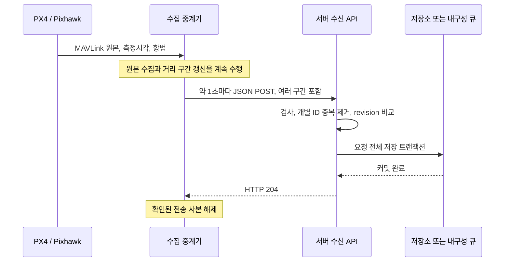

# 서버 수신 API — mavlink_telemetry_data_router 0.10.0

문서 기준: 2026-10-25, 송신 구현 0.10.0. 서버 개발자용 구현 계약이다. 앱 버전과 JSON의 `schema` 버전은 별개다. 이 문서는 현재 C 송신 코드와 대조했으며, 아직 선택되지 않은 운영 서버나 DB가 구현되어 있다고 가정하지 않는다.

함께 전달할 파일:

- [OpenAPI 3.1](api/openapi.json): HTTP 엔드포인트 계약.
- [JSON Schema 2020-12](api/ingestion.schema.json): 본문 구조 검증.
- [합성 예제와 검증 안내](api/README.md): 실제 관측을 포함하지 않는 요청 예제.
- [Git·OneDrive 공유 절차](COLLABORATION.md).
- [전체 기술 참조](REFERENCE.md), [검증 기록](REVIEW.md).

## 1. 서버 개발자가 먼저 구현할 것

1. 설정 가능한 URL에 JSON POST를 받는다. 기본 시험 주소는 `http://127.0.0.1:21000/ingest`다.
2. 최상위 `schema`에 따라 본문을 분기한다. 일반 운용은 온습도뿐 아니라 일반 key–value·혼합 묶음도 보낼 수 있다.
3. 요청 안의 **모든** 묶음을 검사하고, 개별 ID로 중복을 제거하며 저장한다.
4. 거리 구간은 같은 키의 **더 큰 revision으로 교체**한다. 이전 누적 값과 더하지 않는다.
5. 저장 또는 내구성 있는 수신 큐의 커밋이 완료되면 **HTTP 204**를 반환한다. 이미 저장한 중복도 204로 처리한다.

수집기는 204를 받은 요청의 미확인 자료를 RAM에서 해제한다. 따라서 운영 서버가 단순히 요청을 읽었다는 이유로 204를 반환하면 안 된다. 이 저장 계약은 최종 서버가 구현해야 한다. 현재 선택 시험 서버는 RAM 화면 출력용이다.



## 2. 통신 방식

| 항목 | 계약 |
|---|---|
| 방향 | 수집기 → 지정 서버. 서버는 MAVLink를 직접 해독할 필요가 없다 |
| 전송 | HTTP 또는 HTTPS POST over TCP. TCP 위에 별도 길이 헤더를 덧붙이는 사설 프로토콜은 없다 |
| URL | `url` 설정의 전체 URL. `/ingest`·21000은 시험 기본값이며 운영 주소·포트는 변경 가능 |
| 본문 | UTF-8 JSON 문서 하나. 전송 압축·gzip·CBOR·바이너리 압축을 구현하지 않았다 |
| 헤더 | `Content-Type: application/json`, HTTP 스택이 구성한 본문 길이 |
| 인증 | `token_env` 환경변수에 값이 있으면 `Authorization: Bearer <값>`. 값이 없으면 헤더를 보내지 않음 |
| 토큰 제약 | 최대1,024바이트, CR/LF 금지. 토큰 본문은 설정·Git·예제에 넣지 않는다 |
| HTTPS | OS WinHTTP/libcurl의 기본 서버 인증서 검증 사용. 전용 mTLS·인증서 핀·서명 헤더는 없다 |
| 응답 본문 | ACK JSON·확인 순번 필드 불필요. 송신기는 응답 본문을 처리하지 않음 |
| 리다이렉트 | 자동 추적하지 않음. 실제 최종 URL을 설정해야 함 |
| 요청 주기 | 기본 `send_interval_ms=1000`, 설정 범위1,000..60,000ms. 데이터가 없으면 요청하지 않음 |
| 요청 간격 | 이전 요청 시작 후 설정 간격 또는 이전 요청 완료 중 늦은 시점에 다음 시도. 처리시간에 네트워크 지연을 더한 정밀 1Hz 스케줄 보장은 아님 |
| 재시도 | 활성 수집 중 미확인 자료를 계속 재시도. 지수 backoff·`Retry-After` 해석은 없음 |
| 종료 시 | 입력 종료 상태에서 연속 실패 카운터가3이상이면 실패 종료 가능. RAM은 프로세스 종료/전원 단절 후 보존되지 않음 |

Windows는 WinHTTP 단계별 timeout, Linux는 connect timeout과 `connect+2×io` 총 HTTP timeout을 사용한다. 기본 connect/io는 각각1,000ms다. 토큰은 Windows에서 요청 시, Linux에서 HTTP 초기화 시 읽으므로 인증 설정 변경 후에는 수집기를 재시작하는 운용이 일관적이다. User-Agent를 인증·프로토콜 분기 키로 사용하지 않는다.

### 응답 코드

| 응답 | 송신기 동작 | 서버 사용 원칙 |
|---|---|---|
| **204 No Content** | 해당 요청에 들어 있던 모든 큐 항목 해제 | 전체 요청 커밋 또는 이미 커밋된 동일 자료 확인 후 반환 |
| 200·201·202 | 해제하지 않고 재시도 | 성공 응답으로 대체 사용하지 않음. 202 비동기 접수만으로 수집기 RAM을 해제할 수 없음 |
| 3xx | 보존·재시도, 자동 이동 없음 | 수집기에 최종 주소 설정 필요 |
| 400·401·403·409·413·422 | 보존·재시도 | 오류를 서버 로그에 식별 가능하게 남기고 설정/자료 불일치를 해결. 송신기는 영구 오류로 분류해 건너뛰지 않음 |
| 429·5xx·연결 실패·timeout | 보존·재시도 | 장애 복구 후 동일 자료를 다시 받을 수 있음 |

운영 응답 예:

```http
HTTP/1.1 204 No Content
Content-Length: 0

```

TCP ACK는 네트워크 전송 확인이며 위 저장 확인을 대신하지 않는다. 서버가 커밋했지만 응답이 유실된 경우에도 재전송이 발생하므로 중복 처리가 필수다.

## 3. 요청을 읽는 순서와 버전 분기

JSON 객체의 필드 순서는 의미가 없다. 단, 일반 관측의 `raw` 안쪽 배열은 `field_order`가 정한 고정 순서다. 새 객체 필드는 허용하고 계산에 필요한 알려진 필드를 사용한다. 미지원 schema·SI 사전 버전의 데이터를 조용히 버리고204로 답하지 않는다.

| 최상위 `schema` | 용도 | 서버 진입점 |
|---|---|---|
| `"mavlink_weather_v1"` | 온습도 원본·시간 요약·선택 거리 구간 | `records[]` |
| 숫자 `3` | 실제 MAVLink의 일반 key–value 관측 | `batches[]` |
| `"mavlink_router_bundle_v1"` | 온습도와 일반 관측이 함께 대기한 운용 요청 | `records[].kind`, `records[].payload` 안의 원래 envelope |
| `"mavlink_router_test_v1"` | 하트비트·좌표 시험 모드 | `records[]` |
| 숫자 `2` | CSV 개발용 재생 | `batches[]`; 운영 실시간 자료와 구분 |

혼합 요청에는 바깥 `stream`·`session`이 없다. 각 `payload`의 값을 사용한다.

```json
{
  "schema": "mavlink_router_bundle_v1",
  "records": [
    {"kind": "telemetry", "payload": {"schema": 3, "...": "아래 일반 envelope 전체"}},
    {"kind": "weather", "payload": {"schema": "mavlink_weather_v1", "...": "아래 온습도 envelope 전체"}}
  ]
}
```

위 코드는 분기 설명용 축약본이다. 그대로 POST할 유효 요청은 [api/](api/README.md)의 합성 `.json` 예제를 사용한다.

### 정수와 미상 값

`U64String`은 `0..18446744073709551615`를 표현하는 십진 문자열, `U32`는 `0..4294967295` 정수다. 문자열은 숫자 크기로 비교해야 한다. 예를 들어 문자열 정렬에서는 `"10" < "2"`가 되므로 revision 비교에 문자열 사전순을 사용하면 안 된다.

64비트 표현이 현재 구현에서 통일되어 있지 않다.

- boot/UTC 시각 문자열, 일반 `batch_id`, 누적 `loss`, 공간 ID/revision/counters: JSON **문자열**.
- 온습도 `records[].seq`, 하트비트 `seq`·`source_generation`·단조 시각/`boot_ms`: JSON **number**이며 내부 저장형은64비트일 수 있음.
- 일반·온습도 개별 표본 `seq`, 품질 비트·개수·대부분의 센서 ID: U32 JSON number.

JavaScript/TypeScript 서버는 일반 `JSON.parse`만으로 모든64비트 number를 정확히 보존한다고 가정하면 안 된다. 손실 없는 정수 파서나 원문 토큰에서 BigInt/십진 문자열로 보존하는 경로를 사용한다. DB의 signed64 `BIGINT`만으로 전체 U64 범위를 표현할 수 없으므로 숫자형20자리 또는 문자열 등 명시적 저장형을 선택한다.

JSON `null`은 미상/계산 불가다. 값0·좌표0·경과0은 유효할 수 있다. `NaN`·`Infinity` 문자열/리터럴을 보내지 않는다. 온습도 구조와 raw_clock_anchor의 미상 시각 오차는`null`이다. 일반 schema2/3 raw의 상대 시각 오차에는 별도 수락 범위가 있으므로 내부 U32 미상 sentinel을 그대로 보내는 필드라고 가정하지 않는다.

## 4. 온습도 envelope

`records[]` 원소의 필드:

| 필드 | 형식 | 의미 |
|---|---|---|
| `seq` | U64 JSON number | 봉인된 전송 레코드 ID. 개별 센서 표본 순번과 다름 |
| `generation` | U32 | 입력/부팅 세대 |
| `session` | string | 설정 이름+실행 난수+세대. 재실행 전후 동일 센서 자료를 구분 |
| `source.sysid`, `source.compid` | 정수 | MAVLink system/component 식별자 |
| `frame` | `"ENU"` | 위치·속도 성분 순서 East, North, Up |
| `origin_wgs84` | `[lat_deg,lon_deg,alt_msl_m]` 또는null | 세션별 지역 원점. 위경도는 WGS84, 실시간 고도는 MSL |
| `time_basis` | `"pixhawk_boot_us"` | 표본 시각은 해당 Pixhawk 부팅 시계 |
| `host_time_basis` | `"collector_monotonic_ms"` | 전송 묶음의 호스트 시계. UTC가 아님 |
| `clock_model` | 모델 객체 또는null | boot↔UTC 정렬 진단. 아래 시각 절 참고 |
| `weather` | 객체 | 원본과 이번 호스트 전송 구간의 시간 통계 |
| `spatial` | 선택 객체 | `spatial_enabled=1`일 때 거리 누적 통계. 내부 schema는 `mavlink_spatial_v1` |

바깥 envelope에는 `schema`, `stream`, `records`가 있다. 한 온습도 envelope의 현재 송신 레코드 수는1개지만 서버는 배열로 처리한다. 요청 전체가 혼합 envelope로 포장될 수도 있다.

### `weather`

| 필드 | 의미 |
|---|---|
| `si_registry=1` | 아래 두 물리량의 단위 사전 |
| `host_window_ms` | 수집기 단조 시각의 묶음 시작을 나타내는 U64String. 측정시각·UTC·거리 구간 ID가 아님 |
| `n`, `raw_n`, `raw_dropped` | 수락 관측 수·보존 원본 수·원본 한도 초과 수. `n=raw_n+raw_dropped` |
| `measurements.temperature[]` | 센서/프로토콜별 온도 그룹, 단위 K |
| `measurements.humidity[]` | 센서/프로토콜별 상대습도 그룹, 단위0..1 비율 |

센서가 아직 특정되지 않았어도 `sensor_id=0`은 정상적인 논리 ID다. `message_id=8009`는 공식 SENS_ATMOS, `12920`은 HYGROMETER_SENSOR다. 그룹 키는 `(metric,message_id,sensor_id,sensor_instance)`다. 서로 다른 메시지나 instance를 하나의 평균으로 섞지 않는다. 현재 공식 SENS_ATMOS에는 물리 센서 고유 ID가 없어 `(0,0)`은 수집기의 단일 논리 입력을 뜻한다.

각 센서 그룹:

| 필드 | 내용 |
|---|---|
| `message_id`, `sensor_id`, `sensor_instance` | 위 그룹 식별자 |
| `representative` | 실제 표본 하나. 아래 표본 객체와 동일 |
| `statistics` | `n,mean,variance,min,max,time_known_n,t_start_us,t_end_us` |
| `raw_n`, `raw_dropped` | 이 그룹의 원본 보존/누락 수 |
| `samples[]` | 보존한 실제 원본 표본 |

`variance`는 `n≥2`이면 표본분산이며, `n=1`이면null이다. `t_start_us`·`t_end_us`는 시각을 아는 표본만의 최소/최대 시각이고 그 수는 `time_known_n`이다. 모두 시각 미상이면 시각 범위도null이다. 통계 평균을 대표 표본의 좌표에서 직접 관측한 값으로 사용하지 않는다. `raw_dropped>0`이면 전체 통계와 보존 원본 일부를 구별해야 하며 원본만 재계산한 평균을 전체 평균과 같다고 요구하면 안 된다.

### 원본/대표 표본 객체

| 필드 | 형식·단위·해석 |
|---|---|
| `t_us` | U64String 또는null, 센서 관측의 Pixhawk boot µs |
| `seq` | U32, 수집기가 부여한 개별 표본 순번 |
| `value` | 온도 K 또는 상대습도 비율. %값으로 중복 변환하지 않음 |
| `position_m` | ENU `[east,north,up]` m 또는null |
| `velocity_mps` | ENU `[vE,vN,vU]` m/s 또는null. 배열 존재만으로 속도 유효성이 확정되지 않음 |
| `velocity_valid` | boolean, 해당 관측시각에 공간 경로 계산에 쓸 속도 유효성 근거가 있음 |
| `navigation_segment` | U32, 항법의 연속 구간. 0도 유효 ID이며 다른 구간을 이어 적분하지 않음 |
| `position_source` | `GPS`, `ESTGPS`, `UNKNOWN` |
| `estimation_age_us` | 마지막 유효 GPS 기준점 이후 경과 U32 µs 또는null. GPS 표본은0 |
| `measurement_variance` | 해당 단일 표본의 측정 분산, K² 또는비율². 미상이면null |
| `time_uncertainty_us` | 관측시각의 상대 오차 추정 U32 µs 또는null |
| `navigation_uncertainty_m` | 위치 항법 오차 지표 m 또는null |
| `position_uncertainty_m` | 알려진 항법 오차+속력×시각오차 기반 지표 m 또는null |
| `quality` | U32 비트마스크. 정수 크기를 정확도 순위로 정렬하지 않음 |

온습도 품질 비트는 아래와 같다. 여러 비트가 동시에 존재할 수 있다.

| 비트 | 의미 |
|---|---|
| `0x04000000` | 온습도 측정 위치 미상 |
| `0x08000000` | 온습도 측정시각 미상 |
| `0x10000000` | ESTGPS 추정 위치 |
| `0x20000000` | 해독기의 미인증 원천 시계 플래그. 시각 존재/UTC 정확도 보증과 별개 |
| `0x40000000` | 일반 해독기의 보수적 위치 품질/오차 미상 플래그. 그 자체를 `position_m=null`과 동치로 취급하지 않음 |

미래 비트를 보존한다. 위치와 시각의 존재 여부는 해당 필드와 온습도 전용 미상 비트를 확인한다. HYGROMETER_SENSOR는 관측시각이 없어 `t_us`·좌표가null일 수 있으며 서버 접수 시각이나 직전 위치로 채우면 안 된다. GPS는 GPS로 지지된 FC 융합 위치의 분류이며 원시 GPS 표본이라는 뜻은 아니다. ESTGPS 오차가null이면0으로 치환하지 않는다.

ENU 좌표를 위경도로 사용할 때 원점을 함께 보존한다. MSL 고도를 타원체 고도로 바꾸거나 ENU 벡터를 위도/경도 배열처럼 읽지 않는다. 동일 ENU 숫자라도 원점·세션이 다르면 같은 장소를 뜻하지 않는다.

## 5. 거리 구간 `spatial`

1초는 전송 주기이고 기본10m는 수평 경로 구간의 목표 폭이다. 진행 중 구간은 전송 때 초기화하지 않는다. 빠를수록 한 요청에 여러 구간이 담기고, 느릴수록 같은 구간의 표본 수가 증가한다. 단위와 원본은 앞 절과 같다.

| 필드 | 내용 |
|---|---|
| `schema` | `"mavlink_spatial_v1"` |
| `si_registry` | 1 |
| `target_step_m` | 목표 수평 구간 폭 m, 기본10 |
| `adaptive` | 실제 관측 간격에 따라 다음 구간 폭을 조정하는지 |
| `gap_us` | 경로를 잇는 관측 간격 정책, U64String µs |
| `path` | 최신 `known,path_id,bin_index,s_m,effective_width_m`. ID는 U64String |
| `counters` | 아래 누적 진단. 대부분 U64String, `flags`는 U32 |
| `bins[]` | 이번 전송의 완료/중단 구간과 새 표본으로 갱신된 진행 구간, 최대144레코드 |

`counters` 필드는 `samples_seen,spatial_samples,unknown_samples,rejected_samples,late_samples,paths_started,completed_records,dropped_records,undersampled_steps,inconsistent_steps,flags`다. 이는 최신 상태 진단이며 각 전송마다 더하는 값이 아니다. `path.known=false`일 때 `s_m=0` 또는 `effective_width_m=0`을 실측0m 해상도로 해석하지 않는다.

각 `bins[]` 원소:

| 필드 | 내용 |
|---|---|
| `continuity_key,path_id,bin_index,revision` | U64String 식별자/누적 개정 번호 |
| `metric` | 현재 `temperature` 또는 `humidity` |
| `message_id,sensor_id,sensor_instance,source_kind` | 그룹·출처 식별. source_kind는GPS/ESTGPS |
| `state` | `partial`: 진행 중, `complete`: 거리 경계 통과, `interrupted`: 연속성 단절 |
| `flags`, `quality` | 구간 진단 플래그와 관측 품질 비트마스크 |
| `width_m` | 이 구간의 명목 폭. 이미 열린 구간에서는 바뀌지 않음 |
| `interval_start_m,interval_end_m` | 경로상 명목 구간 범위 |
| `observed_start_m,observed_end_m` | 실제 표본이 차지하는 경로 범위. 명목 경계에 표본이 있다는 뜻이 아님 |
| `entry_step_m` | 해당 구간 진입 시 관측된 표본 간 이동거리 |
| `t_start_us,t_end_us` | 실제 포함 표본의 boot 시각 범위, U64String |
| `statistics` | `n,mean,m2,variance,min,max`; `variance=m2/(n−1)`, n1이면null |
| `representative` | 실제 포함 표본 하나의 전체 객체. 평균의 가상 관측이 아님 |

기본 경로는 검증된 수평속력을 사다리꼴 적분한다. 위경도 흔들림의 차분 길이를 그대로 더하지 않는다. 적응 폭은 `max(목표 폭, 관측된 표본 간 거리)`를 기준으로 다음 구간에서 조정한다. 폭 감소 확인·큐 포화 보호로 이 값보다 클 수 있다. 원본이 없는 빈 구간과 경계상의 가상 센서 값을 만들지 않는다. `width_m`이10m라고 실제 대표 표본 사이 거리가 항상10m이거나 센서의 물리 공간 해상도가10m인 것은 아니다.

### 공간 상태 플래그

| 값 | 이름 | 의미 |
|---|---|---|
| 1 | UNDERSAMPLED | 표본 간격이 목표 폭을 넘은 구간 존재 |
| 2 | MOTION_UNKNOWN | 위치·속도 일치성 근거 부족 |
| 4 | NAV_UNKNOWN | 항법 근거 미상 |
| 8 | VELOCITY_UNKNOWN | 유효 속도 미상 |
| 16 | TIME_GAP | 관측 간격 한도 초과 |
| 32 | CONTEXT_CHANGE | 부팅·입력·원점·항법 구간 등 연속성 변경 |
| 64 | SOURCE_CHANGE | GPS/ESTGPS 등 출처 변경 |
| 128 | OUT_OF_ORDER | 경로에 반영하지 않은 역순 표본 |
| 256 | RATE_LIMITED | 공간 완료 큐 용량 압력 |
| 512 | COUNT_OVERFLOW | 카운터/ID 표현 상한 |
| 1024 | CONFIG_CHANGE | 모듈 설정 변경 |
| 2048 | PATH_ESTIMATED | 속도 적분 기반 경로. source_kind의 GPS/ESTGPS와 별개 |

### 공간 구간 저장 키와 갱신

서버가 인증한 송신자/테넌트를 `principal`이라고 하면 권장 논리 키는 다음과 같다.

```text
principal, stream, session, source.sysid, source.compid,
continuity_key, path_id, bin_index,
metric, message_id, sensor_id, sensor_instance, source_kind
```

`principal`은 본문 필드가 아니라 인증/서버 설정에서 결정한다. `bin_index` 하나만으로 전 기체의 구간을 식별하지 않는다.

같은 키를 받으면:

```text
incoming revision > stored revision : 통계·대표값·state를 통째로 교체
incoming revision = stored revision : 동일 의미면 중복 처리
incoming revision < stored revision : 최신값을 유지하고 오래된 갱신은 무시
동일 revision인데 관측 내용이 충돌 : 정상 중복으로 덮어쓰지 말고 불일치 기록
```

예를 들어 같은 구간의 `partial n=10,rev=10` → `partial n=20,rev=20` → `complete n=20,rev=21`을 받으면 최종 표본 수는20이다. 합계50으로 만들면 안 된다. 큰 revision 판단은 원자적인 조건부 갱신/트랜잭션으로 구현해 동시 요청의 순서 역전에도 최신값을 유지한다.

온습도 시간 통계와 공간 통계는 같은 관측을 다른 기준으로 집계한 것이다. 둘의 n을 서로 더하면 중복이다. 서로 다른 완료 공간 구간을 합칠 때도 단순 평균들의 평균을 사용하지 않는다. n가중 평균과 M2 병합식이 필요하다.

```text
n = nA + nB
delta = meanB - meanA
mean = meanA + delta*nB/n
M2 = M2A + M2B + delta²*nA*nB/n
```

이 식은 겹치지 않는 자료를 합칠 때만 사용한다. 같은 구간의 여러 revision은 병합 대상이 아니다. 느린 이동으로 표본 수가 늘어도 센서 응답·자기상관 때문에 독립 관측 수나 정확도가 자동으로 개선됐다고 환산하지 않는다.

## 6. 일반 key–value `schema:3`

일반 운용에서 미세먼지 등 새로운 키가 생길 수 있으므로 정해진 온습도 필드만 가정하는 서버로 만들면 안 된다. 현재 해독/단위 설정이 제공하는 키·단위를 그대로 보존하고, 물리량 사전을 별도로 운영한다. 알 수 없는 MAVLink 메시지를 자동으로 임의 key–value로 변환하는 기능까지 제공한다는 뜻은 아니다.

| envelope 필드 | 내용 |
|---|---|
| `schema=3`, `stream`, `session` | 실시간 일반 관측 분류 |
| `frame,origin_wgs84` | ENU 지역 원점. 실시간 고도는 MSL |
| `source` | `sysid,compid,epoch,altitude_datum:"MSL"` |
| `time_basis,time_epoch,utc_basis` | `pixhawk_boot_us`,`session_boot`,`unix_us_estimate` |
| `field_order` | 아래17개 표본 배열 열 이름 |
| `loss` | `rejected,sequence_gaps,queue_windows,queue_samples,raw_samples`, 누적 U64String |
| `clock_model` | 모델 또는null |
| `raw_clock_anchor` | 선택 원시 boot/UTC 정렬점. `boot_us,utc_us` 문자열·`uncert_us` 정수/null |
| `batches[]` | 개별 중복 처리 단위 |

각 batch는 `batch_id`(U64String), 봉인 시점의 `clock_model`, 선택 `raw_clock_anchor`, `window_us`(U64String), `n,raw_n,raw_dropped,key_n,raw_included`, `stats[]`, `raw[]`를 갖는다. 같은 측정시각 창을 지연 도착/송신 마감으로 여러 batch가 나눠 가질 수 있으므로 **`window_us`만으로 중복 제거하면 안 된다**.

`stats[]`는 키/단위마다 `key,unit,n,mean,variance,min,max,time_uncert_mean_us,time_uncert_max_us,position_error_n,position_error_mean_m,position_error_max_m`다. 이 경로의 n은 해당 통계에 들어간 유한 관측 수이며 batch의 n과 다를 수 있다. `value=null`은batch.n/raw에는 포함되지만stats.n에서는 제외된다. n0이면 평균·분산·min/max·시각오차 통계가null이다. `position_error_n=0`이면 위치오차 평균/최대도null이다. M2를 직접 보내지는 않으며 필요한 경우 n와 표본분산으로 계산한다.

`raw[]` 원소는 다음17열 배열이다.

| 위치 | 이름 | 형식 |
|---|---|---|
| 0 | `t_us` | boot µs U64String |
| 1 | `seq` | U32 |
| 2 | `quality` | U32 |
| 3 | `key` | ASCII 키 |
| 4 | `unit` | 단위 문자열 |
| 5..7 | `east_m,north_m,up_m` | ENU m |
| 8..10 | `ve_mps,vn_mps,vu_mps` | ENU m/s |
| 11 | `value` | number 또는null |
| 12 | `time_uncert_us` | 기본 빌드에서0..20,000µs만 수락. 미상 UINT32_MAX를 보내는 필드가 아님 |
| 13 | `nav_age_us` | 기본 빌드에서0..200,000µs만 수락 |
| 14 | `pos_error_m` | number 또는null |
| 15 | `utc_us` | UNIX UTC µs U64String 또는null |
| 16 | `utc_uncert_us` | U32 µs 또는null |

키는 최대31자, 단위는 최대15자다. 현재 NAMED_VALUE_* wire 이름 자체는 최대10바이트다. **이 경로는 전체 SI 통일이 아니다.** 내부 압력 hPa·온도 degC 등이 들어올 수 있다. `unit_map`은 표시 단위를 지정할 뿐 원본 값을 SI로 바꾸지 않는다. 서버가 변환한다면 원본 값/단위를 보존한 뒤 별도 정규화 값으로 관리한다.

`summary=1`이면 일반 raw 배열을 비우고 `raw_included=false`로 통계만 보낼 수 있다. 이때 `raw_n`은 수집기 내부 보존 개수이며 전송된 `raw[]` 길이와 다를 수 있다. 온습도 원본에는 이 설정을 적용하지 않는다.

## 7. 하트비트 시험·CSV 재생

`mavlink_router_test_v1`은 `stream,records[]`이며 각 record는 `seq,source_generation,session,source,heartbeat,position,coordinate_age_ms`를 갖는다. `source`는 연결 주소 문자열이다. heartbeat는 `sysid,compid,type,autopilot,base_mode,custom_mode,system_status,received_monotonic_ms`다. `position`은 `lat_deg,lon_deg,alt_msl_m,boot_ms,received_monotonic_ms` 또는null이다. 좌표가null이면 `coordinate_age_ms`도null이다.

이는 특정 하트비트가 생성된 위치의 동시 관측이 아니라 최신 수락 항법의 스냅샷이다. 이 시험 형식은 별도 GPS/ESTGPS 출처 필드를 보내지 않으므로 원시 GPS 또는 검증 GPS라는 추가 의미를 부여하지 않는다. 기기 종류는 heartbeat enum으로 식별하고 component 숫자만으로 추측하지 않는다.

숫자 `schema:2`는 CSV 개발 재생용이다. 일반 배열17열·기본 통계 구조는 같지만 실시간 `source`, `batch_id`와 실행 세대 계약이 없다. 이 모드의 batch는 `window_us`로 구분한다. 운영 수집과 다른 스트림으로 분리하고 원점/고도 의미는 해당 CSV 공급 계약을 확인한다.

## 8. 시각과 UTC

- `t_us`는 **관측시각**이며 센서/FC의 boot clock이다. 서버 수신시각과 바꾸지 않는다.
- `host_window_ms`와 `received_monotonic_ms`는 수집기/연결 진단 시계이며 다른 PC의 시계나 UTC와 직접 비교하지 않는다.
- `clock_model=null`이면 시각을 Unix epoch로 간주하거나 값의 자릿수만 보고 UTC로 추정하지 않는다.
- 재부팅/세대 전환 전후의 동일 boot 숫자는 다른 시각이다. 세션·source와 함께 저장한다.
- 서버는 자기 수신 UTC를 별도 열로 추가할 수 있지만 관측 UTC로 덮어쓰지 않는다.

`clock_model` 필드는 다음과 같다.

| 필드 | 의미 |
|---|---|
| `anchors` | 사용한 정렬점 수, 최신 최대16개 |
| `oldest_boot_us,last_boot_us,last_utc_us` | U64String, 정렬점 범위와 마지막 원시 UTC |
| `offset_us` | signed 십진 문자열, 마지막 boot에서 평가한 반올림 UTC−boot |
| `drift_ppm` | 중심화 OLS 기울기의 ppm |
| `residual_std_us,max_residual_us` | 잔차 진단 |
| `anchor_uncert_max_us` | 제공된 anchor 오차 중 최대 U32 µs |
| `rtt_mean_us,rtt_max_us` | 정렬 통신 왕복 지연 진단 |

온습도 표본은 개별 UTC를 내보내지 않는다. 서버가 UTC를 별도로 추정한다면 모델 사용 여부·가정·오차를 함께 보존해야 한다. 내부 모델은 ±500ppm 필터와 마지막 anchor 뒤10초 외삽 한도를 사용한다. 적은 anchor에서 residual_std가0인 것은 시계 오차0이나 정확도 인증을 뜻하지 않는다. 단순히 마지막 raw UTC에 boot 차이를 더하거나 offset만 더해 확정 UTC로 저장하지 않는다.

## 9. 서버의 저장·중복 처리 절차

권장 개별 수신 키:

| 종류 | 요청 내부에서 찾을 키 |
|---|---|
| 온습도 | `(principal,stream,session,source,kind="weather",record.seq)` |
| 일반 실시간 | `(principal,stream,session,source,kind="telemetry",batch.batch_id)` |
| 하트비트 시험 | `(principal,stream,session,kind="test",record.seq)` |
| CSV 재생 | `(principal,stream,session,kind="csv",batch.window_us)` |
| 혼합 | 바깥 bundle 자체의 ID는 없음. 내부 payload의 위 키들을 사용 |

`source`는 sysid/compid 및 제공된 세대를 포함해 일관되게 정규화한다. 여러 기체/사용자가 같은 stream 이름을 정할 수 있으므로 인증된 principal 또는 서버가 정한 수신자 범위를 키 앞에 둔다. seq와 일반 batch_id는 공유 카운터일 수 있어 번호가 연속하지 않아도 곧바로 데이터 손실로 계산하지 않는다.

언어/DB와 무관한 수신 절차:

```text
POST(request):
    principal = authenticate_or_resolve_configured_source(request)
    envelope = parse_json_without_losing_64_bit_integers(request.body)
    items = validate_and_flatten_all_supported_envelopes(envelope)
    BEGIN TRANSACTION
        for item in items:
            key = stable_item_key(principal, item)
            if key already committed:
                verify same immutable observations; do not append them again
                continue
            insert receipt key and original observation payload
            for bin in item.spatial.bins:
                conditionally replace if incoming revision > stored revision
                verify equal-revision conflicts; keep newer stored revisions
        COMMIT
    return HTTP 204 with empty body
```

수신 원장, 원본 표본, 전송 시간 요약, 거리 구간 최신값, 모델/원점은 구분해 저장하면 된다. DB 종류는 아직 정하지 않았다. 원본 표본을 별도 테이블로 분해하면 부모 수신 ID와 표본 그룹/seq를 고유 키에 포함해 재전송 삽입을 막는다. 원장 키의 삽입과 공간 revision 갱신을 같은 커밋 경계에 두어 재시도 때 일부 처리만 누락되지 않게 한다.

**불변 범위는 개별 봉인 묶음이다. 전체 HTTP body의 바이트 불변은 보장하지 않는다.** 재시도 사이에 뒤 묶음이 추가되거나 weather/telemetry가 bundle로 다시 포장될 수 있고 누적 loss가 갱신될 수 있다. 전체 body 해시를 유일 중복 키로 삼지 않는다. 동일 개별 ID의 검증에는 관측·원점·봉인된 시계 등 해당 자료의 의미를 비교하고 객체 키 순서·바깥 포장·누적 loss 차이를 데이터 충돌로 오인하지 않는다.

동일 요청 안에서 일부만 커밋했다면204를 반환하면 안 된다. 모두 롤백하거나, 이미 커밋된 개별 ID를 원장에 남겨 전체 재시도에서 안전하게 이어받을 수 있어야 한다. 이 송신기에는 개별 항목 ACK/부분 성공 응답 규격이 없다.

## 10. 크기·부하·손실 처리

현재 기본 빌드:

| 상한 | 값 |
|---|---|
| 송신 본문 버퍼 | 1,110,016B, NUL 제외 본문 최대1,110,015B |
| 미확인 공용 큐 | 8조각. 지연1초마다8초를 항상 보존한다는 뜻은 아님 |
| 기본 요청 선택 | 최대4조각. 혼합 동시 대기 시 max_windows1도2조각 선택 가능 |
| 일반 배치 | 원본512개·키16개 |
| 온습도 호스트 배치 | 원본128개·그룹16개 |
| 공간 상태 | 진행16그룹·완료128레코드·전송 사본144레코드 |

운영 endpoint/리버스 프록시의 본문 허용량은 위 송신 상한보다 크게, 예를 들어2MiB로 정하고 실제 제한을 문서화한다. 큐가 포화하면 신규 배치를 버릴 수 있고 원본 상한 초과도 손실 계수로 보인다. RAM만 쓰므로 장시간 서버 장애의 무손실·재기동 후 재전송을 보장하지 않는다.

서버 JSON 구조 검사는 O(본문 바이트+토큰 수), 개별 수신/구간 키 조회는 적절한 고유 인덱스가 있을 때 자료 수에 비례하도록 설계한다. 매 요청마다 전체 관측 테이블을 다시 스캔하지 않는다. 입력량은 수집기당 기본 약1요청/s이나 한 요청에 여러 센서 원본과 구간이 들어간다. 작업 큐를 둔다면 메모리 큐에 놓기만 한 상태와 내구성 커밋을 구분한다. 별도 비동기 처리 결과를 기다리지 않으려면 내구성 수신 원장/큐의 커밋을204의 완료 경계로 삼고 후속 처리는 그 원장에서 재개한다.

서버 진단으로는 접수/중복/충돌/거부 수, 저장 지연, 본문 크기, 원본 누락, 공간 dropped/undersampled, 시계 미상, ESTGPS 비율과 revision 역전 수를 권한다. 인증 토큰을 로그·저장 본문에 복제하지 않는다. 서버 수신 UTC와 원본 관측 boot 시각은 구분해 기록한다.

## 11. 시험 서버와 운영 서버의 차이

선택 도구 `build/<OS>/tools/mavlink_telemetry_data_router_test_server`는 실제 C HTTP 수신과 RAM TUI 로그를 확인하기 위한 것이다.

- `POST /ingest`, 기본 TCP21000. `--plain`은 합격한 JSON 레코드를 표준출력으로 내보낸다.
- 현재 온습도/공간 형식과 하트비트 시험만 수락한다. 일반 schema3·혼합 bundle·CSV2를 받는 전체 운영 서버는 아니다.
- 인증·수신 원장·중복 제거·DB·영속 큐는 구현하지 않았다. 이 도구의204는 검사/출력 성공이며 재기동 후 보존을 뜻하지 않는다.
- 헤더8,192B·본문524,288B·JSON32,768토큰·깊이32·레코드64, 연결당 총5초 상한이다. 이 본문 상한은 수집기의 최대 송신 상한보다 작다.
- Content-Length를 요구하고 chunked Transfer-Encoding·중복 Content-Length를 거부한다. HTTP/1.0/1.1과 Expect:100-continue를 처리한다.
- 전체를 먼저 검사하지만 출력 도중 실패하면 앞 레코드가 이미 출력된 채500이 될 수 있다. 영속 저장 트랜잭션 원자성의 예제가 아니다.

시험 서버 사용 시에는 수집기에 `--test-weather`를 선택한다. 이 옵션만 주면 URL이 기본21000으로 바뀌므로 다른 endpoint를 시험할 때는 **`--server-url`을 함께 지정**한다.

```powershell
.\build\windows-x64\tools\mavlink_telemetry_data_router_test_server.exe --bind 127.0.0.1 --port 21000
.\build\windows-x64\mavlink_telemetry_data_router_interactive.exe --config .\telemetry.ini --test-weather --server-url http://127.0.0.1:21000/ingest
```

현재 이미 실행 중인 실물 수집기/서버와 별도의 합성 시험은 다른 임시 포트에서 수행한다. 합성 `.json` 파일은 실제 관측을 담지 않는다.

예를 들어 별도 시험 서버를21001로 실행한 뒤, 저장소 루트의 다른 PowerShell에서 다음처럼 합성 요청을 확인할 수 있다. 예제의 `--port 21001` 서버와 짝을 이루며 현재21000 실물 로그와 분리한다.

```powershell
.\build\windows-x64\tools\mavlink_telemetry_data_router_test_server.exe --bind 127.0.0.1 --port 21001
```

```powershell
curl.exe --silent --show-error --include --header 'Content-Type: application/json' --data-binary '@docs/api/examples/synthetic-weather-gps-spatial.json' http://127.0.0.1:21001/ingest
```

기대 결과는204와 빈 응답 본문이다. Linux에서는 실행 파일의`.exe`를 빼고`curl`을 사용한다. 혼합 bundle 예제는 전체 운영 endpoint를 시험할 때 사용하며 선택 C 시험 서버에서는400이 정상이다.

## 12. 서버 인수 검사

| 검사 | 기대 결과 |
|---|---|
| 정상 온습도·공간·일반·혼합 요청 | 전체 커밋 후204 |
| 동일 개별 ID 재전송 | 원본 중복0,204 |
| 서버 커밋 후 ACK 유실·재시도 | 중복 원장으로 재삽입 방지 |
| 재시도에 새 항목 추가/포장 변경 | 기존 ID는 중복, 새 ID만 저장 |
| partial10→partial20→complete20 | 최종 n20, 마지막 state complete |
| revision 순서 역전·동시 요청 | 큰 revision 유지 |
| 동일 revision의 다른 원본 | 충돌 식별, 최신 통계를 임의 덮어쓰지 않음 |
| 새 키·추가 필드 | 호환 처리, 원본 의미/단위 보존 |
| null/0, n1분산, 64비트 경계값 | 미상과0 구분, 정수 정밀도 유지 |
| 위치·UTC 미상, ESTGPS | 가짜 GPS/UTC 생성 없음 |
| raw_dropped>0·큐 손실 | 부분 원본과 전체 통계를 구분 |
| 인증 실패·본문 과대·저장 실패 | 204 금지, 서버 오류 식별 가능 |
| 서버 재기동 | 커밋된 수신 원장·최신 구간 보존 |

JSON Schema 통과만으로 평균/분산 정확성, 교차 필드 집계, 중복 방지, DB 원자성과 실제 기상 정확도가 검증되는 것은 아니다. 구조 검증에 더해 위 의미/상태 전이 검사를 수행한다. 특히 표본 수·분산은 관측 통계이며 교정 정확도나 독립 표본 수와 구분한다.

## 13. 구현 근거

| 코드 | 소유 계약 |
|---|---|
| `src/sender.c`: `http_post`, `sender`, `seal*`, `encode*` | HTTP204·재시도·큐·각 envelope·봉인 메타데이터 |
| `src/weather.c`: `sample_json`, `weather_batch_json` | 온습도 원본/대표값/시간 통계 |
| `src/spatial.c`: `sp_add`, `sp_take_snapshot`, `sp_batch_json` | 거리 구간과 누적 revision |
| `src/telemetry.c`: `tb_batch_json_mode` | 일반 배열17열·통계 |
| `src/time_sync.c`, `src/time_sync.h` | boot/UTC 정렬 모델·가정 |
| `src/test_server.c`: `validate_body`, `weather_body_record`, `spatial_record` | 선택 시험 서버의 실제 수락 범위 |
| `src/tests/test_spatial_router.py` | 합성 속도별 구간·독립 통계·재시도/서버 검사 |

현재 0.10.0의 실제 시험 범위는 [REVIEW](REVIEW.md)에 있다. 운영 서버 연동·서버 영속 복구는 서버 구현 후 인수 검사할 항목이다.
