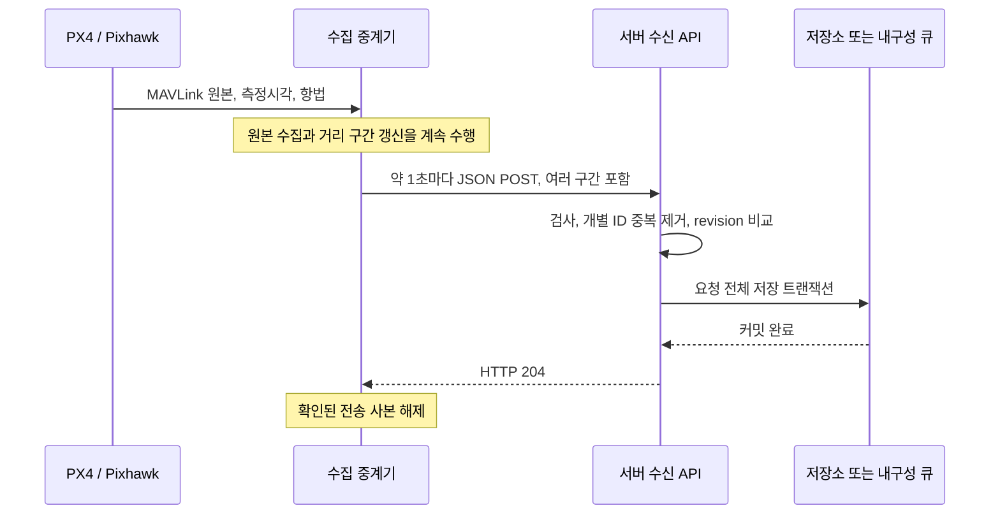

# 서버 수신 API — mavlink_telemetry_data_router 0.10.0

이 문서는 수집 중계기 0.10.0이 보내는 데이터를 서버에서 받아 저장하는 방법을 설명합니다. 2026-10-25의 C 송신 코드를 기준으로 작성했으며, 프로그램 버전과 JSON의 `schema` 버전은 별개입니다. 운영 서버와 데이터베이스는 아직 정하지 않았으므로, 여기서 설명하는 저장·중복 처리 기능은 서버 개발자가 구현해야 합니다.

서버를 구현할 때는 다음 파일을 함께 참고하세요.

- [OpenAPI 3.1](api/openapi.json): HTTP 엔드포인트 계약.
- [JSON Schema 2020-12](api/ingestion.schema.json): 본문 구조 검증.
- [합성 예제와 검증 안내](api/README.md): 실제 관측을 포함하지 않는 요청 예제.
- [Git·OneDrive 공유 절차](COLLABORATION.md).
- [전체 기술 참조](REFERENCE.md), [검증 기록](REVIEW.md).

## 1. 서버에서 구현할 처리 흐름

1. 수집기에 설정한 URL에서 JSON POST 요청을 받습니다. 기본 시험 주소는 `http://127.0.0.1:21000/ingest`입니다.
2. 최상위 `schema`를 확인해 데이터 형식에 맞는 처리 경로로 보냅니다. 온습도 외에도 일반 키-값 관측이나 두 형식을 함께 담은 요청이 들어올 수 있습니다.
3. 요청에 담긴 **모든** 묶음을 검사하고, 개별 ID를 기준으로 중복을 제거해 저장합니다.
4. 같은 거리 구간을 다시 받으면 **더 큰 `revision`의 내용으로 교체**합니다. 이전 누적 값에 새 누적 값을 더하지 않습니다.
5. 저장 트랜잭션이나 장애 후에도 복구할 수 있는 수신 큐의 커밋이 끝나면 **HTTP 204**를 반환합니다. 이미 저장한 자료를 다시 받은 경우에도 204를 반환합니다.

수집기는 204를 받으면 해당 요청에 담았던 자료를 RAM에서 지웁니다. 따라서 운영 서버는 요청을 읽기만 한 상태에서 204를 반환하면 안 됩니다. 아래에서 소개하는 시험 서버는 RAM의 데이터를 화면에 출력하는 도구이며, 운영용 저장 기능은 제공하지 않습니다.



## 2. 통신 방식

| 항목 | 계약 |
|---|---|
| 방향 | 수집기 → 지정 서버. 서버가 MAVLink를 직접 해독할 필요는 없음 |
| 전송 | TCP 기반의 HTTP 또는 HTTPS POST. 별도의 사설 길이 헤더는 사용하지 않음 |
| URL | `url` 설정의 전체 URL. `/ingest`·21000은 시험 기본값이며 운영 주소·포트는 변경 가능 |
| 본문 | UTF-8 JSON 문서 하나. gzip·CBOR 등의 압축·바이너리 전송은 지원하지 않음 |
| 헤더 | `Content-Type: application/json`, HTTP 스택이 구성한 본문 길이 |
| 인증 | `token_env` 환경변수에 값이 있으면 `Authorization: Bearer <값>`. 값이 없으면 헤더를 보내지 않음 |
| 토큰 제약 | 최대 1,024바이트이며 CR/LF는 금지. 토큰 값은 설정 파일·Git·예제에 넣지 않음 |
| HTTPS | OS의 WinHTTP 또는 libcurl이 제공하는 기본 서버 인증서 검증 사용. 별도 mTLS·인증서 고정·서명 헤더는 없음 |
| 응답 본문 | 수신 확인용 JSON이나 순번 필드는 불필요. 송신기는 응답 본문을 처리하지 않음 |
| 리다이렉트 | 자동 추적하지 않음. 실제 최종 URL을 설정해야 함 |
| 요청 주기 | 기본 `send_interval_ms=1000`, 설정 범위 1,000..60,000ms. 보낼 데이터가 없으면 요청하지 않음 |
| 요청 간격 | 이전 요청의 시작 시각에 설정 간격을 더한 시점과 이전 요청의 완료 시점 중 늦은 쪽에서 다음 전송을 시도. 네트워크 지연과 처리 시간에 따라 정확한 1Hz 전송은 보장하지 않음 |
| 재시도 | 수집 중에는 수신 확인을 받지 못한 자료를 계속 재시도. 지수 백오프와 `Retry-After` 해석은 지원하지 않음 |
| 종료 시 | 입력이 끝난 상태에서 연속 실패 횟수가 3 이상이면 실패로 종료할 수 있음. 프로세스 종료나 전원 단절 시 RAM의 자료는 사라짐 |

Windows에서는 WinHTTP의 단계별 시간 제한을 사용합니다. Linux에서는 연결 시간 제한과 `connect+2×io`로 계산한 전체 HTTP 시간 제한을 사용하며, `connect`와 `io`의 기본값은 각각 1,000ms입니다. 인증 토큰은 Windows에서는 요청할 때, Linux에서는 HTTP를 초기화할 때 읽습니다. 두 OS에서 같은 방식으로 설정을 적용하려면 토큰을 바꾼 뒤 수집기를 재시작하세요. 서버는 User-Agent를 인증 수단이나 프로토콜을 구분하는 기준으로 사용하지 않아야 합니다.

### 응답 코드

| 응답 | 송신기 동작 | 서버 사용 원칙 |
|---|---|---|
| **204 No Content** | 해당 요청에 들어 있던 모든 큐 항목 해제 | 전체 요청 커밋 또는 이미 커밋된 동일 자료 확인 후 반환 |
| 200·201·202 | 해제하지 않고 재시도 | 성공 응답으로 대체 사용하지 않음. 202 비동기 접수만으로 수집기 RAM을 해제할 수 없음 |
| 3xx | 보존·재시도, 자동 이동 없음 | 수집기에 최종 주소 설정 필요 |
| 400·401·403·409·413·422 | 보존·재시도 | 원인을 서버 로그에 남기고 설정이나 자료의 불일치를 해결해야 함. 송신기는 영구 오류로 분류해 해당 자료를 건너뛰지 않음 |
| 429·5xx·연결 실패·timeout | 보존·재시도 | 장애 복구 후 동일 자료를 다시 받을 수 있음 |

저장이 끝났을 때의 응답 예시는 다음과 같습니다.

```http
HTTP/1.1 204 No Content
Content-Length: 0

```

TCP ACK는 네트워크 전송을 확인할 뿐, 서버가 자료를 저장했다는 뜻은 아닙니다. 서버가 저장을 마친 뒤 HTTP 응답이 유실되면 수집기는 같은 자료를 다시 보냅니다. 따라서 서버에는 중복을 안전하게 처리하는 기능이 필요합니다.

## 3. 요청을 읽는 순서와 버전 분기

JSON 객체의 필드 순서는 처리 결과에 영향을 주지 않습니다. 다만 일반 관측의 `raw` 배열 안에서는 `field_order`가 정한 열 순서를 따라야 합니다. 호환성을 위해 새 객체 필드는 허용하되, 계산에는 의미를 아는 필드만 사용하세요. 지원하지 않는 `schema`나 SI 단위 사전 버전을 받았을 때는 자료를 버리고 204를 반환해서는 안 됩니다.

| 최상위 `schema` | 용도 | 서버 진입점 |
|---|---|---|
| `"mavlink_weather_v1"` | 온습도 원본·시간 요약·선택 거리 구간 | `records[]` |
| 숫자 `3` | 실제 MAVLink에서 수집한 일반 키-값 관측 | `batches[]` |
| `"mavlink_router_bundle_v1"` | 온습도와 일반 관측이 함께 대기한 운용 요청 | `records[].kind`와 `records[].payload` 안에 담긴 원래 요청 객체 |
| `"mavlink_router_test_v1"` | 하트비트·좌표 시험 모드 | `records[]` |
| 숫자 `2` | CSV 개발용 재생 | `batches[]`; 운영 실시간 자료와 구분 |

혼합 요청의 바깥 객체에는 `stream`과 `session`이 없습니다. 각각의 `payload`에 담긴 값을 사용하세요.

```json
{
  "schema": "mavlink_router_bundle_v1",
  "records": [
    {"kind": "telemetry", "payload": {"schema": 3, "...": "아래 일반 envelope 전체"}},
    {"kind": "weather", "payload": {"schema": "mavlink_weather_v1", "...": "아래 온습도 envelope 전체"}}
  ]
}
```

위 코드는 형식을 설명하기 위해 줄인 예시입니다. 실제로 POST할 때는 [api/](api/README.md)의 합성 `.json` 예제를 사용하세요.

### 정수와 미상 값

`U64String`은 `0..18446744073709551615` 범위의 정수를 십진 문자열로 표현한 것입니다. `U32`는 `0..4294967295` 범위의 정수입니다. `U64String`을 비교할 때는 문자열 순서가 아니라 숫자 크기를 사용해야 합니다. 예를 들어 문자열 정렬에서는 `"10" < "2"`가 되므로 `revision`을 잘못 판단할 수 있습니다.

현재 구현은 다음과 같이 64비트 정수를 문자열과 JSON 숫자로 나누어 표현합니다.

- 부팅 기준·UTC 시각, 일반 `batch_id`, 누적 `loss`, 공간 ID·`revision`·누적 카운터: JSON **문자열**.
- 온습도 `records[].seq`, 하트비트의 `seq`·`source_generation`·단조 시각·`boot_ms`: JSON **number**이며 내부 저장형은 64비트일 수 있습니다.
- 일반·온습도 개별 표본의 `seq`, 품질 비트·개수·대부분의 센서 ID: U32 범위의 JSON number.

JavaScript/TypeScript 서버에서 일반 `JSON.parse`만 사용하면 일부 64비트 숫자의 정밀도가 손실될 수 있습니다. 손실 없는 정수 파서를 사용하거나, JSON 원문의 숫자 토큰을 BigInt 또는 십진 문자열로 보존하세요. 데이터베이스의 부호 있는 64비트 `BIGINT`도 U64 전체 범위를 담지 못하므로, 20자리 숫자형이나 문자열 등 범위를 보존할 수 있는 저장형을 명시해야 합니다.

JSON의 `null`은 값을 모르거나 계산할 수 없다는 뜻입니다. 값·좌표·경과 시간이 0인 경우와 구별해야 합니다. 송신기는 `NaN`이나 `Infinity`를 문자열 또는 리터럴로 보내지 않습니다. 온습도 구조와 `raw_clock_anchor`에서는 알 수 없는 시각 오차를 `null`로 보냅니다. 반면 일반 `schema:2`와 `schema:3`의 원본 상대 시각 오차에는 별도의 허용 범위가 있습니다. 이 필드가 내부 U32의 미상 표시값을 그대로 보내는 것으로 해석해서는 안 됩니다.

## 4. 온습도 요청 객체

`records[]`의 각 원소는 다음 필드를 가집니다.

| 필드 | 형식 | 의미 |
|---|---|---|
| `seq` | U64 JSON number | 내용이 확정된 전송 레코드의 ID. 개별 센서 표본 순번과는 다름 |
| `generation` | U32 | 입력/부팅 세대 |
| `session` | string | 설정 이름·실행 난수·세대를 조합한 값. 프로그램을 다시 실행했을 때 같은 센서의 이전 자료와 구분 |
| `source.sysid`, `source.compid` | 정수 | MAVLink system/component 식별자 |
| `frame` | `"ENU"` | 위치·속도 성분 순서 East, North, Up |
| `origin_wgs84` | `[lat_deg,lon_deg,alt_msl_m]` 또는 null | 세션별 지역 원점. 위경도는 WGS84, 실시간 고도는 MSL |
| `time_basis` | `"pixhawk_boot_us"` | 표본 시각은 해당 Pixhawk 부팅 시계 |
| `host_time_basis` | `"collector_monotonic_ms"` | 전송 묶음의 호스트 시계. UTC가 아님 |
| `clock_model` | 모델 객체 또는 null | boot↔UTC 정렬 진단. 아래 시각 절 참고 |
| `weather` | 객체 | 원본과 이번 호스트 전송 구간의 시간 통계 |
| `spatial` | 선택 객체 | `spatial_enabled=1`일 때 거리 누적 통계. 내부 schema는 `mavlink_spatial_v1` |

바깥 요청 객체에는 `schema`, `stream`, `records`가 있습니다. 현재 송신기는 온습도 요청 하나에 레코드 1개를 담지만, 서버는 `records`를 배열로 처리해야 합니다. 이 온습도 요청 객체가 혼합 요청의 `payload` 안에 담겨 올 수도 있습니다.

### `weather`

| 필드 | 의미 |
|---|---|
| `si_registry=1` | 아래 두 물리량의 단위 사전 |
| `host_window_ms` | 수집기 단조 시각의 묶음 시작을 나타내는 U64String. 측정시각·UTC·거리 구간 ID가 아님 |
| `n`, `raw_n`, `raw_dropped` | 수락 관측 수·보존 원본 수·원본 한도 초과 수. `n=raw_n+raw_dropped` |
| `measurements.temperature[]` | 센서/프로토콜별 온도 그룹, 단위 K |
| `measurements.humidity[]` | 센서/프로토콜별 상대습도 그룹, 단위 0..1 비율 |

실제 센서가 아직 특정되지 않았더라도 `sensor_id=0`은 유효한 논리 ID입니다. `message_id=8009`는 공식 SENS_ATMOS, `12920`은 HYGROMETER_SENSOR를 뜻합니다. 관측 그룹은 `(metric,message_id,sensor_id,sensor_instance)`로 구분하므로 서로 다른 메시지나 센서 인스턴스를 하나의 평균으로 섞지 마세요. 공식 SENS_ATMOS에는 물리 센서의 고유 ID가 없기 때문에 `(0,0)`은 수집기에서 다루는 단일 논리 입력을 나타냅니다.

각 센서 그룹에는 다음 필드가 있습니다.

| 필드 | 내용 |
|---|---|
| `message_id`, `sensor_id`, `sensor_instance` | 위 그룹 식별자 |
| `representative` | 실제 표본 하나. 아래 표본 객체와 동일 |
| `statistics` | `n,mean,variance,min,max,time_known_n,t_start_us,t_end_us` |
| `raw_n`, `raw_dropped` | 이 그룹의 원본 보존/누락 수 |
| `samples[]` | 보존한 실제 원본 표본 |

`variance`는 `n≥2`일 때의 표본분산이며, `n=1`이면 `null`입니다. `t_start_us`와 `t_end_us`는 측정시각을 아는 표본들의 최소·최대 시각이고, `time_known_n`은 그 표본 수입니다. 모든 표본의 시각이 미상이면 시각 범위도 `null`입니다.

통계 평균은 여러 표본을 집계한 값이므로 대표 표본의 좌표에서 직접 측정한 값으로 취급하면 안 됩니다. `raw_dropped>0`이면 원본 일부가 빠졌더라도 통계에는 포함될 수 있습니다. 이때 보존 원본만으로 다시 계산한 평균이 전체 통계 평균과 다르다고 해서 오류로 판단하지 마세요.

### 원본/대표 표본 객체

| 필드 | 형식·단위·해석 |
|---|---|
| `t_us` | U64String 또는 null, 센서 관측의 Pixhawk boot µs |
| `seq` | U32, 수집기가 부여한 개별 표본 순번 |
| `value` | 온도 K 또는 상대습도 비율. %값으로 중복 변환하지 않음 |
| `position_m` | ENU `[east,north,up]` m 또는 null |
| `velocity_mps` | ENU `[vE,vN,vU]` m/s 또는 null. 배열 존재만으로 속도 유효성이 확정되지 않음 |
| `velocity_valid` | boolean, 해당 관측시각에 공간 경로 계산에 쓸 속도 유효성 근거가 있음 |
| `navigation_segment` | U32, 항법의 연속 구간. 0도 유효 ID이며 다른 구간을 이어 적분하지 않음 |
| `position_source` | `GPS`, `ESTGPS`, `UNKNOWN` |
| `estimation_age_us` | 마지막 유효 GPS 기준점 이후 경과 U32 µs 또는 null. GPS 표본은 0 |
| `measurement_variance` | 해당 단일 표본의 측정 분산, K² 또는비율². 미상이면 null |
| `time_uncertainty_us` | 관측시각의 상대 오차 추정 U32 µs 또는 null |
| `navigation_uncertainty_m` | 위치 항법 오차 지표 m 또는 null |
| `position_uncertainty_m` | 알려진 항법 오차+속력×시각오차 기반 지표 m 또는 null |
| `quality` | U32 비트마스크. 정수 크기를 정확도 순위로 정렬하지 않음 |

온습도 품질 비트는 다음과 같습니다. 여러 비트가 동시에 설정될 수 있습니다.

| 비트 | 의미 |
|---|---|
| `0x04000000` | 온습도 측정 위치 미상 |
| `0x08000000` | 온습도 측정시각 미상 |
| `0x10000000` | ESTGPS 추정 위치 |
| `0x20000000` | 해독기의 미인증 원천 시계 플래그. 시각 존재/UTC 정확도 보증과 별개 |
| `0x40000000` | 일반 해독기의 보수적 위치 품질/오차 미상 플래그. 그 자체를 `position_m=null`과 동치로 취급하지 않음 |

아직 정의를 모르는 품질 비트도 보존하세요. 위치와 시각을 알 수 있는지는 해당 필드와 온습도 전용 미상 비트를 함께 확인해야 합니다. HYGROMETER_SENSOR에는 관측시각이 없으므로 `t_us`와 좌표가 `null`일 수 있습니다. 이를 서버 접수 시각이나 직전 위치로 채우면 안 됩니다.

`GPS`는 GPS의 지지를 받는 비행제어기(FC)의 융합 위치라는 분류이며, 원시 GPS 표본을 뜻하지 않습니다. `ESTGPS`의 오차가 `null`인 경우에도 0으로 바꾸지 마세요.

ENU 좌표를 위경도로 변환하거나 보관할 때는 원점도 함께 보존해야 합니다. MSL 고도를 타원체 고도로 해석하거나 ENU 벡터를 위도·경도 배열로 읽지 마세요. ENU 숫자가 같아도 원점이나 세션이 다르면 같은 장소를 뜻하지 않습니다.

## 5. 거리 구간 `spatial`

기본 전송 주기는 1초이고, 기본 거리 구간의 목표 폭은 수평 경로를 따라 10m입니다. 전송할 때도 아직 진행 중인 구간은 초기화하지 않습니다. 빠르게 이동하면 한 요청에 여러 구간이 담기고, 느리게 이동하면 같은 구간에 더 많은 표본이 쌓입니다. 단위와 원본 표본의 구조는 앞 절과 같습니다.

| 필드 | 내용 |
|---|---|
| `schema` | `"mavlink_spatial_v1"` |
| `si_registry` | 1 |
| `target_step_m` | 목표 수평 구간 폭 m, 기본 10 |
| `adaptive` | 실제 관측 간격에 따라 다음 구간 폭을 조정하는지 |
| `gap_us` | 경로를 잇는 관측 간격 정책, U64String µs |
| `path` | 최신 `known,path_id,bin_index,s_m,effective_width_m`. ID는 U64String |
| `counters` | 아래 누적 진단. 대부분 U64String, `flags`는 U32 |
| `bins[]` | 이번 전송의 완료/중단 구간과 새 표본으로 갱신된 진행 구간, 최대 144레코드 |

`counters`에는 `samples_seen,spatial_samples,unknown_samples,rejected_samples,late_samples,paths_started,completed_records,dropped_records,undersampled_steps,inconsistent_steps,flags`가 있습니다. 이 값은 최신 누적 상태를 보여 주므로 전송마다 다시 더하면 안 됩니다. `path.known=false`일 때 `s_m=0`이나 `effective_width_m=0`이라고 해서 실제 해상도가 0m라고 해석해서도 안 됩니다.

`bins[]`의 각 원소는 다음 필드를 가집니다.

| 필드 | 내용 |
|---|---|
| `continuity_key,path_id,bin_index,revision` | U64String 식별자/누적 개정 번호 |
| `metric` | 현재 `temperature` 또는 `humidity` |
| `message_id,sensor_id,sensor_instance,source_kind` | 그룹·출처 식별. source_kind는 GPS/ESTGPS |
| `state` | `partial`: 진행 중, `complete`: 거리 경계 통과, `interrupted`: 연속성 단절 |
| `flags`, `quality` | 구간 진단 플래그와 관측 품질 비트마스크 |
| `width_m` | 이 구간의 명목 폭. 이미 열린 구간에서는 바뀌지 않음 |
| `interval_start_m,interval_end_m` | 경로상 명목 구간 범위 |
| `observed_start_m,observed_end_m` | 실제 표본이 차지하는 경로 범위. 명목 경계에 표본이 있다는 뜻이 아님 |
| `entry_step_m` | 해당 구간 진입 시 관측된 표본 간 이동거리 |
| `t_start_us,t_end_us` | 실제 포함 표본의 boot 시각 범위, U64String |
| `statistics` | `n,mean,m2,variance,min,max`; `variance=m2/(n−1)`, n=1이면 null |
| `representative` | 실제 포함 표본 하나의 전체 객체. 평균의 가상 관측이 아님 |

기본 경로 길이는 유효성이 확인된 수평속력을 사다리꼴 적분해 구합니다. 위경도의 흔들림을 이동거리로 그대로 더하지 않습니다. 적응형 구간 폭은 `max(목표 폭, 관측된 표본 간 거리)`를 기준으로 다음 구간부터 조정합니다. 폭을 줄이기 위한 확인 절차나 큐 포화 보호 때문에 이 기준보다 넓어질 수도 있습니다.

원본 표본이 없는 빈 구간이나 경계 위의 가상 센서 값은 생성하지 않습니다. `width_m`이 10m여도 실제 대표 표본 사이의 거리가 항상 10m인 것은 아니며, 센서 자체의 공간 해상도가 10m라는 의미도 아닙니다.

### 공간 상태 플래그

| 값 | 이름 | 의미 |
|---|---|---|
| 1 | UNDERSAMPLED | 표본 간격이 목표 폭을 넘은 구간 존재 |
| 2 | MOTION_UNKNOWN | 위치·속도 일치성 근거 부족 |
| 4 | NAV_UNKNOWN | 항법 근거 미상 |
| 8 | VELOCITY_UNKNOWN | 유효 속도 미상 |
| 16 | TIME_GAP | 관측 간격 한도 초과 |
| 32 | CONTEXT_CHANGE | 부팅·입력·원점·항법 구간 등 연속성 변경 |
| 64 | SOURCE_CHANGE | GPS/ESTGPS 등 출처 변경 |
| 128 | OUT_OF_ORDER | 경로에 반영하지 않은 역순 표본 |
| 256 | RATE_LIMITED | 공간 완료 큐 용량 압력 |
| 512 | COUNT_OVERFLOW | 카운터/ID 표현 상한 |
| 1024 | CONFIG_CHANGE | 모듈 설정 변경 |
| 2048 | PATH_ESTIMATED | 속도 적분 기반 경로. source_kind의 GPS/ESTGPS와 별개 |

### 공간 구간 저장 키와 갱신

서버가 인증으로 확인한 송신자 또는 테넌트를 `principal`이라고 할 때, 거리 구간은 다음 논리 키로 구분하는 것을 권장합니다.

```text
principal, stream, session, source.sysid, source.compid,
continuity_key, path_id, bin_index,
metric, message_id, sensor_id, sensor_instance, source_kind
```

`principal`은 요청 본문에서 가져오는 값이 아니라 인증이나 서버 설정으로 결정하는 값입니다. 여러 기체의 구간을 `bin_index` 하나만으로 구분해서는 안 됩니다.

같은 키의 구간을 다시 받으면 다음과 같이 처리합니다.

```text
incoming revision > stored revision : 통계·대표값·state를 통째로 교체
incoming revision = stored revision : 동일 의미면 중복 처리
incoming revision < stored revision : 최신값을 유지하고 오래된 갱신은 무시
동일 revision인데 관측 내용이 충돌 : 정상 중복으로 덮어쓰지 말고 불일치 기록
```

예를 들어 같은 구간에 대해 `partial n=10,rev=10` → `partial n=20,rev=20` → `complete n=20,rev=21`을 받았다면 최종 표본 수는 20입니다. 세 값을 더해 50으로 저장하면 안 됩니다. 더 큰 `revision`인지를 판단하고 교체하는 과정은 원자적인 조건부 갱신이나 트랜잭션으로 처리하세요. 그래야 요청이 동시에 들어오거나 도착 순서가 뒤집혀도 최신값이 유지됩니다.

온습도 시간 통계와 공간 통계는 같은 관측을 서로 다른 기준으로 집계한 결과입니다. 두 통계의 `n`을 더하면 같은 표본을 중복 계산하게 됩니다. 서로 다른 완료 구간을 합칠 때도 평균끼리 단순히 평균 내면 안 됩니다. 표본 수를 가중치로 사용하고 다음 M2 병합식을 적용하세요.

```text
n = nA + nB
delta = meanB - meanA
mean = meanA + delta*nB/n
M2 = M2A + M2B + delta²*nA*nB/n
```

이 식은 서로 겹치지 않는 자료를 합칠 때만 사용합니다. 같은 구간의 여러 `revision`은 합치는 대상이 아닙니다. 또한 느리게 이동해 표본 수가 늘더라도 센서 응답 특성과 자기상관의 영향을 고려해야 합니다. 표본 수의 증가를 독립 관측 수나 정확도의 향상으로 바로 환산하지 마세요.

## 6. 일반 키-값 관측 `schema:3`

운용 중에는 미세먼지처럼 새로운 관측 키가 추가될 수 있습니다. 따라서 서버는 온습도 필드만 들어온다고 가정해서는 안 됩니다. 현재 해독기와 단위 설정이 제공하는 키·단위를 그대로 보존하고, 각 키가 뜻하는 물리량은 별도 사전으로 관리하세요. 다만 수집기가 정의를 모르는 MAVLink 메시지까지 자동으로 키-값 관측으로 바꾸는 것은 아닙니다.

| 요청 객체의 필드 | 내용 |
|---|---|
| `schema=3`, `stream`, `session` | 실시간 일반 관측 분류 |
| `frame,origin_wgs84` | ENU 지역 원점. 실시간 고도는 MSL |
| `source` | `sysid,compid,epoch,altitude_datum:"MSL"` |
| `time_basis,time_epoch,utc_basis` | `pixhawk_boot_us`,`session_boot`,`unix_us_estimate` |
| `field_order` | 아래 17개 표본 배열 열 이름 |
| `loss` | `rejected,sequence_gaps,queue_windows,queue_samples,raw_samples`, 누적 U64String |
| `clock_model` | 모델 또는 null |
| `raw_clock_anchor` | 선택 원시 boot/UTC 정렬점. `boot_us,utc_us` 문자열·`uncert_us` 정수/null |
| `batches[]` | 개별 중복 처리 단위 |

각 배치에는 `batch_id`(U64String), 내용 확정 시점의 `clock_model`, 선택적인 `raw_clock_anchor`, `window_us`(U64String), `n,raw_n,raw_dropped,key_n,raw_included`, `stats[]`, `raw[]`가 있습니다. 자료가 늦게 도착하거나 전송을 마감하면서 같은 측정 시간대의 관측이 여러 배치로 나뉠 수 있습니다. 따라서 **`window_us`만으로 중복을 제거하면 안 됩니다**.

`stats[]`는 키와 단위별로 `key,unit,n,mean,variance,min,max,time_uncert_mean_us,time_uncert_max_us,position_error_n,position_error_mean_m,position_error_max_m`를 담습니다. 여기서 `n`은 통계 계산에 포함한 유한 관측 수이므로 배치 전체의 `n`과 다를 수 있습니다. `value=null`인 표본은 배치의 `n`과 `raw`에는 포함되지만 `stats.n`에서는 제외됩니다.

`n=0`이면 평균·분산·최솟값·최댓값·시각 오차 통계는 `null`입니다. `position_error_n=0`이면 위치 오차의 평균과 최댓값도 `null`입니다. M2는 직접 보내지 않으므로 필요한 경우 `n`과 표본분산으로 계산합니다.

`raw[]`의 각 원소는 다음 순서의 17열 배열입니다.

| 위치 | 이름 | 형식 |
|---|---|---|
| 0 | `t_us` | boot µs U64String |
| 1 | `seq` | U32 |
| 2 | `quality` | U32 |
| 3 | `key` | ASCII 키 |
| 4 | `unit` | 단위 문자열 |
| 5..7 | `east_m,north_m,up_m` | ENU m |
| 8..10 | `ve_mps,vn_mps,vu_mps` | ENU m/s |
| 11 | `value` | number 또는 null |
| 12 | `time_uncert_us` | 기본 빌드에서 0..20,000µs만 수락. 미상 UINT32_MAX를 보내는 필드가 아님 |
| 13 | `nav_age_us` | 기본 빌드에서 0..200,000µs만 수락 |
| 14 | `pos_error_m` | number 또는 null |
| 15 | `utc_us` | UNIX UTC µs U64String 또는 null |
| 16 | `utc_uncert_us` | U32 µs 또는 null |

키는 최대 31자, 단위는 최대 15자입니다. 다만 MAVLink의 NAMED_VALUE_* 메시지에서 전송되는 이름 자체는 최대 10바이트입니다. **일반 키-값 관측은 모든 값이 SI 단위로 통일되어 있지 않습니다.** 압력이 hPa, 온도가 degC로 들어올 수 있습니다. `unit_map`은 표시 단위를 지정할 뿐 원본 값을 SI로 변환하지 않습니다. 서버에서 단위를 바꾼다면 원본 값과 단위를 보존하고 변환한 값은 별도로 관리하세요.

`summary=1`이면 일반 관측의 `raw` 배열을 비우고 `raw_included=false`로 통계만 보낼 수 있습니다. 이때 `raw_n`은 수집기가 내부에 보존한 원본 개수이므로 실제 전송한 `raw[]` 길이와 다를 수 있습니다. 이 설정은 온습도 원본에는 적용되지 않습니다.

## 7. 하트비트 시험·CSV 재생

`mavlink_router_test_v1` 요청은 `stream`과 `records[]`로 구성됩니다. 각 레코드에는 `seq,source_generation,session,source,heartbeat,position,coordinate_age_ms`가 있고, `source`는 연결 주소를 나타내는 문자열입니다.

`heartbeat`에는 `sysid,compid,type,autopilot,base_mode,custom_mode,system_status,received_monotonic_ms`가 들어갑니다. `position`은 `lat_deg,lon_deg,alt_msl_m,boot_ms,received_monotonic_ms`를 가진 객체이거나 `null`입니다. 좌표가 `null`이면 `coordinate_age_ms`도 `null`입니다.

여기에 담긴 위치는 특정 하트비트가 생성된 순간의 동시 관측이 아니라, 수집기가 가장 최근에 수락한 항법 상태입니다. 이 시험 형식에는 GPS/ESTGPS를 구분하는 출처 필드가 없으므로 원시 GPS나 검증된 GPS 위치라는 의미를 추가하면 안 됩니다. 기기 종류는 하트비트의 열거형 값으로 식별하고, 컴포넌트 번호만으로 추측하지 마세요.

숫자 `schema:2`는 개발 중 CSV를 재생할 때 사용합니다. 17열 원본 배열과 기본 통계 구조는 일반 관측과 같지만, 실시간 형식의 `source`, `batch_id`, 실행 세대 규칙은 없습니다. 이 모드의 배치는 `window_us`로 구분합니다. 운영 수집과 다른 스트림을 사용하고, 좌표 원점과 고도의 의미는 CSV를 제공하는 쪽의 규칙을 확인하세요.

## 8. 시각과 UTC

- `t_us`는 센서 또는 FC의 부팅 시계를 기준으로 한 **관측시각**입니다. 서버 수신시각으로 바꾸지 마세요.
- `host_window_ms`와 `received_monotonic_ms`는 수집기나 연결 상태를 진단하는 단조 시각입니다. 다른 PC의 시계나 UTC와 직접 비교할 수 없습니다.
- `clock_model=null`이면 시각을 Unix epoch로 간주하거나 자릿수만 보고 UTC라고 추정하지 마세요.
- 재부팅이나 세대 전환 전후에는 부팅 기준 숫자가 같아도 서로 다른 시각입니다. 세션과 `source`를 함께 저장하세요.
- 서버가 수신한 UTC를 별도 열로 기록할 수는 있지만 관측 UTC를 그 값으로 덮어쓰면 안 됩니다.

`clock_model`에는 다음 필드가 있습니다.

| 필드 | 의미 |
|---|---|
| `anchors` | 사용한 정렬점 수, 최신 최대 16개 |
| `oldest_boot_us,last_boot_us,last_utc_us` | U64String, 정렬점 범위와 마지막 원시 UTC |
| `offset_us` | signed 십진 문자열, 마지막 boot에서 평가한 반올림 UTC−boot |
| `drift_ppm` | 중심화 OLS 기울기의 ppm |
| `residual_std_us,max_residual_us` | 잔차 진단 |
| `anchor_uncert_max_us` | 제공된 anchor 오차 중 최대 U32 µs |
| `rtt_mean_us,rtt_max_us` | 정렬 통신 왕복 지연 진단 |

온습도 표본에는 개별 UTC를 직접 담지 않습니다. 서버가 UTC를 추정한다면 사용한 모델과 가정, 오차도 함께 보존해야 합니다. 내부 모델은 ±500ppm 필터를 적용하고, 마지막 시각 기준점 이후에는 최대 10초까지만 외삽합니다.

기준점 수가 적을 때 `residual_std`가 0이더라도 시계 오차가 0이거나 정확도가 인증되었다는 뜻은 아닙니다. 마지막 원시 UTC에 부팅 시각의 차이만 더하거나 오프셋만 더한 결과를 확정 UTC로 저장하지 마세요.

## 9. 서버의 저장·중복 처리 절차

개별 자료의 수신 여부는 다음 키로 구분하는 것을 권장합니다.

| 종류 | 요청 내부에서 찾을 키 |
|---|---|
| 온습도 | `(principal,stream,session,source,kind="weather",record.seq)` |
| 일반 실시간 | `(principal,stream,session,source,kind="telemetry",batch.batch_id)` |
| 하트비트 시험 | `(principal,stream,session,kind="test",record.seq)` |
| CSV 재생 | `(principal,stream,session,kind="csv",batch.window_us)` |
| 혼합 | 바깥 bundle 자체의 ID는 없음. 내부 payload의 위 키들을 사용 |

`source`는 sysid·compid와 제공된 세대를 포함해 일관된 형태로 정규화하세요. 여러 기체나 사용자가 같은 `stream` 이름을 쓸 수 있으므로, 인증된 `principal` 또는 서버가 정한 수신자 범위를 키 앞에 두어야 합니다. `seq`와 일반 `batch_id`는 공유 카운터를 쓸 수 있습니다. 번호가 연속하지 않더라도 곧바로 데이터 손실이라고 판단해서는 안 됩니다.

서버 언어나 데이터베이스에 관계없이 다음 순서로 처리하면 됩니다.

```text
POST(request):
    principal = authenticate_or_resolve_configured_source(request)
    envelope = parse_json_without_losing_64_bit_integers(request.body)
    items = validate_and_flatten_all_supported_envelopes(envelope)
    BEGIN TRANSACTION
        for item in items:
            key = stable_item_key(principal, item)
            if key already committed:
                verify same immutable observations; do not append them again
                continue
            insert receipt key and original observation payload
            for bin in item.spatial.bins:
                conditionally replace if incoming revision > stored revision
                verify equal-revision conflicts; keep newer stored revisions
        COMMIT
    return HTTP 204 with empty body
```

수신 원장, 원본 표본, 전송 시간 구간의 요약, 거리 구간의 최신값, 시계 모델과 원점은 구분해 저장하세요. 데이터베이스 종류는 아직 정하지 않았습니다. 원본 표본을 별도 테이블로 나누어 저장할 때는 부모 수신 ID와 표본 그룹·`seq`를 고유 키에 포함해야 재전송으로 같은 표본이 추가되는 일을 막을 수 있습니다. 수신 원장의 키 삽입과 거리 구간의 `revision` 갱신은 같은 트랜잭션으로 커밋해 일부 처리만 빠지지 않도록 하세요.

**내용이 바뀌지 않는 단위는 개별 전송 묶음입니다. 전체 HTTP 본문이 매 재시도마다 같은 바이트로 유지되는 것은 아닙니다.** 재시도를 기다리는 동안 새 묶음이 추가되거나, 온습도와 일반 관측이 혼합 요청으로 다시 포장되거나, 누적 `loss`가 갱신될 수 있습니다. 따라서 전체 본문의 해시만으로 중복을 판단하면 안 됩니다. 같은 개별 ID를 비교할 때는 관측·원점·내용 확정 시점의 시계 모델 등 자료 자체의 의미를 확인하세요. 객체 키 순서, 바깥 포장, 누적 `loss`의 차이를 관측 충돌로 판단하지 마세요.

한 요청에서 일부 항목만 커밋했다면 204를 반환하면 안 됩니다. 전체를 롤백하거나, 이미 커밋한 개별 ID를 원장에 남겨 요청 전체를 재시도해도 안전하게 이어받을 수 있어야 합니다. 송신기는 개별 항목의 수신 확인이나 부분 성공 응답을 지원하지 않습니다.

## 10. 크기·부하·손실 처리

현재 기본 빌드의 용량 제한은 다음과 같습니다.

| 상한 | 값 |
|---|---|
| 송신 본문 버퍼 | 1,110,016B, NUL 제외 본문 최대 1,110,015B |
| 미확인 공용 큐 | 전송 묶음 8개. 묶음마다 담기는 시간 범위가 다르므로 항상 8초분을 보존한다는 뜻은 아님 |
| 기본 요청 선택 | 최대 4개 묶음. 온습도와 일반 관측이 함께 대기하면 `max_windows=1`이어도 2개를 선택할 수 있음 |
| 일반 배치 | 원본 512개·키 16개 |
| 온습도 호스트 배치 | 원본 128개·그룹 16개 |
| 공간 상태 | 진행 16그룹·완료 128레코드·전송 사본 144레코드 |

운영 수신 API와 리버스 프록시의 본문 허용량은 수집기의 송신 상한보다 크게 설정하세요. 예를 들어 2MiB로 정하고, 실제 적용한 제한을 문서에 남기면 됩니다. 수집기의 큐가 가득 차면 새 배치를 버릴 수 있으며, 원본 보존 한도를 넘은 수량도 손실 카운터로 나타납니다. 수집기는 RAM만 사용하므로 장시간 서버 장애가 나도 모든 자료를 보존하거나 재시작 후 재전송한다고 보장할 수 없습니다.

JSON 구조 검사의 연산량은 O(본문 바이트+토큰 수)입니다. 개별 수신 키와 거리 구간 키에는 적절한 고유 인덱스를 두어 처리량이 받은 자료 수에 비례하도록 설계하세요. 요청마다 관측 테이블 전체를 다시 읽는 구조는 피해야 합니다. 기본 입력량은 수집기당 초당 약 1요청이지만, 한 요청에 여러 센서의 원본과 여러 거리 구간이 담길 수 있습니다.

작업 큐를 사용할 때는 자료가 메모리 큐에 들어간 상태와 장애 후 복구 가능한 상태로 커밋된 시점을 구별해야 합니다. 후속 비동기 처리까지 기다리지 않고 응답하려면, 복구 가능한 수신 원장이나 큐의 커밋을 마친 뒤 204를 반환하고 후속 작업은 그 원장에서 이어가세요.

서버 상태를 확인하려면 접수·중복·충돌·거부 건수, 저장 지연, 본문 크기, 원본 누락, 공간 구간의 누락·표본 부족, 시계 미상, ESTGPS 비율, `revision` 순서 역전 건수를 기록하는 것이 좋습니다. 인증 토큰은 로그나 저장 본문에 복제하지 마세요. 서버 수신 UTC와 원본 관측의 부팅 기준 시각도 구분해 기록해야 합니다.

## 11. 시험 서버와 운영 서버의 차이

선택적으로 빌드하는 `build/<OS>/tools/mavlink_telemetry_data_router_test_server`는 C로 작성한 HTTP 수신 기능을 시험하고, 받은 자료를 RAM에 유지하면서 TUI 로그로 확인하는 도구입니다.

- `POST /ingest`로 받으며 기본 TCP 포트는 21000입니다. `--plain` 옵션을 사용하면 검사를 통과한 JSON 레코드를 표준출력으로 내보냅니다.
- 현재는 온습도·공간 형식과 하트비트 시험 형식만 받습니다. 일반 `schema:3`, 혼합 요청, CSV용 `schema:2`까지 처리하는 운영 서버는 아닙니다.
- 인증, 수신 원장, 중복 제거, 데이터베이스, 영속 큐는 구현되어 있지 않습니다. 이 도구가 반환하는 204는 검사와 출력이 성공했다는 뜻이며, 재시작 후에도 자료가 남는다는 뜻은 아닙니다.
- 허용 상한은 헤더 8,192B, 본문 524,288B, JSON 32,768토큰, 중첩 깊이 32, 레코드 64개입니다. 연결당 전체 시간 제한은 5초이며, 본문 상한은 수집기의 최대 송신 크기보다 작습니다.
- `Content-Length`가 필요하며 chunked `Transfer-Encoding`과 중복 `Content-Length`는 거부합니다. HTTP/1.0·1.1과 `Expect: 100-continue`는 처리합니다.
- 출력 전에 요청 전체를 검사합니다. 다만 출력 중 실패하면 앞의 레코드는 이미 출력된 상태에서 500을 반환할 수 있으므로, 영속 저장 트랜잭션의 원자성을 구현한 예제로 사용해서는 안 됩니다.

시험 서버로 온습도를 보낼 때는 수집기에 `--test-weather` 옵션을 지정하세요. 이 옵션만 사용하면 서버 URL이 기본 21000번 포트로 바뀝니다. 다른 주소를 시험하려면 **`--server-url`도 함께 지정**해야 합니다.

```powershell
.\build\windows-x64\tools\mavlink_telemetry_data_router_test_server.exe --bind 127.0.0.1 --port 21000
.\build\windows-x64\mavlink_telemetry_data_router_interactive.exe --config .\telemetry.ini --test-weather --server-url http://127.0.0.1:21000/ingest
```

실물 센서를 수집하는 프로그램이나 시험 서버가 이미 실행 중이라면 합성 시험은 다른 임시 포트에서 진행하세요. 합성 `.json` 예제에는 실제 관측 자료가 들어 있지 않습니다.

예를 들어 다음 명령으로 21001번 포트에 별도 시험 서버를 실행할 수 있습니다. 이어서 저장소 루트에서 다른 PowerShell 창을 열고 합성 요청을 보내세요. 이 예시는 `--port 21001` 서버를 사용하므로 21000번 포트의 실물 관측 로그와 섞이지 않습니다.

```powershell
.\build\windows-x64\tools\mavlink_telemetry_data_router_test_server.exe --bind 127.0.0.1 --port 21001
```

```powershell
curl.exe --silent --show-error --include --header 'Content-Type: application/json' --data-binary '@docs/api/examples/synthetic-weather-gps-spatial.json' http://127.0.0.1:21001/ingest
```

정상 결과는 204와 빈 응답 본문입니다. Linux에서는 실행 파일 이름에서 `.exe`를 빼고 `curl`을 사용하세요. 혼합 요청 예제는 모든 형식을 구현한 운영 수신 API를 시험할 때 사용합니다. 현재 C 시험 서버가 혼합 요청에 400을 반환하는 것은 정상입니다.

## 12. 서버 인수 검사

| 검사 | 기대 결과 |
|---|---|
| 정상 온습도·공간·일반·혼합 요청 | 전체 커밋 후 204 |
| 동일 개별 ID 재전송 | 원본 중복 0, 응답 204 |
| 서버 커밋 후 ACK 유실·재시도 | 중복 원장으로 재삽입 방지 |
| 재시도에 새 항목 추가/포장 변경 | 기존 ID는 중복, 새 ID만 저장 |
| partial10→partial20→complete20 | 최종 n=20, 마지막 state complete |
| revision 순서 역전·동시 요청 | 큰 revision 유지 |
| 동일 revision의 다른 원본 | 충돌 식별, 최신 통계를 임의 덮어쓰지 않음 |
| 새 키·추가 필드 | 호환 처리, 원본 의미/단위 보존 |
| null/0, n=1 분산, 64비트 경계값 | 미상과 0 구분, 정수 정밀도 유지 |
| 위치·UTC 미상, ESTGPS | 가짜 GPS/UTC 생성 없음 |
| raw_dropped>0·큐 손실 | 부분 원본과 전체 통계를 구분 |
| 인증 실패·본문 과대·저장 실패 | 204 금지, 서버 오류 식별 가능 |
| 서버 재기동 | 커밋된 수신 원장·최신 구간 보존 |

JSON Schema 검사를 통과해도 평균·분산 계산, 필드 간 집계 관계, 중복 방지, 데이터베이스의 원자성, 실제 기상 관측의 정확성까지 확인된 것은 아닙니다. 구조 검사와 함께 위 표에 있는 의미와 상태 전이도 시험해야 합니다. 특히 표본 수와 분산은 관측 통계이며, 센서의 교정 정확도나 독립 표본 수와 구분해야 합니다.

## 13. 구현 근거

| 코드 | 담당 기능 |
|---|---|
| `src/sender.c`: `http_post`, `sender`, `seal*`, `encode*` | HTTP 204·재시도·큐·요청 객체 인코딩·내용 확정 시점의 메타데이터 |
| `src/weather.c`: `sample_json`, `weather_batch_json` | 온습도 원본/대표값/시간 통계 |
| `src/spatial.c`: `sp_add`, `sp_take_snapshot`, `sp_batch_json` | 거리 구간과 누적 revision |
| `src/telemetry.c`: `tb_batch_json_mode` | 일반 배열 17열·통계 |
| `src/time_sync.c`, `src/time_sync.h` | boot/UTC 정렬 모델·가정 |
| `src/test_server.c`: `validate_body`, `weather_body_record`, `spatial_record` | 선택 시험 서버의 실제 수락 범위 |
| `src/tests/test_spatial_router.py` | 합성 속도별 구간·독립 통계·재시도/서버 검사 |

0.10.0에서 실제로 시험한 범위는 [검증 기록](REVIEW.md)에 정리했습니다. 운영 서버 연동과 저장 자료의 복구 여부는 서버를 구현한 뒤 인수 검사에서 확인해야 합니다.
